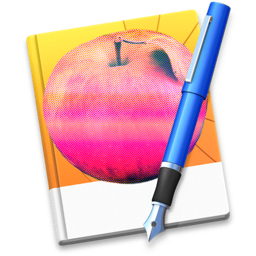
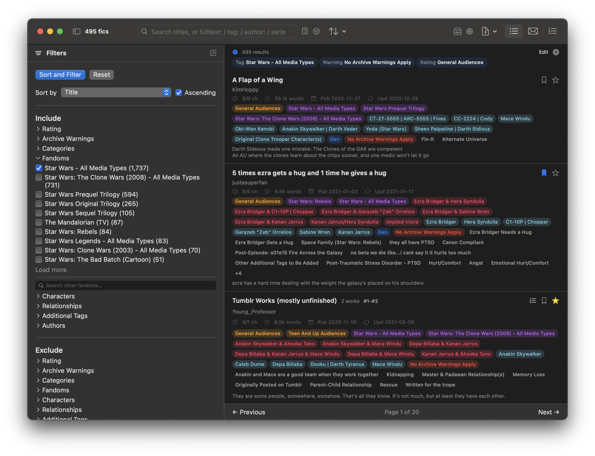
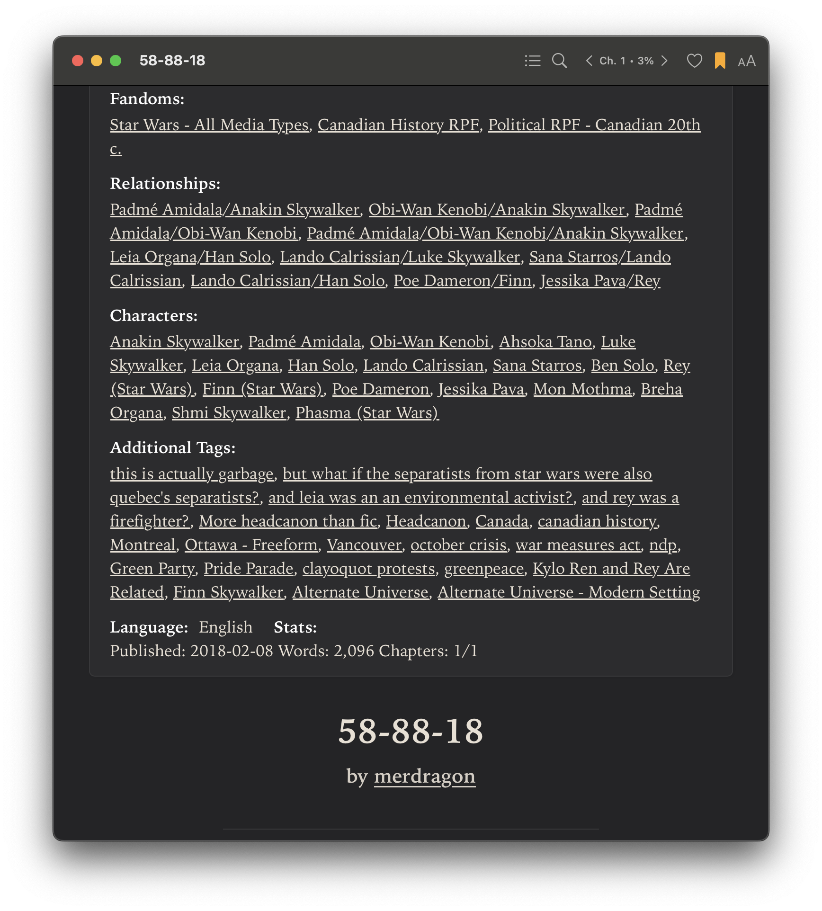
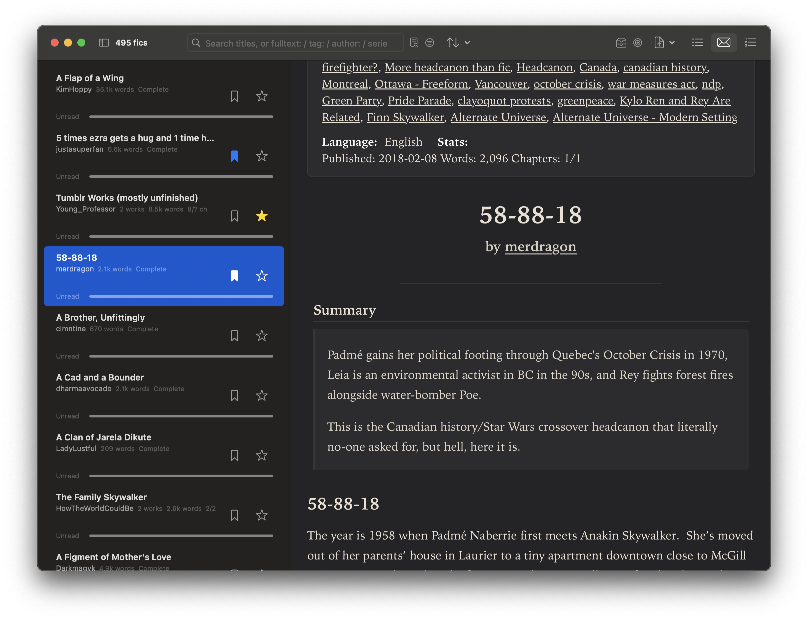
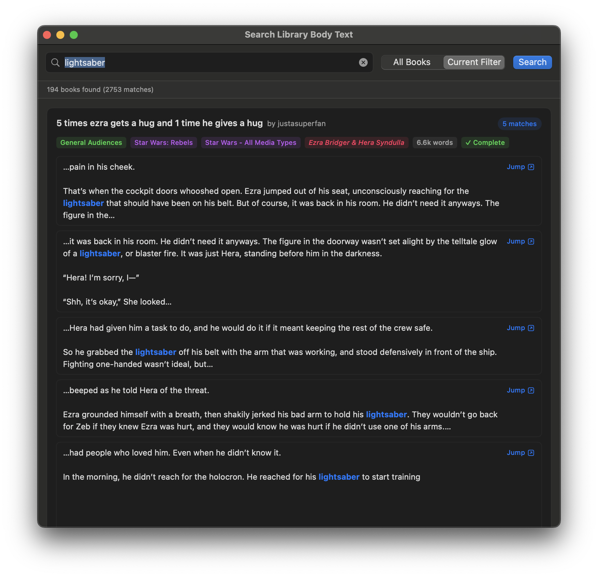
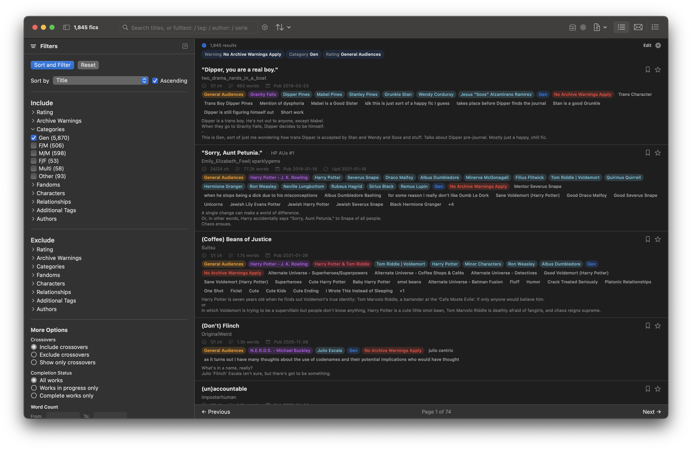
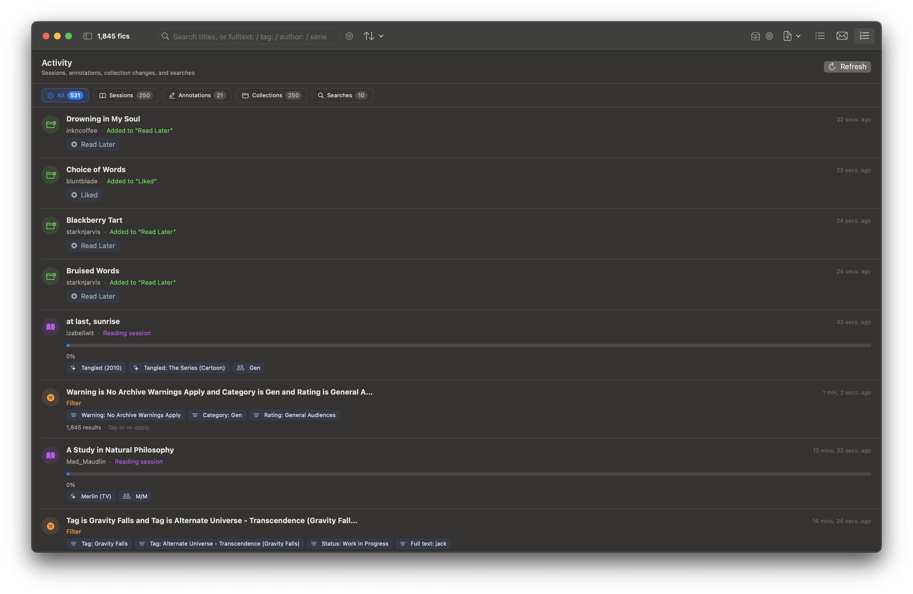
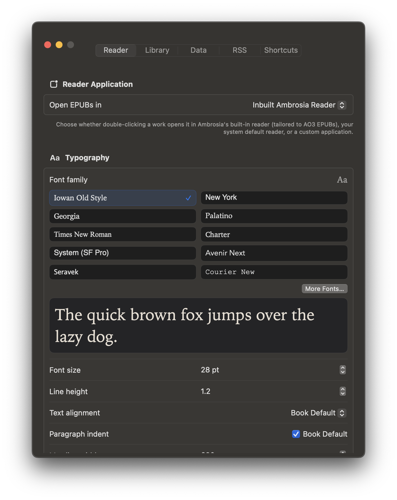
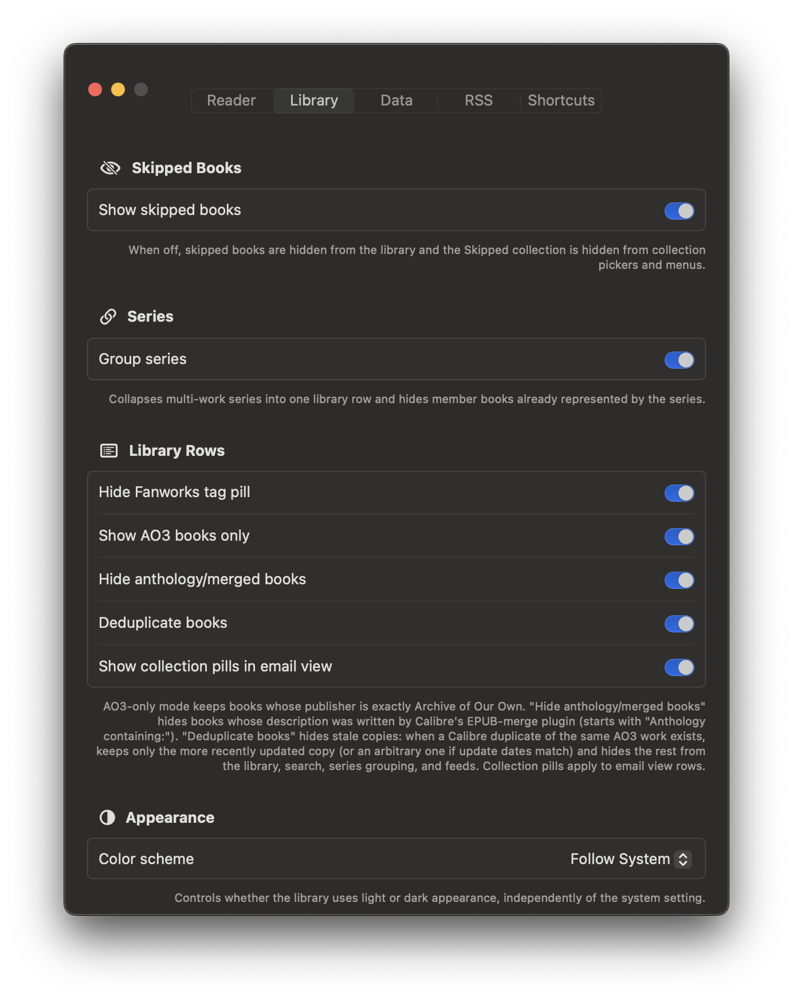

# Ambrosia

<p align="center">
  
</p>

<p align="center">
  <a href="https://github.com/kyrielie/ambrosia/actions/workflows/swift.yml"></a>
  <a href="https://github.com/kyrielie/ambrosia/releases/latest"></a>
  
  <a href="LICENSE"></a>
</p>

A native macOS EPUB library reader for AO3-heavy Calibre libraries. Designed for AO3 metadata first!

Quick install:
```bash
brew tap kyrielie/yggdrasil && brew install --cask ambrosia
```

Check out https://github.com/kyrielie/nectar, its iOS companion reader, and https://github.com/kyrielie/honeycrisp, a lightweight standalone reader for individual EPUBs.

## Screenshots

<p align="center">
  
</p>

<table>
<tr>
<td width="33%" align="center"><br><em>Custom reader with themes & paginated columns</em></td>
<td width="33%" align="center"><br><em>Split-view email mode with live reader</em></td>
<td width="33%" align="center"><br><em>Full-text body search with snippets</em></td>
</tr>
<tr>
<td width="33%" align="center"><br><em>Faceted search & filter drawer</em></td>
<td width="33%" align="center"><br><em>Activity feed & reading goals</em></td>
<td width="33%" align="center"><br><em>Appearance & library preferences</em></td>
</tr>
<tr>
<td width="33%" align="center"><br><em>Reader typography & shortcuts</em></td>
<td width="33%" align="center"></td>
<td width="33%" align="center"></td>
</tr>
</table>

## Installation

### Homebrew

```bash
brew tap kyrielie/yggdrasil
brew install --cask ambrosia
```

Update with `brew upgrade --cask ambrosia` once a tap update has been merged. See the
[Yggdrasil tap](https://github.com/kyrielie/homebrew-yggdrasil) for cask and release details.

### Manual download

Download the latest `Ambrosia.dmg` from [Releases](https://github.com/kyrielie/ambrosia/releases/latest)
and move it to Applications.

### First launch

Releases are ad-hoc signed and not notarized, so macOS Gatekeeper will block the first launch.
Either open **System Settings > Privacy & Security** and choose **Open Anyway**, or remove the
quarantine attribute:

```bash
xattr -dr com.apple.quarantine /Applications/Ambrosia.app
```

## Features

**Library & Browsing**
- Three display modes: AO3-style list cards, split-view email mode with live reader, and activity/ranking dashboard (`⌘1`, `⌘2`, `⌘3`).
- Automatic series grouping clusters multi-work series in reading sequence.
- Faceted filter drawer: filter by fandom, relationship, character, rating, status, language, or custom rule with live match counts.
- Search prefixes: filter directly using `tag:`, `author:`, `series:`, `title:`, or `fandom:`.

**AO3-First Metadata**
- Calibre's `metadata.db` remains **strictly read-only**.
- Automatically parses EPUB preface metadata into a local `ambrosia_meta.db`, extracting fandoms, pairings, characters, freeform tags, categories, warnings, word counts, and chapter counts.
- Seed canonical AO3 tag databases for intelligent tag autocomplete and synonym expansion.

**Full-Text Search (FTS)**
- Fast inverted-index search across EPUB text (`⇧⌘F`) using Calibre's full-text search database.
- Multi-token ranking, match count indicators, token highlights, and instant jump to matching snippets.

**Built-in Reader**
- Custom reader engine supporting paginated multi-column layouts and continuous scrolling.
- Continuous reading across entire series in one window.
- Table of contents popup and sidebar navigation.
- Curated reader themes: Parchment, Sepia, Paper, Night, Dark, Slate, and OLED.
- Toggle between System, Light, and Dark window appearances (`^⌘T`).

**Organization & Progress**
- System collections: Read Later, Liked, Skipped, Finished, In Progress, and Has Annotations.
- User-created shelves and collections.
- Text highlights and point annotations stored safely in your per-library database.
- Reading goals: configure reading targets (daily/monthly), streaks, and milestones.

**Sync & Export**
- Embedded local read-only RSS and OPML feed server for syncing with feed readers.
- Export visible library rows and annotations to CSV.

## Keyboard Shortcuts

| Shortcut | Action |
|:---------|:-------|
| `⌘F` | Search Library / Search in Reader |
| `⇧⌘F` | Search Library Body Text (Full-Text Search) |
| `⌘R` | Reload Library |
| `^⌘T` | Toggle Dark / Light Appearance |
| `⌘1` / `⌘2` / `⌘3` | List View / Email View / Activity View |
| `⌥⌘0` | Show Main Library Window |
| `⌘[` / `⌘]` | Previous / Next Chapter |
| `⌥⌘[` / `⌥⌘]` | Beginning / End of Work |
| `⌘←` / `⌘→` | Previous / Next Page (Paginated Reader) |
| `⌘=` / `⌘-` / `⌘0` | Increase / Decrease / Reset Reader Font Size |

## Library Setup & Data Model

Ambrosia connects to an existing Calibre library directory containing:
- `metadata.db` (read-only source of truth)
- Calibre author/book directories and EPUB files
- Optionally `full-text-search.db` for full-text search (`⇧⌘F`)

On first launch, Ambrosia registers the library and creates its own isolated support database at:
```text
~/Library/Application Support/Ambrosia/libraries/<library-hash>/ambrosia_meta.db
```

Ambrosia never writes to Calibre's `metadata.db` or alters your EPUB files.

## Privacy

Ambrosia is completely local and offline-first. It reads local Calibre libraries and writes only to local application support databases. No cloud sync, telemetry, or external network requests are required.

## Development

Requirements: macOS 14+; Xcode 15 or later with Swift 5.0+. Packages are managed via SwiftPM.

```bash
brew install xcodegen
xcodegen generate
open Ambrosia.xcodeproj
```

Select the **Ambrosia** scheme and run (`⌘R`).

`project.yml` is the source of truth for the generated project. Do not edit `Ambrosia.xcodeproj` directly.

### Running Tests

Run linting and the test suite locally:

```bash
./test.sh
```

Options:
- `./test.sh --lint-only`: Run SwiftLint only
- `./test.sh --no-lint`: Run unit tests without linting
- `./test.sh --filter <PATTERN>`: Run specific test suite (e.g. `CollectionStoreTests`)

## License

This project is licensed under the GNU General Public License v3.0 (GPL-3.0-only). See [`LICENSE`](LICENSE) for details. Third-party dependency licenses are listed in `THIRD_PARTY.md`.
