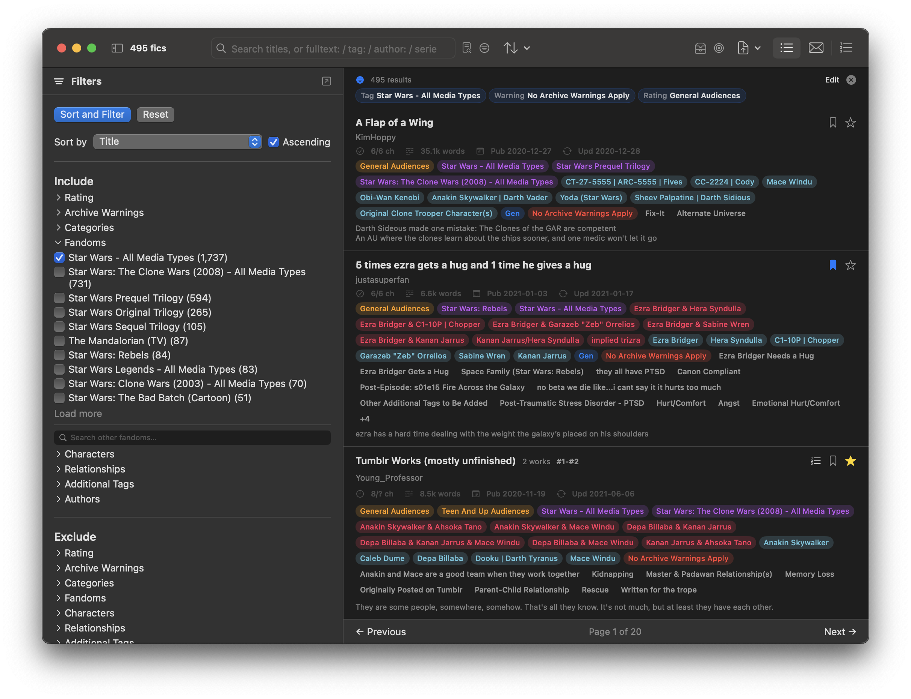
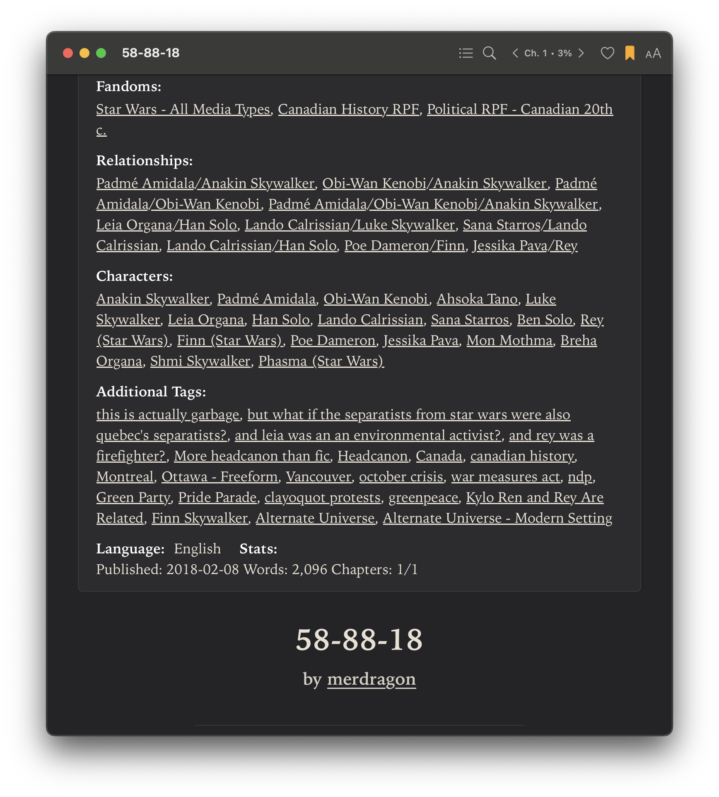
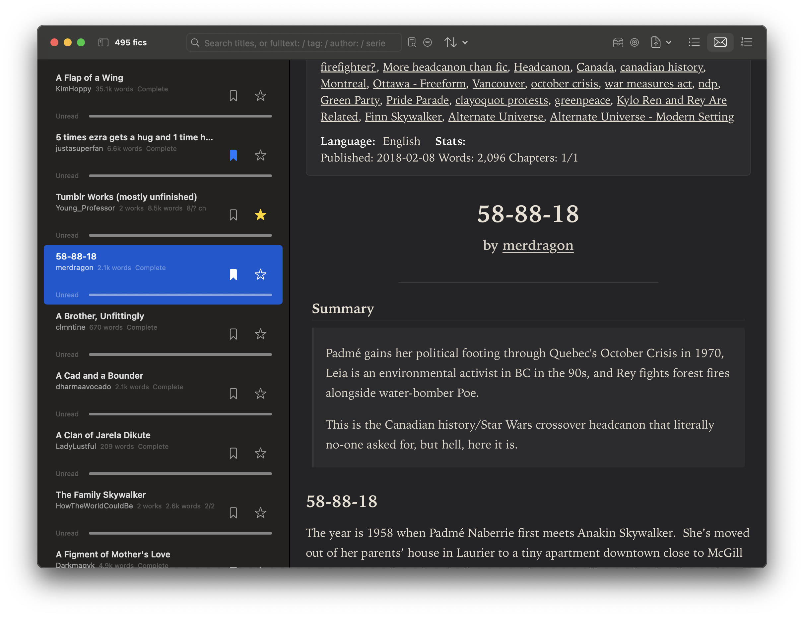
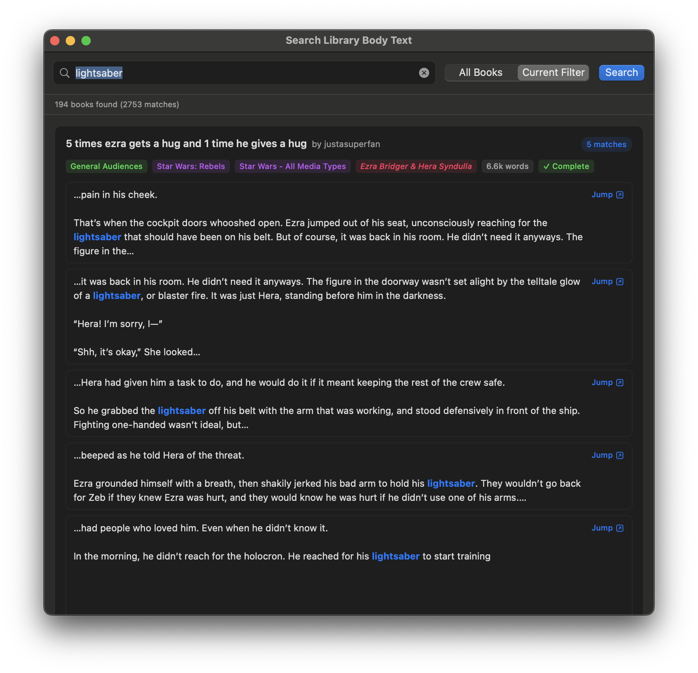
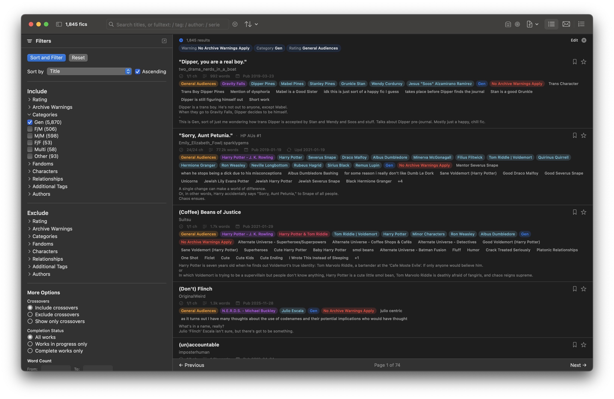
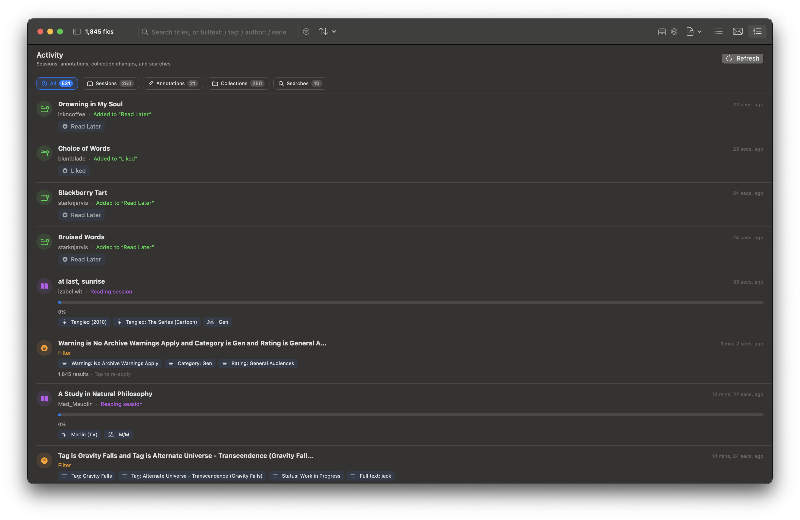
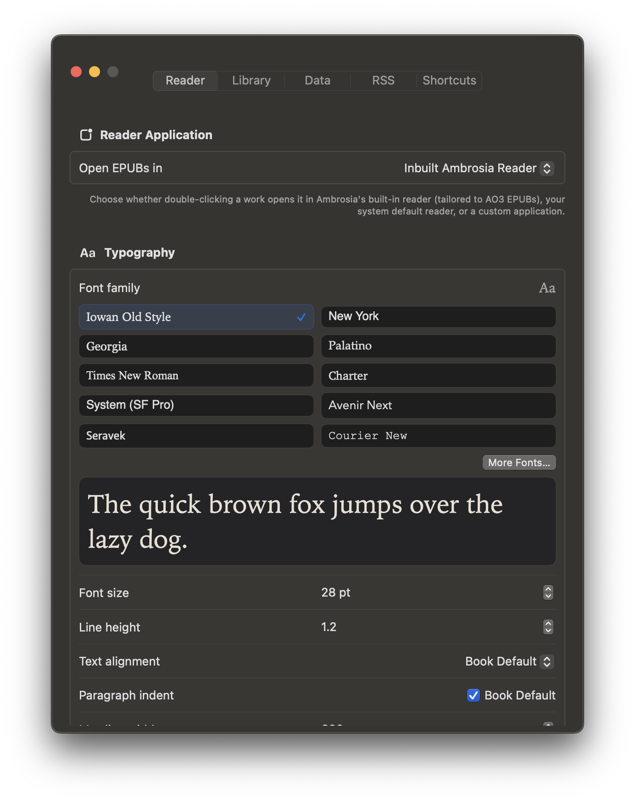
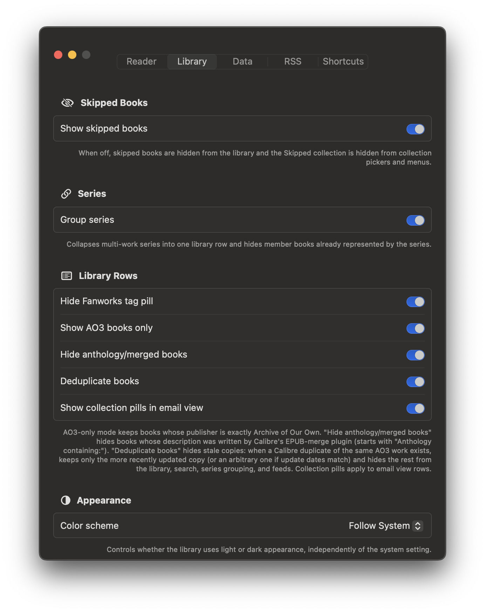

# Ambrosia

<p align="center">
  
</p>

<p align="center">
  <a href="https://github.com/kyrielie/ambrosia/actions/workflows/swift.yml"></a>
  <a href="https://github.com/kyrielie/ambrosia/releases/latest"></a>
  
  <a href="LICENSE"></a>
</p>

A native macOS EPUB library reader for AO3-heavy Calibre libraries. Designed for AO3 metadata first!

Quick install:
```bash
brew tap kyrielie/yggdrasil && brew install --cask ambrosia
```

Check out https://github.com/kyrielie/nectar, its iOS companion reader, and https://github.com/kyrielie/honeycrisp, a lightweight standalone reader for individual EPUBs.

## Screenshots

<p align="center">
  
  <br>
  <em>Main library list view with AO3 tags, stats, and series clustering</em>
</p>

<p align="center">
  
  &nbsp;&nbsp;
  
  &nbsp;&nbsp;
  
  <br>
  <em>Reader view with curated themes &middot; Split email mode with live reading pane &middot; Full-text body search</em>
</p>

<p align="center">
  
  &nbsp;&nbsp;
  
  <br>
  <em>Faceted filter drawer &middot; Reading goals & activity feed</em>
</p>

<p align="center">
  
  &nbsp;&nbsp;
  
  <br>
  <em>Library preferences &middot; Reader typography & shortcuts</em>
</p>

## Installation

### Homebrew

```bash
brew tap kyrielie/yggdrasil
brew install --cask ambrosia
```

Update with `brew upgrade --cask ambrosia` once a tap update has been merged. See the
[Yggdrasil tap](https://github.com/kyrielie/homebrew-yggdrasil) for cask and release details.

### Manual download

Download the latest `Ambrosia.dmg` from [Releases](https://github.com/kyrielie/ambrosia/releases/latest)
and move it to Applications.

### First launch

Releases are ad-hoc signed and not notarized, so macOS Gatekeeper will block the first launch.
Either approve it in [System Settings > Privacy & Security](https://support.apple.com/en-us/102445) (choose **Open Anyway**), or remove the
quarantine attribute:

```bash
xattr -dr com.apple.quarantine /Applications/Ambrosia.app
```

## Features

**Library & Browsing**
- Three display modes: AO3-style list cards, split-view email mode with live reader, and activity/ranking dashboard (`⌘1`, `⌘2`, `⌘3`).
- Automatic series grouping clusters multi-work series in reading sequence.
- Faceted filter drawer: filter by fandom, relationship, character, rating, status, language, or custom rule with live match counts.
- Search prefixes: filter directly using `tag:`, `author:`, `series:`, `title:`, or `fandom:`.

**AO3-First Metadata & Extraction**
- Calibre's `metadata.db` remains **strictly read-only**.
- Automatically parses EPUB preface metadata into a local `ambrosia_meta.db`, extracting fandoms, pairings, characters, freeform tags, categories, warnings, word counts, and chapter counts.
- **Extraction Diagnostics & Failed Works Inspector**: View exact counts of extracted vs. failed works with a dedicated viewer in Settings to inspect and debug books that failed preface extraction.
- **External Tag Seed Database**: Directly queries canonical AO3 tag seed databases in read-only mode for intelligent tag autocomplete and synonym expansion without duplicating 1.7M+ rows into each library.

**Full-Text Search (FTS) & Maintenance**
- Fast inverted-index search across EPUB text (`⇧⌘F`) using Calibre's full-text search database.
- Multi-token ranking, match count indicators, token highlights, and instant jump to matching snippets.
- **Index Unindexed Works**: Background scanner that indexes text for newly added EPUBs, maintaining 100% Calibre FTS compatibility.
- **Compact & Vacuum**: Optimizes SQLite FTS5 segment trees, flushes and truncates WAL logs, and reclaims deleted disk space.
- **Clear Search Index**: Completely deletes `full-text-search.db` (and companion `-wal` / `-shm` files) from the library folder to reclaim massive amounts of disk space (hundreds of megabytes to gigabytes). Can be safely rebuilt at any time via "Index Unindexed Works".

**Multi-Library Management & Storage Footprint**
- Seamlessly switch between multiple Calibre libraries in **Settings ▸ Data**.
- **Volume & Removable Drive Monitoring**: Automatically detects unmounted external volumes and missing drives with clear visual indicators and a one-click **Locate…** relinking picker.
- **Detailed Storage Footprint**: Scope toggle to view the active library or all known libraries combined, showing exact sizes and proportional footprints for EPUBs, `metadata.db`, `full-text-search.db`, and `ambrosia_meta.db`.
- **Library Creator**: Turn any folder of EPUBs into a fully compliant Calibre library with standard directory structure and metadata (`File ▸ Create Calibre Library from Folder…`).

**Built-in Reader**
- Custom reader engine supporting paginated multi-column layouts and continuous scrolling.
- Continuous reading across entire series in one window.
- Table of contents popup and sidebar navigation.
- Curated reader themes: Parchment, Sepia, Paper, Night, Dark, Slate, and OLED.
- Toggle between System, Light, and Dark window appearances (`^⌘T`).

**Organization & Progress**
- System collections: Read Later, Liked, Skipped, Finished, In Progress, and Has Annotations.
- User-created shelves and collections.
- Text highlights and point annotations stored safely in your per-library database.
- Reading goals: configure reading targets (daily/monthly), streaks, and milestones.

**Sync & Export**
- Embedded local read-only RSS and OPML feed server for syncing with feed readers.
- Export visible library rows and annotations to CSV.

## Keyboard Shortcuts

| Shortcut | Action |
|:---------|:-------|
| `⌘F` | Search Library / Search in Reader |
| `⇧⌘F` | Search Library Body Text (Full-Text Search) |
| `⌘R` | Reload Library |
| `^⌘T` | Toggle Dark / Light Appearance |
| `⌘1` / `⌘2` / `⌘3` | List View / Email View / Activity View |
| `⌥⌘0` | Show Main Library Window |
| `⌘[` / `⌘]` | Previous / Next Chapter |
| `⌥⌘[` / `⌥⌘]` | Beginning / End of Work |
| `⌘←` / `⌘→` | Previous / Next Page (Paginated Reader) |
| `⌘=` / `⌘-` / `⌘0` | Increase / Decrease / Reset Reader Font Size |

## Library Setup & Data Model

Ambrosia connects to an existing Calibre library directory containing:
- `metadata.db` (read-only source of truth)
- Calibre author/book directories and EPUB files
- Optionally `full-text-search.db` for full-text search (`⇧⌘F`)

On first launch, Ambrosia registers the library and creates its own isolated support database at:
```text
~/Library/Application Support/Ambrosia/libraries/<library-hash>/ambrosia_meta.db
```

Ambrosia never writes to Calibre's `metadata.db` or alters your EPUB files.

### Storage Footprint & Database Maintenance

In **Settings ▸ Data**, Ambrosia provides a complete breakdown of disk space consumed by your books and databases:
- **EPUB Files**: Your original book files stored in the Calibre library.
- **Calibre Metadata (`metadata.db`)**: Calibre's core database (read-only).
- **Full-Text Search (`full-text-search.db`)**: Calibre's FTS5 search index. Because FTS stores uncompressed body text alongside dual token indexes (`books_fts` and `books_fts_stemmed`), this file can grow to 2–3× the size of compressed EPUBs.
- **Ambrosia Metadata (`ambrosia_meta.db`)**: Ambrosia's local database storing extracted AO3 metadata, reading history, collections, and bookmarks (~3–5 MB per library).
- **Semantic Passage Database (`ambrosia_semantic_passages.db`)**: Optional SQLite database storing packed FP16 vector embeddings and chapter offset anchors for fine-grained narrative scene search (~2–3 GB for 4M+ chunks).

Ambrosia provides database management tools directly in Settings:
- **Compact & Vacuum**: Merges fragmented FTS5 B-tree index segments (`INSERT INTO books_fts(books_fts) VALUES('optimize')`), truncates SQLite write-ahead logs (WAL), and executes `VACUUM` across `full-text-search.db`, `ambrosia_meta.db`, and `ambrosia_semantic_passages.db` to reclaim unused disk space without altering any data.
- **Index Unindexed Works**: Matches Calibre's indexing workflow by scanning for newly added EPUBs that lack body text in `full-text-search.db` and indexes them in the background.
- **Clear Search Index / Clear Passage DB**: Deletes search databases and companion WAL/SHM files to instantly reclaim disk space (often several hundred megabytes to gigabytes for large libraries). This is completely safe and non-destructive: your EPUBs, reading progress, and metadata remain untouched.

## Optional Downloads & Data Assets

Ambrosia supports optional local data assets and machine learning models to unlock advanced semantic search and canonical AO3 tag expansion:

### 1. On-Device CoreML Passage Query Model (`Qwen3-Embedding-0.6B`)
Used for full-text semantic passage search (`⇧⌘F` ▸ **Semantic (Passages)**). The compiled model executes query embedding locally on the Apple Neural Engine (ANE) or Metal GPU in ~8–15 ms without sending text over the network.

- **Destination**: `~/Library/Application Support/Ambrosia/Models/Qwen3-Embedding-0.6B.mlmodelc`
- **Format**: Pre-compiled CoreML model bundle (`.mlmodelc`, Float16, 1024 dimensions, ~1.14 GB)
- **Model Source**: [neuradex/Qwen3-Embedding-0.6B-CoreML-ANE on Hugging Face](https://huggingface.co/neuradex/Qwen3-Embedding-0.6B-CoreML-ANE)
- **Direct Download**:
  ```bash
  mkdir -p "$HOME/Library/Application Support/Ambrosia/Models/Qwen3-Embedding-0.6B.mlmodelc/analytics"
  mkdir -p "$HOME/Library/Application Support/Ambrosia/Models/Qwen3-Embedding-0.6B.mlmodelc/weights"
  
  BASE_URL="https://huggingface.co/neuradex/Qwen3-Embedding-0.6B-CoreML-ANE/resolve/main/compiled/b1_s128.mlmodelc"
  curl -L "$BASE_URL/metadata.json" -o "$HOME/Library/Application Support/Ambrosia/Models/Qwen3-Embedding-0.6B.mlmodelc/metadata.json"
  curl -L "$BASE_URL/coremldata.bin" -o "$HOME/Library/Application Support/Ambrosia/Models/Qwen3-Embedding-0.6B.mlmodelc/coremldata.bin"
  curl -L "$BASE_URL/model.mil" -o "$HOME/Library/Application Support/Ambrosia/Models/Qwen3-Embedding-0.6B.mlmodelc/model.mil"
  curl -L "$BASE_URL/analytics/coremldata.bin" -o "$HOME/Library/Application Support/Ambrosia/Models/Qwen3-Embedding-0.6B.mlmodelc/analytics/coremldata.bin"
  curl -L "$BASE_URL/weights/weight.bin" -o "$HOME/Library/Application Support/Ambrosia/Models/Qwen3-Embedding-0.6B.mlmodelc/weights/weight.bin"
  ```

### 2. Canonical AO3 Tag Seed Database (`ao3_tags.db`) *(Scaffolded / Coming Soon)*
Enables instant tag autocomplete, synonym expansion, and metatag mapping across ~1.7M canonical AO3 tags, synonyms, and parent/child hierarchies without scraping or duplicate database ingestion.

- **Configuration**: Select database path in **Settings ▸ Data ▸ AO3 Tag Synonyms**
- **Format**: Read-only SQLite database (`ao3_tags.db`)
- **Download**: [Download `ao3_tags.db.gz` (Placeholder Asset)](https://github.com/kyrielie/ambrosia/releases/download/assets/ao3_tags.db.gz) *(Asset release pending; you can point Settings to any existing AO3 tag seed SQLite database)*

### 3. External Passage Ingestion CLI (`ambrosia_embed_task`)
For large Calibre libraries, passage embeddings can be generated externally on a dedicated GPU (e.g. NVIDIA CUDA):
- Use `scripts/pack_embed_task.sh -o /path/to/destination /path/to/calibre/` to stream a zero-temp archive for another machine.
- Run `./run_embed.sh` on the target machine, which automatically verifies CUDA, downloads the base embedding model (`Qwen/Qwen3-Embedding-0.6B`), and generates `ambrosia_semantic_passages.db`.
- Copy or import `ambrosia_semantic_passages.db` into your Calibre library folder or use **Settings ▸ Data ▸ Import Database…**.
- See the complete step-by-step walkthrough in the [External Semantic Passage Indexing Guide](docs/guides/external-semantic-indexing-walkthrough.md).

## Privacy

Ambrosia is completely local and offline-first. It reads local Calibre libraries and writes only to local application support databases. No cloud sync, telemetry, or external network requests are required.

## Development

Requirements: macOS 14+; Xcode 15 or later with Swift 5.0+. Packages are managed via SwiftPM.

```bash
brew install xcodegen
xcodegen generate
open Ambrosia.xcodeproj
```

Select the **Ambrosia** scheme and run (`⌘R`).

`project.yml` is the source of truth for the generated project. Do not edit `Ambrosia.xcodeproj` directly.

### Running Tests

Run linting and the test suite locally:

```bash
./test.sh
```

Options:
- `./test.sh --lint-only`: Run SwiftLint only
- `./test.sh --no-lint`: Run unit tests without linting
- `./test.sh --filter <PATTERN>`: Run specific test suite (e.g. `CollectionStoreTests`)

## License

This project is licensed under the GNU General Public License v3.0 (GPL-3.0-only). See [`LICENSE`](LICENSE) for details. Third-party dependency licenses are listed in `THIRD_PARTY.md`.
