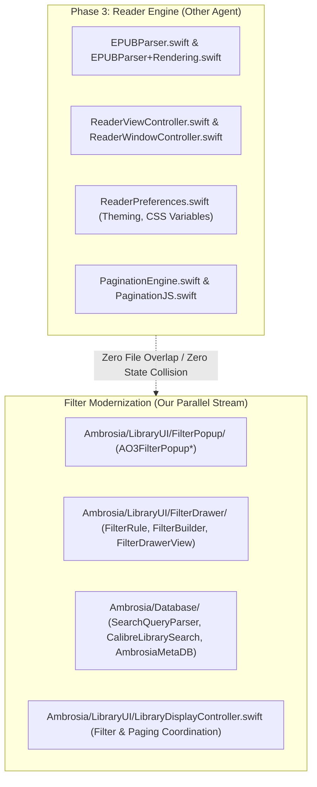
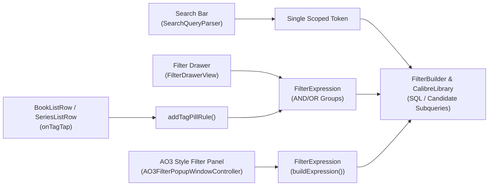
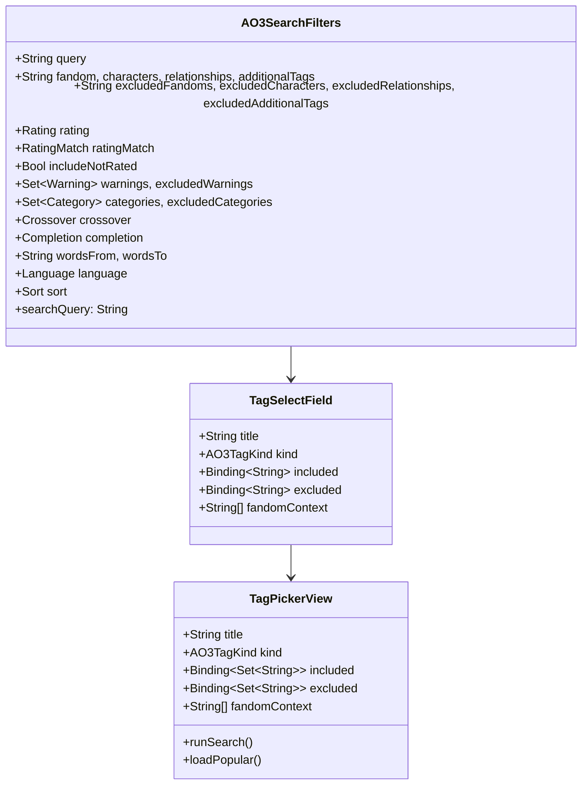
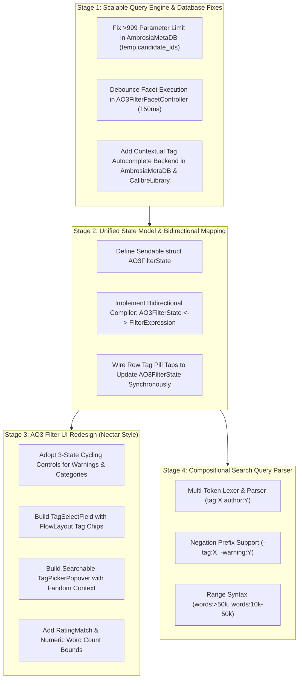

# Ambrosia Filter System: Architecture Review & Modernization Plan

This document presents a comprehensive review of Ambrosia's search and filter systems, with specific focus on its existing **AO3-style tag filter** and the reference implementation in Nectar (`../nectar/kudosreader.xml`). It establishes a detailed, parallel implementation plan designed to run safely alongside **Phase 3** (EPUB Engine & Reader Modernization).

---

## 1. Parallel Execution Assessment (Working Concurrently with Phase 3)

The roadmap assigns Phase 3 to EPUB parsing and reader performance modernization. Here is the operational boundary between that work and this filter modernization stream:



### File & Domain Independence Matrix
| Subsystem | Phase 3 (Reader Engine) | Filter Modernization Stream | Merge Conflict Risk |
|---|---|---|---|
| **Reader / Parsing** | `EPUBParser*`, `ReaderViewController`, `PaginationJS` | *None* | **Zero** |
| **Preferences** | `ReaderPreferences.swift` (font, spacing, theme CSS) | *None* | **Zero** |
| **UI Components** | `ReaderWindowController`, `FindBarView`, `TOCSidebarView` | `FilterPopup*`, `FilterDrawer*`, `SearchSuggestionsView`, `BookListRow` tag taps | **Zero** |
| **Database / Query** | *None* (reads book paths/spines only) | `FilterBuilder`, `SearchQueryParser`, `CalibreLibrarySearch`, `AmbrosiaMetaDB` | **Zero** |
| **Presentation Model** | *None* | `LibraryDisplayController` (filter execution, counts) | **Zero** |

**Conclusion:** The filter system modernization is completely orthogonal to Phase 3. Both streams can proceed simultaneously without git conflicts or regression risks.

---

## 2. In-Depth Review of Ambrosia's Existing Filter Systems

Ambrosia currently features two independent filter front-ends, row-level tag interactions, and a prefix search parser:



### 2.1 The Existing AO3-Style Tag Filter (`Ambrosia/LibraryUI/FilterPopup/`)
Ambrosia includes an AO3-style filter popup, hosted in a docked `NSPanel` (`AO3FilterPopupWindowController`), backed by `AO3FilterPopupState`, `AO3FilterPopupView`, and `AO3FilterFacetController`.

While it faithfully mimics AO3's web structure (`_filters.html.erb`), several deep architectural flaws and UX limitations exist:

1. **Duplicate "Include" vs "Exclude" Lists**:
   - The UI is split into two massive top-level sections: **"Include"** and **"Exclude"**.
   - Each section renders separate accordions for the 7 tag types (Ratings, Warnings, Categories, Fandoms, Characters, Relationships, Additional Tags, Authors).
   - To include one warning and exclude another, the reader must scroll between two completely distinct sections.

2. **Top-10 Truncation with Zero Search/Autocomplete**:
   - Each tag accordion in `DirectionalTagFacetSection` only displays the top 10 tags by count.
   - If a tag is not in the top 10, the user must click "Load more" (+10 at a time).
   - **There is no search bar, text filter, or tag picker inside the popup!** In a Calibre library with hundreds of fandoms or thousands of characters, finding a specific tag is nearly impossible.

3. **Critical Bug: SQLite Bound Parameter Overflow in `topFacets(for:scopedTo:)`**:
   - In `AmbrosiaMetaDB.swift` (lines 2384–2402):
     ```swift
     func topFacets(for field: AO3FacetField, scopedTo ids: [Int], limit: Int = 10) -> [(name: String, count: Int)] {
         guard !ids.isEmpty else { return [] }
         let idPlaceholders = ids.map { _ in "?" }.joined(separator: ", ")
         let sql = """
             SELECT je.value AS name, COUNT(*) AS cnt
             FROM ao3_metadata, json_each(ao3_metadata.\(field.jsonColumn)) AS je
             WHERE ao3_metadata.calibre_id IN (\(idPlaceholders))
             ...
     ```
   - When a reader has an active filter matching >999 books (e.g., selecting a major fandom like Harry Potter with 1,500 books), `ids` contains 1,500 integers.
   - Binding 1,500 `?` placeholders exceeds SQLite's default limit (`SQLITE_MAX_VARIABLE_NUMBER = 999`).
   - The query throws an error, swallowed by `guard let rows = try? readDB.prepare(...) else { return [] }`.
   - **Result: All character, pairing, warning, and category counts silently vanish to empty (`[]`)!**

4. **Un-Debounced 7-Query Storm**:
   - Toggling any single checkbox in `AO3FilterPopupView` invokes `refreshFacets()`.
   - This immediately dispatches **7 concurrent asynchronous queries** across all facet fields plus rating.
   - Rapidly checking 3 boxes fires 21 heavy JSON1 SQLite queries in parallel with no debouncing.

5. **Destructive State Synchronization**:
   - On Apply, `AO3FilterPopupState.buildExpression()` creates a brand-new `FilterExpression` that completely obliterates any custom rules created in the Drawer.
   - Tapping a tag pill on a book row (`BookListRow.swift`) calls `displayController.addOrReplaceRule(...)`. This bumps the toolbar digest, so when the user next opens the AO3 Filter, it treats it as an external change and **clears all checkbox state**.
   - The AO3 popup and Drawer are completely out of sync.

6. **Missing Common AO3 Facets**:
   - **No Rating Match Mode**: Only exact single rating or explicit exclusions; no "Rating+" or "Rating-" (e.g. Teen and Up or Higher).
   - **No "Include Not Rated" Toggle**: AO3 allows including unrated works alongside rated works.
   - **No Word Count / Kudos Ranges in Popup**: Word count is only in the drawer as raw `>` / `<` rules.
   - **No Language Picker**: AO3 readers heavily rely on language filtering.

---

## 3. Reference Implementation: Kudos Reader (`kudosreader.xml`)

In Kudos Reader (`../nectar/kudosreader.xml`), AO3-style filtering is implemented across two clean front-ends:
1. `AO3FilterPanel.swift`: Used for live AO3 searching and browse views.
2. `LibraryFilterPanel.swift`: Used for filtering local saved works.



### Key Architectural Lessons from Kudos Reader

1. **3-State Cycling Facet Rows (`cyclingFacetRow`)**:
   - Rather than duplicating Warnings and Categories into separate "Include" and "Exclude" accordions, each row has 3 states:
     $$\text{Clear} \xrightarrow{\text{tap}} \text{Included (Tint / Check)} \xrightarrow{\text{tap}} \text{Excluded (Red / Minus)} \xrightarrow{\text{tap}} \text{Clear}$$
   - This keeps the UI compact, elegant, and directly comparable to AO3's logic.

2. **`TagSelectField` & FlowLayout Tag Chips**:
   - Instead of listing checkboxes for tags, each tag category (Fandoms, Characters, Relationships, Additional Tags) displays a header summary (e.g. `2 included · 1 excluded`).
   - Active tags are displayed as compact `FilterTagChip`s in a `FlowLayout` directly below the header.
   - Clicking a chip cycles its state or removes it.

3. **Dedicated Searchable `TagPickerView` with Fandom Context**:
   - Clicking the tag row opens a searchable picker sheet/popover (`TagPickerView` or `LibraryOptionPicker`).
   - Includes an inline `.searchable` text field that filters all tags instantly.
   - **Fandom Contextual Seeding**: When a fandom is included, opening the Characters or Relationships picker automatically shows **"Popular in [Selected Fandom]"** as default suggestions.

4. **Rating Match & Unrated Handling**:
   - Exposes `RatingMatch`: `.exact`, `.orHigher` (Rating+), and `.orLower` (Rating-).
   - Exposes an explicit `Toggle("Include Not Rated", isOn: $filters.includeNotRated)`.

5. **Structured Numeric Bounds ("From" / "To")**:
   - Dedicated text fields for Word Count range with number validation.

6. **Unified Value Struct & Named Saved Searches**:
   - All filter parameters live in an immutable, `Codable` struct (`AO3SearchFilters` / `LibraryFilters`).
   - Supports `SavedSearch` ("Save Search...") so users can persist favorite filter configurations.

---

## 4. Feature Comparison Matrix

| Feature | Ambrosia Existing (`AO3FilterPopupView`) | Kudos Reader (`kudosreader.xml`) | Modernized Ambrosia Design |
|---|---|---|---|
| **Layout Paradigm** | 2 giant duplicate sections (Include vs Exclude) | Single grouped form with 3-state cycling controls | **Unified Form with 3-State Cycling** for Warnings & Categories |
| **Tag Selection** | Checkboxes in top 10 accordion + "Load more" | `TagSelectField` + `TagPickerView` sheet | **`TagSelectField` with Flow Chips + Searchable Tag Popover** |
| **Tag Search / Autocomplete** | ❌ None | ✅ Real-time search across all tags | ✅ **Live SQLite Tag Search with Fandom Context** |
| **Rating Filtering** | Radio in Include + Checkboxes in Exclude | Rating Picker + `RatingMatch` + `Include Not Rated` | ✅ **Rating Picker + RatingMatch (`Exact`, `+`, `−`) + Unrated Toggle** |
| **Numeric Bounds** | ❌ None in popup (Drawer only) | "From" and "To" text fields | ✅ **Word Count & Kudos "From" / "To" Bounds** |
| **Language Filtering** | ❌ None | Language Picker | ✅ **Library Language Picker** |
| **Active Tags Visibility** | Hidden inside collapsed accordions | FlowLayout chips with green/red badges | ✅ **Interactive Tag Chips Tray** |
| **Scale & Parameter Safety** | ❌ Fails silently when >999 books (`IN (?,?...))` | In-memory evaluation / API query | ✅ **Temporary SQLite Candidate Tables (`temp.facet_ids`)** |
| **Query Throttling** | ❌ None (7 simultaneous queries per toggle) | Debounced searches | ✅ **`DebounceTimer` (150ms) on Facet Recalculation** |
| **State Synchronization** | ❌ Destructive overwrite; drawer/tag tap mismatch | Single source of truth | ✅ **Bidirectional Lossless Mapping (`AO3FilterState` $\leftrightarrow$ `FilterExpression`)** |
| **Search Bar Support** | Single prefix token (`tag:foo`) | Full query composition (`-tag:"foo"`) | ✅ **Compositional Parser (`tag:X author:Y -warning:Z`)** |

---

## 5. Detailed Multi-Stage Implementation Plan



### Stage 1: Scalable Query Engine & Database Fixes
*Target Files: `Ambrosia/Database/AmbrosiaMetaDB.swift`, `Ambrosia/LibraryUI/FilterPopup/AO3FilterFacetController.swift`, `Ambrosia/Database/CalibreLibrary.swift`*

1. **Resolve SQLite Parameter Overflow in `topFacets` & `topRatingFacets`**:
   - In `AmbrosiaMetaDB.swift`, when `ids.count > 500`:
     - Create a temporary table or use a single transaction:
       ```sql
       CREATE TEMP TABLE IF NOT EXISTS temp.facet_scoped_ids (calibre_id INTEGER PRIMARY KEY);
       DELETE FROM temp.facet_scoped_ids;
       INSERT INTO temp.facet_scoped_ids (calibre_id) VALUES (?);
       ```
     - Join directly against `temp.facet_scoped_ids`:
       ```sql
       SELECT je.value AS name, COUNT(*) AS cnt
       FROM ao3_metadata
       JOIN temp.facet_scoped_ids ON ao3_metadata.calibre_id = temp.facet_scoped_ids.calibre_id,
            json_each(ao3_metadata.\(field.jsonColumn)) AS je
       GROUP BY je.value
       ORDER BY cnt DESC
       LIMIT ?;
       ```
   - Eliminates `SQLITE_MAX_VARIABLE_NUMBER` limits completely, allowing libraries of 50,000+ books to calculate facets seamlessly.
2. **Debounce Facet Recalculation**:
   - In `AO3FilterFacetController` / `AO3FilterPopupView`, route `refreshFacets()` through `DebounceTimer(interval: 0.15)`.
   - Rapidly clicking checkboxes coalesces into a single calculation wave.
3. **Context-Aware Tag Autocomplete Queries**:
   - Add `searchTags(query:kind:fandomContext:limit:)` to `AmbrosiaMetaDB`.
   - If `fandomContext` is non-empty, query tags from works where `json_each(fandoms_json).value IN (fandoms)` ordered by frequency, falling back to global library tag frequency.

---

### Stage 2: Unified State Model & Bidirectional Mapping
*Target Files: `Ambrosia/LibraryUI/FilterPopup/AO3FilterPopupState.swift`, `Ambrosia/LibraryUI/FilterDrawer/FilterRule.swift`, `Ambrosia/LibraryUI/LibraryDisplayController.swift`*

1. **Define `AO3FilterState` Value Type**:
   - Replace the mutable class `AO3FilterPopupState` with an immutable `Sendable` value struct `AO3FilterState` (matching Nectar's `AO3SearchFilters`).
   - Fields:
     - Tag sets: `includedFandoms`, `excludedFandoms`, `includedCharacters`, `excludedCharacters`, `includedRelationships`, `excludedRelationships`, `includedFreeforms`, `excludedFreeforms`, `includedAuthors`, `excludedAuthors`.
     - 3-state enums: `warnings: [AO3Warning: FilterSelectionState]`, `categories: [AO3Category: FilterSelectionState]`.
     - Rating: `rating: AO3Rating?`, `ratingMatch: RatingMatch`, `includeNotRated: Bool`.
     - Bounds: `wordsFrom: Int?`, `wordsTo: Int?`, `kudosFrom: Int?`, `kudosTo: Int?`.
     - Tri-states: `crossoverState`, `completionState`.
     - Sort: `sortField`, `ascending`.
2. **Bidirectional Lossless Mapping**:
   - Implement `AO3FilterState.toFilterExpression() -> FilterExpression`.
   - Implement `AO3FilterState(from: FilterExpression)`:
     - Inspects existing rules (`field: .tag`, `field: .authorName`, `field: .warning`, `field: .category`, `field: .rating`, `field: .wordCountGT/LT`).
     - Parses them back into structured `AO3FilterState`.
3. **Synchronize Row Tag Taps & Drawer Rules**:
   - When the user taps a tag pill on a `BookListRow`, `displayController.addOrReplaceRule` updates the active `FilterExpression`.
   - Opening the AO3 filter reconstructs `AO3FilterState` from that expression, showing the clicked tag as active!

---

### Stage 3: Modern AO3 Filter UI Redesign
*Target Files: `Ambrosia/LibraryUI/FilterPopup/AO3FilterPopupView.swift`, `Ambrosia/LibraryUI/FilterPopup/TagSelectField.swift`, `Ambrosia/LibraryUI/FilterPopup/TagPickerPopover.swift`*

1. **Eliminate Duplicate Include/Exclude Accordions**:
   - Replace the two giant `FilterDirectionSection`s with a single, unified form layout.
2. **3-State Cycling Facet Rows**:
   - Warnings and Categories render as single rows with state indicators:
     - Clear: Neutral text.
     - Included: Accent tint with checkmark.
     - Excluded: Red tint with strikethrough / minus.
3. **`TagSelectField` with `FlowLayout`**:
   - Renders field headers ("Fandoms", "Characters", "Relationships", "Additional Tags", "Authors") with summary count.
   - Shows active tags as `FilterTagChip`s below the header with role-specific colors (Fandom: Purple, Pairing: Pink, Character: Teal).
   - Tapping a chip cycles its state or removes it.
4. **Searchable `TagPickerPopover`**:
   - Clicking a tag field header opens an AppKit popover / sheet with:
     - Live search field: queries `AmbrosiaMetaDB.searchTags`.
     - "Popular in [Fandom]" section if fandom context exists.
     - Live toggle on search result rows.
5. **Rating Match & Word Count Controls**:
   - Rating segmented control or picker with Match mode (`Exact`, `Rating+`, `Rating-`).
   - "Include Not Rated" toggle.
   - Dual numeric text fields for Word Count ("Min words", "Max words").

---

### Stage 4: Compositional Search Query Parser
*Target Files: `Ambrosia/Database/SearchQueryParser.swift`, `Ambrosia/Database/CalibreLibrarySearch.swift`*

1. **Multi-Token Lexer**:
   - Tokenize free-form text by whitespace while preserving quoted strings (`"Slow Burn"`).
   - Recognize prefixes: `tag:`, `author:`, `series:`, `title:`, `warning:`, `category:`, `words:`, `fulltext:`.
2. **Negation Support**:
   - Tokens prefixed with `-` (e.g. `-tag:Angst`, `-author:Rowling`) generate `.notEquals` / `.notContains` rules.
3. **Numeric Range Support**:
   - Parse `words:>50000`, `words:<20k`, `words:10k-50k` into corresponding `wordCountGT` / `wordCountLT` rules.
4. **Calibre Search Integration**:
   - Multiple plain terms continue to run fuzzy title search.
   - Scoped tokens combine compositionally into a structured `FilterExpression`.

---

## 6. Verification and Invariant Enforcement

1. **Adherence to Core Invariants**:
   - **Invariant 12**: Zero force-unwraps (`!`) across all new code and tests.
   - **Invariant 17**: `tagExpansions` threaded explicitly as parameters, never cached on shared actors.
   - **Invariant 24**: Negated conditions built as correlated `NOT EXISTS` subqueries, never `NOT IN`.
   - **Invariant 25**: In-memory filter fields applied strictly as post-filters over SQL-backed candidates.
2. **Unit Test Suite Coverage**:
   - `AO3FilterStateTests`: Bidirectional round-trip conversion tests (`FilterExpression` $\leftrightarrow$ `AO3FilterState`).
   - `AO3FacetControllerTests`: Test temp table scoping with >1,000 candidate IDs; verify 0 SQLite parameter errors.
   - `TagAutocompleteTests`: Test search query prefix matching and fandom contextual ranking.
   - `SearchQueryParserTests`: Multi-token parsing, negation tokens, and numeric ranges.
3. **Verification Command**:
   - Run `./test.sh` to ensure **0 SwiftLint violations** and **100% test pass rate** across all targets.
