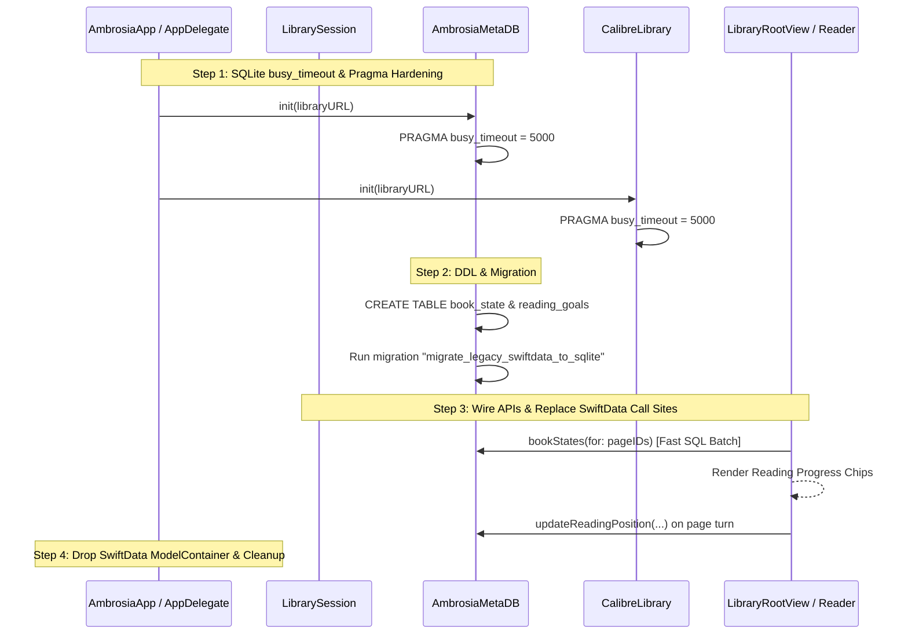

# Phase 1 Implementation Plan: Database Architecture Consolidation & Data Integrity

**Author**: Senior Swift Engineer & Database Architect  
**Status**: Completed ✅ (October 2026)  
**Target Systems**: `AmbrosiaMetaDB`, `CalibreLibrary`, `LibrarySession`, `ReaderViewController`, `ReaderWindowController`, `LibraryRootView`, `EmailLibraryViewController`, `ReadingGoalView`, `AmbrosiaApp`  
**Related Docs**: [`docs/metadb-and-migrations.md`](file:///Users/ethanchan/Documents/Applications/ambrosia/docs/metadb-and-migrations.md), [`docs/swiftdata-store.md`](file:///Users/ethanchan/Documents/Applications/ambrosia/docs/swiftdata-store.md), [`docs/session-model.md`](file:///Users/ethanchan/Documents/Applications/ambrosia/docs/session-model.md)

---

## 1. Executive Summary & Problem Definition

Ambrosia currently maintains three disconnected persistence systems:
1. **Calibre's `metadata.db`**: Read-only SQLite via `SQLite.swift` actor `CalibreLibrary`.
2. **`ambrosia_meta.db`**: Per-library read-write WAL SQLite via `SQLite.swift` actor `AmbrosiaMetaDB`.
3. **SwiftData Store (`Ambrosia.store`)**: Global CoreData-backed `ModelContainer` hosting `BookState` and `ReadingGoal`.

### The Core Architectural Flaws
1. **Cross-Library State Contamination**:
   `BookState` is keyed solely by an integer `calibreID: Int`. Because Calibre libraries each assign auto-incrementing integer IDs (`1, 2, 3...`), opening different Calibre libraries in Ambrosia causes reading progress, scroll offsets, total reading time, and ELO scores for Book #1 to overwrite or mix across libraries.
2. **SQLite Lock Contention (`SQLITE_BUSY`)**:
   Neither `AmbrosiaMetaDB` nor `CalibreLibrary` sets `PRAGMA busy_timeout`. Under SQLite's default 0 ms timeout, any concurrent read/write collision throws an immediate `SQLITE_BUSY` error, forcing ad-hoc degraded states like `rebuildDegraded: Bool` in the UI.
3. **Thread Priority Inversion & UI Freezes**:
   As documented in `ReaderWindowController.swift`, `ModelContainer`'s internal locking between background tasks and `@MainActor` triggers priority inversions and Thread Performance Checker "Hang Risk" warnings.
4. **Inefficient Unindexed Queries**:
   In `ReaderViewController.swift`, `bookState(for:)` fetches all `BookState` records across the entire database into memory (`FetchDescriptor<BookState>()` without a predicate) and filters locally with `.first(where:)`.
5. **Architectural Overhead**:
   Maintaining SwiftData requires schema fallback logic in `AmbrosiaApp.init()`, modal error alerts, and complex multi-context synchronization, while preventing direct SQL joins with Calibre and AO3 metadata.

---

## 2. Technical Blueprint

### 2.1 Database Configuration & Concurrency Hardening

#### Connection Timeout
All SQLite connections (`db`, `readDB`, and `CalibreLibrary.db`) must be configured with a 5-second busy timeout immediately upon connection initialization:
```sql
PRAGMA busy_timeout = 5000;
```
Under SQLite WAL mode, readers do not block writers and writers do not block readers, except during brief WAL index (`-shm`) synchronization. A 5,000 ms timeout guarantees that any transient lock acquisition succeeds without throwing `SQLITE_BUSY`.

#### WAL Checkpointing & Normal Synchronous
On the primary write connection of `AmbrosiaMetaDB`:
```sql
PRAGMA journal_mode = WAL;
PRAGMA synchronous = NORMAL;
PRAGMA foreign_keys = ON;
```

---

### 2.2 Relational Schema Specification (DDL)

The new tables will reside inside each library's `ambrosia_meta.db`.

```sql
-- 1. Book Reading State
CREATE TABLE IF NOT EXISTS book_state (
    calibre_id                  INTEGER PRIMARY KEY NOT NULL,
    last_opened_date            REAL NOT NULL DEFAULT 0,            -- Unix epoch seconds (Double)
    total_read_percent          REAL NOT NULL DEFAULT 0.0           -- Normalized 0.0 .. 1.0
        CHECK (total_read_percent >= 0.0 AND total_read_percent <= 1.0),
    total_reading_time_seconds  REAL NOT NULL DEFAULT 0.0,          -- Elapsed reading time
    last_spine_index            INTEGER NOT NULL DEFAULT 0,         -- Spine item index
    last_character_offset       INTEGER NOT NULL DEFAULT 0,         -- UTF-16 text node code units
    last_scroll_offset          REAL NOT NULL DEFAULT 0.0,          -- Vertical scroll offset
    elo_score                   REAL NOT NULL DEFAULT 1000.0,       -- Matchmaking rating
    elo_match_count             INTEGER NOT NULL DEFAULT 0,         -- Number of comparisons
    updated_at                  REAL NOT NULL DEFAULT (strftime('%s', 'now'))
);

CREATE INDEX IF NOT EXISTS idx_book_state_opened 
    ON book_state (last_opened_date DESC);

CREATE INDEX IF NOT EXISTS idx_book_state_read_percent 
    ON book_state (total_read_percent);

-- 2. Reading Goals
CREATE TABLE IF NOT EXISTS reading_goals (
    id                  INTEGER PRIMARY KEY AUTOINCREMENT,
    target_books_count  INTEGER NOT NULL CHECK (target_books_count > 0),
    period_start        REAL NOT NULL,                              -- Unix epoch seconds
    period_end          REAL NOT NULL,                              -- Unix epoch seconds
    created_at          REAL NOT NULL DEFAULT (strftime('%s', 'now'))
);

CREATE INDEX IF NOT EXISTS idx_reading_goals_period 
    ON reading_goals (period_start, period_end);
```

---

### 2.3 Legacy SwiftData Migration Strategy (Zero Data Loss)

SwiftData stores its SQLite file on macOS under:
`~/Library/Application Support/default.store` (or `~/Library/Application Support/Ambrosia/default.store`).

Under CoreData/SwiftData, the underlying SQLite tables are named:
- `ZBOOKSTATE`
- `ZREADINGGOAL`

CoreData date fields are stored as `REAL` representing **seconds since 2001-01-01 00:00:00 UTC** (Apple Reference Date).  
Conversion formula to Unix epoch:
$$\text{UnixTimestamp} = \text{CoreDataTimestamp} + 978307200.0$$

#### Migration Algorithm:
1. Gated by `schema_migrations` under name `"migrate_legacy_swiftdata_to_sqlite"`.
2. Locate the legacy SwiftData `.store` file in `Application Support`.
3. If absent (new install), record migration as applied and exit.
4. If present:
   - Open a read-only `Connection` to the `.store` file.
   - Attach it or query `ZBOOKSTATE` and `ZREADINGGOAL`:
     ```sql
     SELECT 
         ZCALIBREID, 
         COALESCE(ZLASTOPENEDDATE + 978307200.0, 0),
         COALESCE(ZTOTALREADPERCENT, 0.0),
         COALESCE(ZTOTALREADINGTIMESECONDS, 0.0),
         COALESCE(ZLASTSPINEINDEX, 0),
         COALESCE(ZLASTCHARACTEROFFSET, 0),
         COALESCE(ZLASTSCROLLOFFSET, 0.0),
         COALESCE(ZELOSCORE, 1000.0),
         COALESCE(ZELOMATCHCOUNT, 0)
     FROM ZBOOKSTATE;
     ```
   - In `AmbrosiaMetaDB`, verify if each `ZCALIBREID` exists in the current library (by querying `CalibreLibrary` or checking `book_authors` / `ao3_metadata`), or import all valid records with `INSERT OR IGNORE INTO book_state`.
   - Migrate `ZREADINGGOAL` records into `reading_goals`.
   - Wrap the entire operation in `db.transaction`.
   - Record migration completion in `schema_migrations`.
   - Once all libraries have completed or on explicit user confirmation, rename `default.store` to `default.store.migrated`.

---

### 2.4 Swift Data Transfer Objects & Domain Models

Replace `@Model final class BookState` with an immutable, thread-safe, `Sendable` Swift struct:

```swift
public struct BookReadingState: Identifiable, Sendable, Equatable, Hashable {
    public var id: Int { calibreID }
    public let calibreID: Int
    public let lastOpenedDate: Date
    public let totalReadPercent: Double
    public let totalReadingTimeSeconds: TimeInterval
    public let lastSpineIndex: Int
    public let lastCharacterOffset: Int
    public let lastScrollOffset: Double
    public let eloScore: Double
    public let eloMatchCount: Int

    public var isFinished: Bool { totalReadPercent >= 0.99 }
    public var isInProgress: Bool { totalReadPercent > 0 && totalReadPercent < 0.99 }

    public static func initial(calibreID: Int) -> BookReadingState {
        BookReadingState(
            calibreID: calibreID,
            lastOpenedDate: Date(timeIntervalSince1970: 0),
            totalReadPercent: 0.0,
            totalReadingTimeSeconds: 0.0,
            lastSpineIndex: 0,
            lastCharacterOffset: 0,
            lastScrollOffset: 0.0,
            eloScore: 1000.0,
            eloMatchCount: 0
        )
    }
}

public struct ReadingGoalRecord: Identifiable, Sendable, Equatable {
    public let id: Int64
    public let targetBooksCount: Int
    public let periodStart: Date
    public let periodEnd: Date
}
```

---

### 2.5 `AmbrosiaMetaDB` Actor Interface

Add the following actor methods to `AmbrosiaMetaDB`:

```swift
extension AmbrosiaMetaDB {

    // MARK: - Book State Queries

    /// Fetches state for a single book. Returns default initial state if unread.
    public func bookState(for calibreID: Int) -> BookReadingState {
        if let cached = bookStateCache[calibreID] { return cached }
        let state = fetchBookState(for: calibreID) ?? .initial(calibreID: calibreID)
        bookStateCache[calibreID] = state
        return state
    }

    /// High-performance batched fetch for page loading in list/email views.
    public func bookStates(for calibreIDs: [Int]) -> [Int: BookReadingState] {
        guard !calibreIDs.isEmpty else { return [:] }
        var result: [Int: BookReadingState] = [:]
        var missingIDs: [Int] = []

        for id in calibreIDs {
            if let cached = bookStateCache[id] {
                result[id] = cached
            } else {
                missingIDs.append(id)
            }
        }

        if !missingIDs.isEmpty {
            let fetched = fetchBookStatesBatch(for: missingIDs)
            for id in missingIDs {
                let state = fetched[id] ?? .initial(calibreID: id)
                bookStateCache[id] = state
                result[id] = state
            }
        }

        return result
    }

    // MARK: - Book State Mutations

    public func updateReadingPosition(
        calibreID: Int,
        spineIndex: Int,
        characterOffset: Int,
        scrollOffset: Double,
        readPercent: Double
    ) throws {
        let stmt = """
        INSERT INTO book_state (
            calibre_id, last_spine_index, last_character_offset, last_scroll_offset, 
            total_read_percent, last_opened_date, updated_at
        ) VALUES (?, ?, ?, ?, ?, strftime('%s', 'now'), strftime('%s', 'now'))
        ON CONFLICT(calibre_id) DO UPDATE SET
            last_spine_index = excluded.last_spine_index,
            last_character_offset = excluded.last_character_offset,
            last_scroll_offset = excluded.last_scroll_offset,
            total_read_percent = MAX(book_state.total_read_percent, excluded.total_read_percent),
            last_opened_date = excluded.last_opened_date,
            updated_at = excluded.updated_at;
        """
        try db.run(stmt, calibreID, spineIndex, characterOffset, scrollOffset, readPercent)
        bookStateCache.removeValue(forKey: calibreID)
    }

    public func markBookOpened(calibreID: Int, date: Date = Date()) throws {
        let stmt = """
        INSERT INTO book_state (calibre_id, last_opened_date, updated_at)
        VALUES (?, ?, strftime('%s', 'now'))
        ON CONFLICT(calibre_id) DO UPDATE SET
            last_opened_date = excluded.last_opened_date,
            updated_at = excluded.updated_at;
        """
        try db.run(stmt, calibreID, date.timeIntervalSince1970)
        bookStateCache.removeValue(forKey: calibreID)
    }

    public func addReadingTime(calibreID: Int, seconds: TimeInterval) throws {
        let stmt = """
        INSERT INTO book_state (calibre_id, total_reading_time_seconds, updated_at)
        VALUES (?, ?, strftime('%s', 'now'))
        ON CONFLICT(calibre_id) DO UPDATE SET
            total_reading_time_seconds = book_state.total_reading_time_seconds + excluded.total_reading_time_seconds,
            updated_at = excluded.updated_at;
        """
        try db.run(stmt, calibreID, seconds)
        bookStateCache.removeValue(forKey: calibreID)
    }

    public func markBookRead(calibreID: Int) throws {
        let stmt = """
        INSERT INTO book_state (calibre_id, total_read_percent, updated_at)
        VALUES (?, 1.0, strftime('%s', 'now'))
        ON CONFLICT(calibre_id) DO UPDATE SET
            total_read_percent = 1.0,
            updated_at = excluded.updated_at;
        """
        try db.run(stmt, calibreID)
        bookStateCache.removeValue(forKey: calibreID)
    }

    public func resetReadingProgress(calibreID: Int) throws {
        let stmt = """
        UPDATE book_state SET
            total_read_percent = 0.0,
            last_spine_index = 0,
            last_character_offset = 0,
            last_scroll_offset = 0.0,
            last_opened_date = 0,
            total_reading_time_seconds = 0.0,
            updated_at = strftime('%s', 'now')
        WHERE calibre_id = ?;
        """
        try db.run(stmt, calibreID)
        bookStateCache.removeValue(forKey: calibreID)
    }

    // MARK: - Reading Goals

    public func currentReadingGoal() -> ReadingGoalRecord? {
        let now = Date().timeIntervalSince1970
        let query = "SELECT id, target_books_count, period_start, period_end FROM reading_goals WHERE ? BETWEEN period_start AND period_end ORDER BY period_end DESC LIMIT 1"
        // Executed via readDB
        ...
    }

    public func completedBooksCount(from start: Date, to end: Date) -> Int {
        let query = "SELECT COUNT(*) FROM book_state WHERE total_read_percent >= 0.99 AND last_opened_date BETWEEN ? AND ?"
        // Executed via readDB
        ...
    }
}
```

---

## 3. Step-by-Step Implementation Sequence



### Step 1: SQLite Connection Hardening
- **Files**: [`AmbrosiaMetaDB.swift`](file:///Users/ethanchan/Documents/Applications/ambrosia/Ambrosia/Database/AmbrosiaMetaDB.swift), [`CalibreLibrary.swift`](file:///Users/ethanchan/Documents/Applications/ambrosia/Ambrosia/Database/CalibreLibrary.swift), [`CalibreFTSLibrary.swift`](file:///Users/ethanchan/Documents/Applications/ambrosia/Ambrosia/Database/CalibreFTSLibrary.swift)
- **Changes**:
  - Add `try connection.execute("PRAGMA busy_timeout = 5000")` inside `AmbrosiaMetaDB.init()` (on both `db` and `readDB`).
  - Add `try connection.execute("PRAGMA busy_timeout = 5000")` in `CalibreLibrary.openConnection(path:)`.
  - Add `try connection.execute("PRAGMA busy_timeout = 5000")` in `CalibreFTSLibrary.openConnection(ftsURL:)`.

### Step 2: Schema Migration & Legacy Backfill
- **Files**: [`AmbrosiaMetaDB.swift`](file:///Users/ethanchan/Documents/Applications/ambrosia/Ambrosia/Database/AmbrosiaMetaDB.swift)
- **Changes**:
  - Add `createBookState(db: Connection)` and `createReadingGoals(db: Connection)` to `runMigrations`.
  - Add `migrateLegacySwiftDataIfNeeded(db: Connection)` checked via `hasAppliedMigration("migrate_legacy_swiftdata_to_sqlite", db: db)`.
  - Convert CoreData timestamps (`+ 978307200`) and insert existing records with `INSERT OR IGNORE`.

### Step 3: Domain Model & MetaDB API Implementation
- **Files**: [`BookReadingState.swift`](file:///Users/ethanchan/Documents/Applications/ambrosia/Ambrosia/Database/Models/), [`AmbrosiaMetaDB.swift`](file:///Users/ethanchan/Documents/Applications/ambrosia/Ambrosia/Database/AmbrosiaMetaDB.swift)
- **Changes**:
  - Define `BookReadingState` and `ReadingGoalRecord`.
  - Implement query and mutation methods on `AmbrosiaMetaDB`.
  - Implement LRU or in-memory dictionary cache `bookStateCache` on the `AmbrosiaMetaDB` actor.

### Step 4: Refactor Reader & UI Call Sites
- **Files**: 
  - [`ReaderViewController.swift`](file:///Users/ethanchan/Documents/Applications/ambrosia/Ambrosia/Reader/ReaderViewController.swift)
  - [`ReaderWindowController.swift`](file:///Users/ethanchan/Documents/Applications/ambrosia/Ambrosia/Reader/ReaderWindowController.swift)
  - [`LibraryRootView.swift`](file:///Users/ethanchan/Documents/Applications/ambrosia/Ambrosia/LibraryUI/LibraryRootView.swift)
  - [`EmailLibraryViewController.swift`](file:///Users/ethanchan/Documents/Applications/ambrosia/Ambrosia/LibraryUI/Email/EmailLibraryViewController.swift)
  - [`ReadingGoalView.swift`](file:///Users/ethanchan/Documents/Applications/ambrosia/Ambrosia/LibraryUI/ReadingGoalView.swift)
  - [`LocalFeedServer.swift`](file:///Users/ethanchan/Documents/Applications/ambrosia/Ambrosia/Networking/LocalFeedServer.swift)
- **Changes**:
  - In `ReaderViewController`: Remove `saveContext: ModelContext`, replace in-memory fetch with `await session.metaDB?.bookState(for: calibreID)`. Call `updateReadingPosition` periodically.
  - In `ReaderWindowController`: Replace detached task with `Task { await session.metaDB?.markBookOpened(calibreID: book.id) }`.
  - In `LibraryRootView` and `EmailLibraryViewController`: Replace `refreshBookStatesForCurrentPage()` with `let states = await metaDB.bookStates(for: pageIDs)`.
  - In `ReadingGoalView`: Replace `@Query var goals: [ReadingGoal]` with state driven by `session.metaDB?.currentReadingGoal()`.
  - In `LocalFeedServer`: Read read percentages directly from `metaDB.bookStates(for:)`.

### Step 5: SwiftData Removal & Project Decoupling
- **Files**:
  - [`AmbrosiaApp.swift`](file:///Users/ethanchan/Documents/Applications/ambrosia/Ambrosia/App/AmbrosiaApp.swift)
  - [`AppDelegate.swift`](file:///Users/ethanchan/Documents/Applications/ambrosia/Ambrosia/App/AppDelegate.swift)
  - Delete `Ambrosia/Database/Models/BookState.swift` (legacy model) and `Ambrosia/Database/Models/ReadingGoal.swift`.
  - [`project.yml`](file:///Users/ethanchan/Documents/Applications/ambrosia/project.yml)
- **Changes**:
  - Remove `sharedModelContainer`, `ModelContainer` error alerts, and fallback container in `AmbrosiaApp.init()`.
  - Remove `.modelContainer(...)` scene modifier.
  - Remove `modelContainer` property from `AppDelegate` and `LibrarySession`.

---

## 4. Verification & Testing Strategy

### 4.1 Unit & Integration Tests
Add `AmbrosiaTests/BookStateMetaDBTests.swift`:
1. **Migration Test**:
   - Construct a synthetic SQLite file matching SwiftData's `ZBOOKSTATE` schema with known records and Apple Reference Date timestamps.
   - Run `migrateLegacySwiftDataIfNeeded`.
   - Assert all rows are present in `book_state` with converted Unix epoch dates and matching read percentages.
2. **Lock Contention Test**:
   - Concurrently execute 50 write transactions (`updateReadingPosition`) and 50 read transactions (`bookStates(for:)`) across multiple tasks.
   - Assert zero `SQLITE_BUSY` errors occur under the 5-second `busy_timeout`.
3. **Multi-Library Isolation Test**:
   - Create two temporary library fixtures with identical `calibreID = 1`.
   - Update reading position in Library A to 50%, and Library B to 100%.
   - Verify Library A retains 50% and Library B retains 100% without data bleeding.

### 4.2 Manual Verification Checklist
- [ ] Open multiple distinct Calibre libraries; verify reading progress is strictly isolated.
- [ ] Open a 100-chapter book in the reader; advance pages, close window, reopen; verify resume position is accurate to the exact character offset.
- [ ] Trigger background AO3 extraction scan while actively turning pages; verify no UI lag, stutter, or database lock errors.
- [ ] Inspect console output during launch; verify zero Thread Performance Checker "Hang Risk" priority inversion reports.
- [ ] Verify `ReadingGoalView` displays correct targets and completions without `@Query`.
