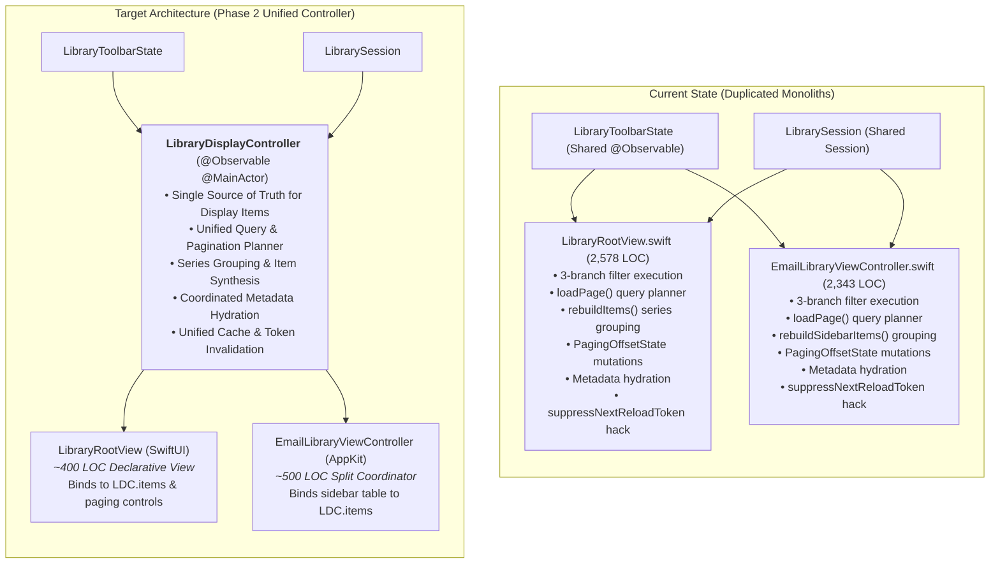
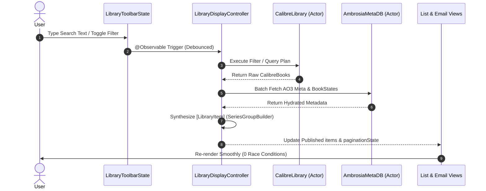

# Phase 2 Implementation Plan: Presentation Model & View Controller Unification

**Author**: Principal Swift Engineer & macOS Systems Architect  
**Status**: Ready for Implementation 🎯  
**Target Systems**: `LibraryDisplayController` (New), `LibraryQueryController`, `LibraryRootView`, `EmailLibraryViewController`, `LibraryViewController`, `LibraryToolbarState`, `LibrarySession`  
**Related Docs**: [`docs/library-ui.md`](file:///Users/ethanchan/Documents/Applications/ambrosia/docs/library-ui.md), [`docs/caching.md`](file:///Users/ethanchan/Documents/Applications/ambrosia/docs/caching.md), [`docs/search-and-filter.md`](file:///Users/ethanchan/Documents/Applications/ambrosia/docs/search-and-filter.md), [`docs/roadmap.md`](file:///Users/ethanchan/Documents/Applications/ambrosia/docs/roadmap.md)

---

## 1. Executive Summary & Problem Definition

Ambrosia currently maintains two separate, monolithic presentation surfaces for displaying books in the library window:
1. **List Mode**: [`LibraryRootView.swift`](file:///Users/ethanchan/Documents/Applications/ambrosia/Ambrosia/LibraryUI/LibraryRootView.swift) (2,578 lines) — a SwiftUI view hosting an AO3-style paginated list.
2. **Email Mode**: [`EmailLibraryViewController.swift`](file:///Users/ethanchan/Documents/Applications/ambrosia/Ambrosia/LibraryUI/Email/EmailLibraryViewController.swift) (2,343 lines) — an AppKit `NSViewController` managing a split view with an NSTableView sidebar and SwiftUI reading detail pane.

Together, these two files contain **nearly 5,000 lines of code**, over **65% of which is duplicated business logic**.



### The 5 Critical Architectural Liabilities

1. **Massive Logic Duplication**:
   - Both surfaces independently implement the exact same 3-branch filter execution:
     - Branch A: Fast SQL-paged query with WHERE clause ([`LibraryRootView.swift#L1808-L1847`](file:///Users/ethanchan/Documents/Applications/ambrosia/Ambrosia/LibraryUI/LibraryRootView.swift#L1808-L1847) vs [`EmailLibraryViewController.swift#L755-L789`](file:///Users/ethanchan/Documents/Applications/ambrosia/Ambrosia/LibraryUI/Email/EmailLibraryViewController.swift#L755-L789)).
     - Branch B: LRU-cached filter results.
     - Branch C: Full evaluator compute pipeline with task cancellation.
   - Both surfaces independently execute series grouping and item synthesis ([`rebuildItems()`](file:///Users/ethanchan/Documents/Applications/ambrosia/Ambrosia/LibraryUI/LibraryRootView.swift#L1179) vs [`rebuildSidebarItems()`](file:///Users/ethanchan/Documents/Applications/ambrosia/Ambrosia/LibraryUI/Email/EmailLibraryViewController.swift#L1553)).
   - Both surfaces parse queries, look up cached full-text search phrases, resolve tag synonym expansions, and build `LibraryVisibilityPolicy` identically.

2. **Cross-Surface Race Conditions & `suppressNextReloadToken`**:
   - Because `LibraryToolbarState` is shared, applying a filter in one surface writes to `toolbarState.activeFilterResult`.
   - The *other* surface observes this change and dispatches an asynchronous reload, racing with the active surface.
   - To mitigate this, developers had to invent complex, timing-sensitive workarounds:
     - `suppressNextReloadToken` flags ([`caching.md#L37`](file:///Users/ethanchan/Documents/Applications/ambrosia/docs/caching.md#L37)).
     - `lastHandledReloadToken` string comparisons ([`LibraryRootView.swift#L143`](file:///Users/ethanchan/Documents/Applications/ambrosia/Ambrosia/LibraryUI/LibraryRootView.swift#L143)).
     - Fragile teardown flags like `toolbarState.isListSurfaceTornDown` and `EmailLibraryViewController.isTornDown` ([`LibraryViewController.swift#L63-L86`](file:///Users/ethanchan/Documents/Applications/ambrosia/Ambrosia/LibraryUI/LibraryViewController.swift#L63-L86)).

3. **Inconsistent Pagination Models**:
   - List mode uses discrete page replacement (`currentPage * pageSize = 25`), whereas Email mode uses infinite scrolling (appending 25 items at a time).
   - However, both surfaces use the exact same underlying `PagingOffsetState` frontier and group-aware drain logic.
   - Maintaining two separate paging loops resulted in subtle bugs where series grouping overflow behaved differently between list and email views.

4. **Monolithic SwiftUI `@State` Heap**:
   - `LibraryRootView` holds 24 separate `@State` properties (`books`, `items`, `bookStates`, `ao3Metadata`, `likedIDs`, `readLaterIDs`, `skippedIDs`, `seriesOrMergedIDs`, 6 separate `Task` references, etc.).
   - Any state change triggers wide SwiftUI body re-evaluations and renders 1,500+ lines of template code, causing scrolling hitches and frame drops.

5. **Mode-Switch Latency and Flicker**:
   - Switching from List to Email mode destroys `EmailLibraryViewController` and recreates it from scratch ([`LibraryViewController.swift#L147-L155`](file:///Users/ethanchan/Documents/Applications/ambrosia/Ambrosia/LibraryUI/LibraryViewController.swift#L147-L155)), re-running metadata queries and causing UI blinks.
   - Switching back to List mode unhides `listHostingView` with stale data until an asynchronous task completes.

---

## 2. Target Architecture: `LibraryDisplayController`

We will extract all querying, filtering, sorting, paging, series grouping, and metadata hydration into a single, unified, observable presentation controller:

```swift
@Observable
@MainActor
final class LibraryDisplayController {
    // MARK: - Published State for Views
    private(set) var items: [LibraryItem] = []
    private(set) var currentBooks: [CalibreBook] = []
    private(set) var bookStates: [Int: BookState] = [:]
    private(set) var ao3Metadata: [Int: AO3MetadataRecord] = [:]
    private(set) var ao3Diagnostics: [Int: AO3ExtractionDiagnostic] = [:]
    private(set) var singletonWarnings: [Int: [SingletonSeriesWarning]] = [:]

    // MARK: - Pagination State
    private(set) var offsetState = PagingOffsetState()
    private(set) var hasNextPage: Bool = false
    private(set) var hasPreviousPage: Bool = false
    private(set) var totalFilteredCount: Int? = nil
    private(set) var visibleTotalCount: Int? = nil
    private(set) var isLoading: Bool = false
    private(set) var isDegraded: Bool = false

    // MARK: - Selected Item (for Email/Split Mode)
    var selectedItemID: String? = nil
    var selectedBook: CalibreBook? { ... }
}
```

### Consumption Models Supported:
- **Page-Replaced Windowing (List Mode)**:
  `displayController.loadPage(index: Int)` or `displayController.nextPage()` / `displayController.previousPage()`.
  Updates `items` with the exact 25 items for that page.
- **Infinite Append Windowing (Email Mode)**:
  `displayController.loadNextBatchIfAvailable()`.
  Appends the next page to `items` without clearing existing items.
- **Search & Filter Mutation**:
  Both views simply update `toolbarState.searchText` or `toolbarState.filterExpression`. `LibraryDisplayController` observes these changes and updates `items` centrally. Neither view manages in-flight tasks or tokens.

---

## 3. Step-by-Step Implementation Roadmap

### Phase 2.1: Design and Implement `LibraryDisplayController`
**Files**:
- Create: `Ambrosia/LibraryUI/LibraryDisplayController.swift`
- Test: `AmbrosiaTests/LibraryDisplayControllerTests.swift`

**Milestones**:
1. Implement state properties and initializers accepting `session: LibrarySession` and `toolbarState: LibraryToolbarState`.
2. Extract the unified query planner:
   - Search query parsing with cached full-text token lookup.
   - Asynchronous tag synonym expansion resolution.
   - Consolidated 3-branch filter execution (SQL-pageable, LRU-cached, full evaluate).
3. Extract `loadPage` core execution:
   - Standard SQL queries, random sort, word count sort, and explicit ID sets.
   - Series grouping drain loop using `PagingOffsetState`.
   - Invalidation tracking via generation counters (`loadGeneration`).
4. Extract series grouping and item synthesis:
   - `buildItems(for:mode:)` combining `SeriesGroupBuilder` and ungrouped items.
   - Page metadata batch fetching (`ao3Metadata`, `bookStates`, `singletonWarnings`).
5. Support both pagination modes:
   - `mode: .discrete(pageSize: 25)` for List view.
   - `mode: .accumulating(pageSize: 25)` for Email view.

### Phase 2.2: Refactor `LibraryRootView` to Declarative Shell
**Files**:
- Modify: `Ambrosia/LibraryUI/LibraryRootView.swift`

**Milestones**:
1. Inject `displayController: LibraryDisplayController` via `@Environment` or direct parameter.
2. Delete 2,000+ lines of duplicated code:
   - Remove manual `Task` handling (`fullTextTask`, `filterCountTask`, `filterComputeTask`, `rebuildTask`, `loadPageTask`, `groupAwareCountTask`).
   - Remove local copies of `books`, `items`, `bookStates`, `ao3Metadata`, `ao3ExtractionDiagnostics`, and `singletonSeriesWarnings`.
   - Remove `loadPage()`, `applyFilterRules()`, `rebuildItems()`, `rebuildUngroupedItems()`.
   - Remove `lastHandledReloadToken` and `lastScrollResetKey`.
3. Bind UI directly to `displayController`:
   - List renders `ForEach(displayController.items)`.
   - Footer binds to `displayController.currentPage`, `displayController.hasNextPage`, `displayController.visibleTotalCount`.
   - Previous/Next buttons call `displayController.previousPage()` and `displayController.nextPage()`.

### Phase 2.3: Refactor `EmailLibraryViewController` to Declarative Split View
**Files**:
- Modify: `Ambrosia/LibraryUI/Email/EmailLibraryViewController.swift`

**Milestones**:
1. Pass `displayController` into `EmailLibraryViewController`.
2. Delete 1,800+ lines of duplicated code:
   - Remove duplicate `loadPage(reset:)`, `applyFilterRules()`, `rebuildSidebarItems()`.
   - Remove manual `withObservationTracking` loop (`scheduleObservation()`) and `isTornDown` flag.
   - Remove `suppressNextReloadToken`.
3. Configure `sidebarVC` table to observe `displayController.items`.
4. Configure table scroll-to-bottom to call `displayController.loadNextBatchIfAvailable()`.
5. Retain only AppKit split view management, sidebar thickness persistence, and reading detail pane coordination.

### Phase 2.4: Eliminate Surface Switching Overhead in `LibraryViewController`
**Files**:
- Modify: `Ambrosia/LibraryUI/LibraryViewController.swift`

**Milestones**:
1. Own a single `LibraryDisplayController` instance per `LibraryViewController`.
2. Maintain both `listHostingView` and `emailSplitView` in memory, toggling `isHidden` on mode switch instead of re-instantiating `EmailLibraryViewController` on every click.
3. Eliminate `toolbarState.isListSurfaceTornDown` and `stopObserving()`. Switching modes becomes instantaneous (0 ms delay, no re-fetching).

### Phase 2.5: Cleanup Deprecated Helpers & Verify Invariants
**Files**:
- Clean up: `Ambrosia/Database/LibraryQueryHelpers.swift`, `Ambrosia/Database/LibraryQueryController.swift`
- Run test suite: `./test.sh`

**Milestones**:
1. Deprecate or absorb redundant helper functions into `LibraryDisplayController`.
2. Update documentation: `docs/library-ui.md`, `docs/caching.md`, `CLAUDE.md`.
3. Verify all 566 tests pass, no SwiftLint warnings, and no memory leaks on repeated view mode switching.

---

## 4. Verification & Testing Strategy



### New Test Cases to Add:
1. **Query & Filter Deduplication Test (`LibraryDisplayControllerTests`)**:
   - Verify changing filter expression only executes a single query pipeline.
   - Verify fast SQL-pageable vs LRU-cached vs full evaluator branch selection.
2. **Discrete vs Accumulating Pagination Test**:
   - Verify `displayController.nextPage()` advances offset and replaces items in discrete mode.
   - Verify `displayController.loadNextBatch()` appends items in accumulating mode.
3. **Cross-Mode State Continuity Test**:
   - Verify switching between List and Email mode preserves loaded books and metadata without re-fetching from disk.
4. **Task Cancellation & Race Invariant**:
   - Rapidly dispatching 10 search queries cancels previous tasks and guarantees the final committed page matches the latest query.

---

## 5. Success Criteria & Metrics

| Metric | Current State | Target (Phase 2 Complete) |
|---|---|---|
| **Lines of Code (List + Email)** | ~4,920 lines | **~1,200 lines (~75% reduction)** |
| **Duplicated Business Logic** | ~3,200 lines duplicated | **0 lines duplicated** |
| **Mode Switch Latency** | 150–350 ms (re-instantiation & fetch) | **< 16 ms (instantaneous unhide)** |
| **Reload Races / Flickers** | Present (`suppressNextReloadToken` hacks) | **Completely eliminated by single controller** |
| **SwiftUI Re-render Cost** | 24 `@State` variables on root | **Single `@Observable` binding** |
| **Test Suite Pass Rate** | 566 passing | **100% passing with new controller unit tests** |
