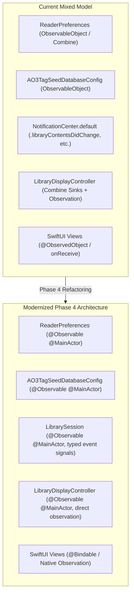

# Implementation Plan: Phase 4 — State Management & Swift Concurrency Modernization

## 1. Goal Description
The Ambrosia codebase currently runs with Swift 5 compatibility (`SWIFT_VERSION: 5.0` in `project.yml`) and splits its reactive state management across multiple disjoint patterns:
1. **Combine (`ObservableObject`)**: `ReaderPreferences` and `AO3TagSeedDatabaseConfig` use Combine (`@Published`, `ObservableObject`, `PassthroughSubject`, and `AnyCancellable`), forcing SwiftUI views to use `@ObservedObject` while the rest of the application uses the modern `@Observable` macro (`LibrarySession`, `LibraryDisplayController`, `LibraryToolbarState`).
2. **Untyped String Notifications**: Core lifecycle and sync events (`.libraryContentsDidChange`, `.librarySnapshotsDidBecomeReady`, `.seriesOrMergedCollectionDidChange`) are broadcast via global `NotificationCenter.default` string-based notifications and ingested via `NotificationCenter.default.publisher`, bypassing actor safety.
3. **Implicit Data-Race Risks**: Without Swift strict concurrency checks enabled, potential actor boundary crossings and unsynchronized property access are hidden from the compiler and must be manually tracked.

Phase 4 unifies the application's reactive state under Swift's modern `@Observable` macro and prepares the codebase for compile-time verified concurrency safety.

---

## 2. User Review Required

> [!IMPORTANT]
> **Combine to `@Observable` Migration**:
> All SwiftUI views that currently inject `@ObservedObject private var prefs = ReaderPreferences.shared` will be modernized to use direct `@Bindable var prefs = ReaderPreferences.shared` or standard property access.
> Combine publishers on `ReaderPreferences` (e.g. `preferenceChangeKind`, `$libraryAppearanceMode`, `$keyBindings`) will be modernized to typed `@Observable` property observation or direct closure/async callbacks.

> [!NOTE]
> **Strict Concurrency Flag**:
> We will configure `SWIFT_STRICT_CONCURRENCY: targeted` in `project.yml` first to catch actor boundary crossing warnings and verify zero runtime regressions before evaluating `complete`.

---

## 3. Architecture & Dependency Flow



---

## 4. Proposed Changes

### Component A: `ReaderPreferences` & `AO3TagSeedDatabaseConfig` Observation Migration

#### [MODIFY] `Ambrosia/Reader/ReaderPreferences.swift`
- Convert `final class ReaderPreferences: ObservableObject` to `@Observable @MainActor final class ReaderPreferences`.
- Remove `@Published` property wrappers from all 33 properties (leaving plain stored properties with `didSet { UserDefaults.standard.set(...); ... }`).
- Modernize `preferenceChangeKind`:
  - Replace `PassthroughSubject<PreferenceChangeKind, Never>` with an `@Observable` change tracker or a typed listener callback/AsyncStream for `ReaderViewController`.
- Preserve custom initializer and UserDefaults defaults logic.

#### [MODIFY] `Ambrosia/Database/AO3TagSeedDatabaseConfig.swift`
- Convert from `ObservableObject` to `@Observable @MainActor`.
- Remove `@Published` wrappers from `isEnabled`, `databasePath`, and `validationStatus`.

#### [MODIFY] `Ambrosia/Reader/ReaderViewController.swift`
- Update preferences subscription:
  - Replace Combine `preferenceChangeKind.filter { ... }.sink { ... }` with a structured `withObservationTracking` observer or typed handler on `ReaderPreferences`.
  - Remove unused `prefsCancellables: Set<AnyCancellable>`.

#### [MODIFY] `Ambrosia/LibraryUI/LibraryDisplayController.swift`
- Remove Combine subscriptions for preferences (`$showSkippedCollection`, `$hideNonAO3PublisherBooks`, etc.).
- Bind directly to `@Observable` preference properties via `withObservationTracking` or explicit refresh triggers.

#### [MODIFY] SwiftUI Preference Consumers
Update all views referencing `@ObservedObject private var prefs = ReaderPreferences.shared`:
- [`CollectionsView.swift`](file:///Users/ethanchan/Documents/Applications/ambrosia/Ambrosia/LibraryUI/CollectionsView.swift)
- [`RSSPublishView.swift`](file:///Users/ethanchan/Documents/Applications/ambrosia/Ambrosia/LibraryUI/RSSPublishView.swift)
- [`LibraryRootView.swift`](file:///Users/ethanchan/Documents/Applications/ambrosia/Ambrosia/LibraryUI/LibraryRootView.swift)
- [`FilterDrawerView.swift`](file:///Users/ethanchan/Documents/Applications/ambrosia/Ambrosia/LibraryUI/FilterDrawer/FilterDrawerView.swift)
- [`PreferencesWindowController.swift`](file:///Users/ethanchan/Documents/Applications/ambrosia/Ambrosia/Preferences/PreferencesWindowController.swift)

---

### Component B: Modernize NotificationCenter Broadcasts on `LibrarySession`

#### [MODIFY] `Ambrosia/Database/LibrarySession.swift`
- Add an observable event counter / epoch or typed `AsyncStream<LibrarySessionEvent>`:
  ```swift
  enum LibrarySessionEvent: Sendable {
      case snapshotsDidBecomeReady
      case contentsDidChange
      case seriesOrMergedCollectionDidChange
  }
  ```
- Retain existing `NotificationCenter.default.post` as a deprecation bridge for backward compatibility, while allowing `LibraryDisplayController` and primary UI components to observe `LibrarySession` directly.

#### [MODIFY] `Ambrosia/LibraryUI/LibraryDisplayController.swift`
- Replace `NotificationCenter.default.publisher(for: ...).sink` in `startObservingNotifications()` with typed observation or stream handling.

---

### Component C: Build System & Concurrency Modernization

#### [MODIFY] `project.yml`
- Add `SWIFT_STRICT_CONCURRENCY: targeted` under `settings.base` for both `Ambrosia` and `AmbrosiaTests`.
- Regenerate project via `xcodegen generate`.
- Audit and resolve any strict concurrency warnings.

---

## 5. Verification Plan

### Automated Tests
1. **Full Test Suite & Lint**:
   ```bash
   ./test.sh
   ```
   Ensures **0 SwiftLint violations** and **all 576 unit tests pass**.
2. **Specific Observation & Preferences Tests**:
   - Verify `PreferencesWindowController` binding updates.
   - Verify `ReaderViewController` receives cosmetic CSS updates and structural reloads when preferences change.
   - Verify `LibraryDisplayController` handles visibility and snapshot changes without Combine publishers.

### Manual Verification
1. Launch Ambrosia, open Preferences (`Cmd+,`), toggle fonts, colors, and margins:
   - Confirm Reader view updates live with zero latency.
2. Toggle library visibility preferences (Hide Non-AO3, Hide Anthologies, Show Skipped):
   - Confirm library table updates immediately without app restart.
3. Switch libraries or reopen existing library:
   - Verify snapshots load and populate collection counts properly.
