# Implementation Plan: Phase 5 — Search & Facet Query Scalability

## 1. Goal Description
As an AO3 Calibre library grows (often containing 10,000+ fanfictions and hundreds of thousands of tags), search and facet aggregation exhibit three distinct scalability bottlenecks:
1. **Un-debounced Facet Thrashing**: In [`AO3FilterPopupView.swift`](file:///Users/ethanchan/Documents/Applications/ambrosia/Ambrosia/LibraryUI/FilterPopup/AO3FilterPopupView.swift), every checkbox toggle immediately fires a full recalculation across 7 facet fields concurrently. Rapid user clicks spawn competing task groups that overload the SQLite actors.
2. **SQLite Parameter Limit Explosion in Facets**: [`AmbrosiaMetaDB.topFacets(for:scopedTo:limit:)`](file:///Users/ethanchan/Documents/Applications/ambrosia/Ambrosia/Database/AmbrosiaMetaDB.swift#L2384) and [`topRatingFacets(scopedTo:)`](file:///Users/ethanchan/Documents/Applications/ambrosia/Ambrosia/Database/AmbrosiaMetaDB.swift#L2432) build dynamic SQL queries with `calibre_id IN (?, ?, ?, ...)` binding one `?` per ID. In libraries with thousands of candidate books, this risks hitting SQLite's parameter limits (`SQLITE_LIMIT_VARIABLE_NUMBER`) and produces massive query strings.
3. **Single-Token Query Parser Limitation**: [`SearchQueryParser.swift`](file:///Users/ethanchan/Documents/Applications/ambrosia/Ambrosia/Database/SearchQueryParser.swift) only recognizes one scoped operator at a time (e.g. `author:X`), dropping subsequent prefixes like `author:"Alice" tag:"Angst"`.

Phase 5 optimizes facet aggregation performance and enables composite scoped search queries.

---

## 2. Proposed Architectural Changes

```mermaid
flowchart TD
    subgraph FacetOptimization["Facet Aggregation Scalability"]
        V["AO3FilterPopupView (checkbox click)"] --> D["DebounceTimer (150ms)"]
        D --> C["AO3FilterFacetController.topFacets"]
        C --> M["AmbrosiaMetaDB: SQLIDList.clause(column: calibre_id)"]
        M --> SQL["SQLite: calibre_id IN (SELECT value FROM json_each(?))"]
    end

    subgraph ParserOptimization["Multi-Token Search Parser"]
        Input["Search text: 'author:Alice tag:Fluff rating:Teen'"]
        Input --> Tokenizer["SearchQueryParser.parse()"]
        Tokenizer --> Multi["SearchQuery (all terms categorized)"]
        Multi --> Rules["asFilterRules() -> [FilterRule]"]
        Rules --> FilterEngine["FilterBuilder / LibraryToolbarState"]
    end
```



---

## 3. Detailed Component Plan

### Part A: Debounce Facet Queries in `AO3FilterPopupView`

#### [MODIFY] `Ambrosia/LibraryUI/FilterPopup/AO3FilterPopupView.swift`
- Introduce a `@State private var facetDebouncer = DebounceTimer(delay: 0.15)` inside `AO3FilterPopupView`.
- Update `refreshFacets()`:
  - First cancel any active `facetRefreshTask`.
  - Schedule execution via `facetDebouncer.schedule { ... }`.
  - Keep initial `.task { ... }` or explicit programmatic triggers non-debounced when desired, while user interactions (checkbox toggles, dropdown changes) go through the 150ms debounce window.

---

### Part B: Adopt `SQLIDList` in `AmbrosiaMetaDB` Facet Queries

#### [MODIFY] `Ambrosia/Database/AmbrosiaMetaDB.swift`
- In `topFacets(for field: AO3FacetField, scopedTo ids: [Int], limit: Int = 10)`:
  - Replace:
    ```swift
    let idPlaceholders = ids.map { _ in "?" }.joined(separator: ", ")
    let sql = """
        SELECT je.value AS name, COUNT(*) AS cnt
        FROM ao3_metadata, json_each(ao3_metadata.\(field.jsonColumn)) AS je
        WHERE ao3_metadata.calibre_id IN (\(idPlaceholders))
        GROUP BY je.value
        ORDER BY cnt DESC
        LIMIT ?
        """
    let bindings: [Binding?] = ids.map { $0 as Binding? } + [limit as Binding?]
    ```
  - With:
    ```swift
    let sql = """
        SELECT je.value AS name, COUNT(*) AS cnt
        FROM ao3_metadata, json_each(ao3_metadata.\(field.jsonColumn)) AS je
        WHERE \(SQLIDList.clause(column: "ao3_metadata.calibre_id"))
        GROUP BY je.value
        ORDER BY cnt DESC
        LIMIT ?
        """
    let bindings: [Binding?] = [SQLIDList.binding(ids), limit as Binding?]
    ```
- In `topRatingFacets(scopedTo ids: [Int])`:
  - Replace `WHERE calibre_id IN (\(idPlaceholders))` with:
    ```swift
    let sql = """
        SELECT rating, COUNT(*) AS cnt
        FROM ao3_metadata
        WHERE \(SQLIDList.clause(column: "calibre_id")) AND rating IS NOT NULL
        GROUP BY rating
        ORDER BY cnt DESC
        """
    let bindings: [Binding?] = [SQLIDList.binding(ids)]
    ```
- **Benefit**: Binds arbitrarily large candidate ID lists (10,000+ IDs) as **1 single parameter** instead of 10,000 parameters, eliminating parameter explosion and speeding up query preparation by orders of magnitude.

---

### Part C: Multi-Token Scoped Search Parsing

#### [MODIFY] `Ambrosia/Database/SearchQueryParser.swift`
- Upgrade `SearchQueryParser.parse(_:)` to extract multiple scoped prefixes from a single input string.
  - Supports quote-enclosed terms: `tag:"Slow Burn" author:"Jane Doe" rating:General` or `tag:Romance title:Mystery`.
  - Splits tokens preserving quotes.
  - Extracted prefixes populate `tagTerms`, `authorTerms`, `titleTerms`, `seriesTerms`, `statusTerms`, `fulltextPhrase`, and remaining `plainTerms`.
- Add `func asFilterRules(canonicalTagResolver: ((String) async -> String)? = nil) async -> [FilterRule]`:
  - Translates each scoped token into its respective `FilterRule`.
  - Tags are classified (`AO3TagKind`) so ratings, warnings, and categories get their appropriate operators (`.ratingAtMost`, `.equals`).
- Keep backward compatibility for `asSingleFilterRule()`.

#### [MODIFY] `Ambrosia/LibraryUI/LibraryWindowController.swift`
- In `commitSearchField()`, if multiple scoped rules are parsed, convert all of them into filter rules, clear the search field, and commit them together into `toolbarState`.

---

## 4. Verification Plan

### Automated Tests
1. **New Unit Tests (`AmbrosiaTests/SearchQueryParserMultiTokenTests.swift`)**:
   - Verify parsing of composite queries: `author:"Jane Doe" tag:"Hurt/Comfort" title:Redemption`.
   - Verify handling of quote pairing, unquoted multi-word prefixes, and mixed plain text.
   - Verify translation into multiple `FilterRule`s with proper operators and fields.
2. **Facet Query Tests (`AmbrosiaTests/AO3FacetScalabilityTests.swift`)**:
   - Verify `AmbrosiaMetaDB.topFacets(for:scopedTo:)` and `topRatingFacets(scopedTo:)` execute correctly using `SQLIDList` with large candidate ID sets (e.g. 5,000+ IDs).
3. **Full Test Suite & Lint**:
   ```bash
   ./test.sh
   ```
   Ensures **0 SwiftLint violations** and **all unit tests pass**.

### Manual Verification
1. Open the AO3 Filter Popup, rapidly click multiple checkboxes across Fandoms, Relationships, Characters, and Ratings:
   - Confirm counts update smoothly without UI stutter or SQLite lock contention.
2. Enter `author:"Some Author" tag:"Romance"` in the toolbar search field and press Return:
   - Confirm both filter rules are added to the active filter expression in the drawer and the search field is cleared.
