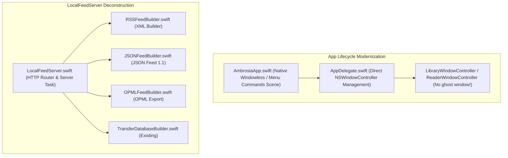

# Implementation Plan: Phase 6 — App Lifecycle & Monolith Deconstruction

## 1. Goal Description
The Ambrosia codebase has grown in complexity and still carries legacy scaffolding patterns in two critical areas:
1. **The Ghost Window Workaround (`AmbrosiaApp.swift`)**:
   - `AmbrosiaApp` initializes a SwiftUI `WindowGroup { Color.clear.frame(width: 0, height: 0) }`.
   - On launch, `AppDelegate.applicationDidFinishLaunching` must immediately call `ghostWindow.orderOut(nil)` to suppress this phantom window.
   - When the user clicks the Dock icon (`applicationShouldHandleReopen`), extra guards prevent macOS from re-spawning this empty clear window.
   - Using SwiftUI's menu bar/windowless scenes with native AppKit window management cleanly solves this without any ghost windows or orderOut hacks.
2. **The `LocalFeedServer.swift` Monolith (2,520 lines)**:
   - `LocalFeedServer.swift` mixes HTTP socket routing (FlyingFox), RSS 2.0 XML rendering, JSON Feed v1.1 rendering, OPML generation, Gzip compression streaming, and SQLite transfer database packaging in a single file.
   - Decomposing this into dedicated, testable domain builders:
     - `RSSFeedBuilder.swift`: RSS 2.0 XML schema and item serialization.
     - `JSONFeedBuilder.swift`: JSON Feed v1.1 serialization and metadata enrichment.
     - `OPMLFeedBuilder.swift`: OPML subscription document generation.
     - `LocalFeedServer.swift`: Lean HTTP dispatch, port binding, and actor lifecycle.

---

## 2. Non-Interference Guarantee (Working in Parallel with Filter Modernization)

> [!IMPORTANT]
> **Complete Domain Isolation**:
> Another agent is currently refactoring Ambrosia's filter systems in [`Ambrosia/LibraryUI/FilterPopup/`](file:///Users/ethanchan/Documents/Applications/ambrosia/Ambrosia/LibraryUI/FilterPopup) and [`Ambrosia/LibraryUI/FilterDrawer/`](file:///Users/ethanchan/Documents/Applications/ambrosia/Ambrosia/LibraryUI/FilterDrawer).
> **Phase 6 touches zero filter files**:
> - App lifecycle changes are strictly confined to `Ambrosia/App/` (`AmbrosiaApp.swift`, `AppDelegate.swift`).
> - Networking/Feed server refactorings are strictly confined to `Ambrosia/Networking/`.
> - There is **zero overlap** and **zero merge conflict risk**.

---

## 3. Architecture & Proposed Changes



---

## 4. Component Details

### Part A: Modernize macOS App Lifecycle (`AmbrosiaApp.swift` & `AppDelegate.swift`)

#### [MODIFY] `Ambrosia/App/AmbrosiaApp.swift`
- Replace `WindowGroup { Color.clear.frame(width: 0, height: 0) }` with:
  ```swift
  @main
  struct AmbrosiaApp: App {
      @NSApplicationDelegateAdaptor(AppDelegate.self) var appDelegate
      let session = LibrarySession()

      init() {
          appDelegate.session = session
      }

      var body: some Scene {
          Settings {
              EmptyView()
          }
          .commands {
              // Retain all existing menu bar commands (Preferences, Library, Reader menus)
              ...
          }
      }
  }
  ```
  *(Using a `Settings` scene or windowless scene keeps all menu commands fully active while eliminating the phantom primary window completely).*

#### [MODIFY] `Ambrosia/App/AppDelegate.swift`
- Remove the `ghostWindow.orderOut(nil)` hack in `applicationDidFinishLaunching`:
  ```swift
  // Deleted:
  // if let ghostWindow = NSApp.windows.first {
  //     ghostWindow.isExcludedFromWindowsMenu = true
  //     ghostWindow.orderOut(nil)
  // }
  ```
- Ensure `applicationShouldHandleReopen(_:hasVisibleWindows:)` activates `libraryWindowController?.showWindow(nil)` cleanly when no windows are visible without macOS trying to restore a ghost window.

---

### Part B: Decompose `LocalFeedServer.swift` Monolith

#### [NEW] `Ambrosia/Networking/RSSFeedBuilder.swift`
- Extract RSS 2.0 XML string generation:
  - `buildRSS(...)`
  - XML escaping and tag formatting
  - Item enclosure / content:encoded tags

#### [NEW] `Ambrosia/Networking/JSONFeedBuilder.swift`
- Extract JSON Feed v1.1 structure and serialization:
  - `buildJSONFeed(...)`
  - `buildJSONFeedItem(...)`
  - Grouped JSON item logic

#### [NEW] `Ambrosia/Networking/OPMLFeedBuilder.swift`
- Extract OPML document generation for feed readers (`buildOPML(...)`).

#### [MODIFY] `Ambrosia/Networking/LocalFeedServer.swift`
- Focus purely on:
  - Actor lifecycle, FlyingFox server configuration, port binding (`.inet`).
  - Route handlers (`GET /`, `GET /feed/...`, `GET /transfer/...`).
  - ETag verification and HTTP status responses.
  - Per-item HTML and SQLite walk caching.
- Size drops from 2,520 LOC to under 800 LOC.

---

## 5. Verification Plan

### Automated Tests
1. **Existing Networking & Feed Tests**:
   - `LocalFeedServerWalkCacheTests.swift`
   - `GzipEncoderTests.swift`
2. **New Unit Tests (`AmbrosiaTests/FeedBuilderTests.swift`)**:
   - Verify `RSSFeedBuilder` produces valid RSS 2.0 XML with CDATA and metadata.
   - Verify `JSONFeedBuilder` outputs valid JSON Feed v1.1 schema with authors, tags, and summary.
   - Verify `OPMLFeedBuilder` generates valid XML outlines.
3. **Full Test Suite & Lint**:
   ```bash
   ./test.sh
   ```
   Ensures **0 SwiftLint violations** and **all unit tests pass**.

### Manual Verification
1. Launch Ambrosia:
   - Confirm only the main Library window appears (no blank ghost window flashing or appearing in Window menu).
2. Close Library window and click Dock icon:
   - Confirm Library window re-opens cleanly.
3. Start the Local Feed Server in Preferences, curl `http://localhost:8080/feed/search.xml` and `http://localhost:8080/feed/search.json`:
   - Verify both RSS and JSON feeds respond with 200 OK and valid schemas.
