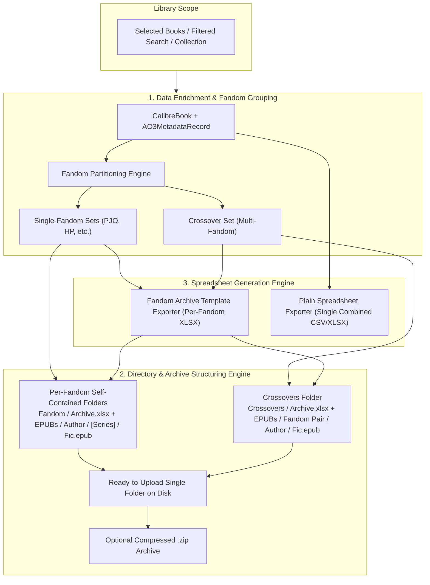

# Ambrosia Feature Plan: Fanfiction Library Sharing & Archive Export

## Executive Summary

Fanfiction readers and archivists frequently share their curated libraries with friends, fandom communities, or public archives. Today, Ambrosia can export plain CSV metadata and copy EPUBs locally to an unorganized folder. However, sharing a library externally requires two tightly coupled capabilities:

1. **Curated Spreadsheet Catalog**: Generating either a **Plain Spreadsheet** (CSV / flat XLSX) or a **Rich Fandom Archive Spreadsheet** directly modeled after the community-standard [PJO Fanfiction Archive v3.7.1](file:///Users/ethanchan/Downloads/PJO%20Fanfiction%20Archive%20v3.7.1%20%E2%80%94%20PUBLIC%20VIEW(1).xlsx), where each fic entry links to its EPUB file.
2. **Structured EPUB Package (Directory or ZIP)**: Automatically organizing EPUBs into an intuitive, browsable hierarchy (`Fandom / Author / [Series] / Fic.epub`) that users can upload directly to Google Drive, Dropbox, OneDrive, or share as a standalone archive.



---

## 1. Analysis of Reference Template (`PJO Fanfiction Archive v3.7.1`)

Inspection of `/Users/ethanchan/Downloads/PJO Fanfiction Archive v3.7.1 — PUBLIC VIEW(1).xlsx` reveals how community fanfiction archives are structured in practice. The workbook contains 11 sheets with color-coded tab icons, interactive navigation, two-tier category headers, and dynamic formulas:

### Sheet Architecture

| Sheet | Role & Function | Key Elements |
|---|---|---|
| **🤎 Home** | Welcome portal & navigation dashboard | Title banner, navigation hyperlinks (`Back to Home`, `Jump to Fics`), archive metrics summary. |
| **🩷 Filter Instructions** | End-user guide for reading the sheet | Instructions on using Google Sheets / Excel filter funnels and search bars. |
| **💜 Fic Entries** | **Master Fic Catalog** (Core table) | 27 columns with two-tier header grouping, color hierarchy, hyperlinks to AO3 and EPUBs. |
| **💙 Series Entries** | Relational series index | Lists series with part numbers, titles, ratings, and cross-links to Fic Entries. |
| **🩵 Archive Statistics** | Analytics dashboard | Dynamic `COUNTIF` formulas aggregating counts by Rating, Status, Word Count Range, and Top Genres. |
| **_Metadata** | Controlled vocabulary reference | Data validation tables and count indices for dropdowns, ratings, tropes, and genres. |
| **Auxiliary Sheets** | Community maintenance | `New Entries`, `To Be Added`, `FAQs`, `Update Log`, `Save Instructions`. |

### Fic Entries Column Mapping (27 Columns)

The reference template's `Fic Entries` sheet uses a two-tier header structure:
- **Row 2**: Category Groupings (`Basic Information`, `Length`, `Warnings / Crossover`, `Relationships`, `Genres / Tropes`, `Setting`, `Other Tags`, `Files`)
- **Row 3**: Individual Column Headers

Here is how each column maps to Ambrosia's data model:

| Col | Header (Row 3) | Group (Row 2) | Ambrosia Source / Derivation Rule |
|:---:|---|---|---|
| **A** | **Title** | Basic Information | `CalibreBook.displayTitle` (or `title`) |
| **B** | **Author** | Basic Information | `CalibreBook.displayAuthors` (or `AO3AuthorEntry.username`) |
| **C** | **Status** | Basic Information | `AO3MetadataRecord.isComplete` ? "Complete" : "In Progress" |
| **D** | **Summary** | Basic Information | `CalibreBook.displayComment` (HTML stripped) |
| **E** | **Series** | Basic Information | If in series: `SeriesName #Index` (or "No") |
| **F** | **Chapters** | Length | If `chapterTotal == 1` or `(chapterCurrent == 1 && isComplete)`: "One-shot"; else "\(chapterCurrent ?? 1)/\(chapterTotal.map(String.init) ?? "?")" or "Multi-chapter" |
| **G** | **Word Range** | Length | Computed bucket: `<10k`, `10–25k`, `25–50k`, `50–100k`, `100–200k`, `200k+` |
| **H** | **Word Count (Thousand)** | Length | `round((ao3.wordCount ?? book.wordCount ?? 0) / 1000)` (e.g. 12 = 12k words) |
| **I** | **Rating** | Warnings / Crossover | `AO3Rating` code: `G`, `T`, `M`, `E`, or `Not Rated` |
| **J** | **Warnings** | Warnings / Crossover | `AO3MetadataRecord.warnings` (or `None Apply`) |
| **K** | **Crossover** | Warnings / Crossover | `ao3.fandoms.count > 1` ? "Yes" : "No" |
| **L** | **Category** | Relationships | `AO3MetadataRecord.categories` (Gen, M/M, F/F, F/M, Multi, Other) |
| **M** | **Main Relationship/s** | Relationships | First 1–2 entries of `ao3.relationships` |
| **N** | **Other Relationships** | Relationships | Remaining entries of `ao3.relationships` |
| **O** | **Genres** | Genres / Tropes | Classified from `additionalTags` (Fluff, Humour, Angst, Romance, Hurt/Comfort) |
| **P** | **(Romantic) Relationship Tropes** | Genres / Tropes | Classified from `additionalTags` (e.g. "Established Relationship", "Enemies to Lovers", "Fake Dating") |
| **Q** | **Character Tropes** | Genres / Tropes | Classified from `additionalTags` (e.g. "BAMF!Percy", "Protective Annabeth") |
| **R** | **Canon Status** | Setting | Classified from `additionalTags` ("Canon Compliant", "Canon Divergence", "Alternate Universe") |
| **S** | **Location** | Setting | Extracted setting tag if present (e.g. "Camp Half-Blood", "New Rome", "Tartarus") |
| **T** | **Time Period** | Setting | Extracted temporal tag (e.g. "Post-Tartarus", "Post-War", "Pre-Canon") |
| **U** | **Main POV** | Other Tags | POV tag if present (e.g. "Percy Jackson POV") |
| **V** | **Minor POV** | Other Tags | Secondary POV tag if present |
| **W** | **Additional Tags** | Other Tags | Remaining freeform tags not categorized above |
| **X** | **Admin Tag / Shelf** | Other Tags | Ambrosia collection names (e.g. "Favorites", "To Read", "Comfort Fics") |
| **Y** | **Original Link** | Files | `AO3MetadataRecord.storyURL` (hyperlinked) |
| **Z** | **EPUB** | Files | **Hyperlink to EPUB file** (Cell display text: `Author — Title [WorkID].epub`, Relative link: `EPUBs/Fandom/Author/Filename.epub`) |
| **AA**| **PDF** | Files | Optional / blank for EPUB-only exports |

---

## 2. Directory Hierarchy & Package Structure

Ambrosia generates a **single structured directory or `.zip` bundle** containing both curated spreadsheets and organized EPUB files. The user can drag-and-drop this entire package directly into Google Drive (or any cloud storage).

### A. Per-Fandom Self-Contained Architecture

For the **Fandom Archive Template**, Ambrosia defaults to generating **one spreadsheet per fandom**. This ensures each fandom package is 100% self-contained: an archivist can upload, move, or share just the `Percy Jackson and the Olympians/` folder with a PJO community, and its internal links and statistics remain completely valid.

```
📁 Ambrosia Archive — [Archive Name] /
│
├── 📁 Percy Jackson and the Olympians /
│   ├── 📄 Percy Jackson Fanfiction Archive.xlsx  <-- Fandom-specific catalog, Home banner, & stats
│   └── 📁 EPUBs /
│       ├── 📁 1967HogwartsGoddess /             <-- Author
│       │   ├── 📄 A Day in the Life... [55356616].epub
│       │   └── 📁 [Series] Falling For You /    <-- Series (when applicable)
│       │       ├── 📄 01 - Falling for You [26200348].epub
│       │       └── 📄 02 - Rising Above [26200349].epub
│       └── 📁 alwaysou28 /
│           └── 📄 You Got My Heart [52364320].epub
│
├── 📁 Harry Potter /
│   ├── 📄 Harry Potter Fanfiction Archive.xlsx   <-- Fandom-specific catalog & stats
│   └── 📁 EPUBs /
│       └── 📁 author_name /
│           └── 📄 ...
│
└── 📁 Crossovers /
    ├── 📄 Crossover Fanfiction Archive.xlsx      <-- Dedicated catalog for multi-fandom works
    └── 📁 EPUBs /
        └── 📁 Percy Jackson & Harry Potter /    <-- Subdivided by fandom combination
            └── 📁 author_name /
                └── 📄 ...
```

*(Note: For **Plain Spreadsheet** exports, a single unified `Ambrosia_Library.csv` or `.xlsx` is placed at the root containing a `Fandom` column, with all EPUBs stored under a global `EPUBs/Fandom/Author/` tree).*

### B. Tier Organization Rules

1. **Top Tier: Fandom (`Fandom/`)**
   - **Single Fandom Works**: Sanitized primary fandom name from `AO3MetadataRecord.fandoms.first` or Calibre tags (e.g. `Percy Jackson and the Olympians`). Each fandom folder contains its dedicated `[Fandom Name] Fanfiction Archive.xlsx` alongside its `EPUBs/` folder.
   - **Crossovers (Multi-Fandom Works)**:
     - Grouped into a dedicated `Crossovers/` top-level directory.
     - Contains a dedicated `Crossover Fanfiction Archive.xlsx`.
     - Subdivided by specific fandom pairing (e.g. `Crossovers/EPUBs/Percy Jackson & Harry Potter/`).
   - **Single-Fandom Archive Scope**: If an archivist is exporting a library or search result that already belongs to a single fandom (e.g. filtered by `fandom:"Percy Jackson"`), the top-level wrapper is simplified to export just that fandom's files directly without redundant nesting.
2. **Second Tier: Author (`Author/`)**
   - Sanitized author username from `AO3AuthorEntry.username` (or Calibre author).
   - Co-authored works: Primary authors joined by `&` (e.g. `AuthorA & AuthorB`).
   - Anonymous / Orphaned works: `Anonymous` or `orphan_account`.
3. **Third Tier: Series (`[Series] Series Name/`)**
   - Works belonging to an AO3 or Calibre series are placed in a dedicated series subfolder under the author directory.
   - Standalone works (one-shots or non-series multi-chapter fics) sit directly under the author folder.
4. **File Naming Convention**:
   - Matching the PJO reference template standard:
     `[Index - ]Author — Title [AO3-WorkID].epub`
     - *Example (standalone)*: `1967HogwartsGoddess — A Day in the Life of Camp Half Blood's Older Cousin [55356616].epub`
     - *Example (in series)*: `01 - 1967HogwartsGoddess — Falling for You [26200348].epub`
   - Incorporating the work ID ensures zero collisions even if an author has two works with identical titles or updates revisions.

### C. Spreadsheet Link Resolution

In each fandom spreadsheet, Column Z is `EPUB`. Ambrosia populates Column Z with:
- Display text: `Author — Title [WorkID].epub`
- Hyperlink: **Relative path within that fandom folder**:
  `EPUBs/1967HogwartsGoddess/A Day in the Life... [55356616].epub`
  *(or `EPUBs/1967HogwartsGoddess/[Series] Falling For You/...epub`)*
- Because the link is relative to the fandom spreadsheet itself, moving or sharing just that fandom folder keeps every single link working!
- When uploaded to Google Drive, anyone browsing the fandom folder can find the file immediately using the same hierarchy or by searching the filename.

### D. Export Output Options (Folder vs ZIP)
- **Folder Mode**: Exports the structured directory directly to a location chosen by the user (perfect for users who sync using Google Drive for Desktop or Dropbox).
- **ZIP Archive Mode**: Automatically compresses the entire bundle into a single `.zip` file using `ZIPFoundation`, ready for a single-click drag-and-drop upload into the Google Drive web interface.

---

## 3. Spreadsheet Generation Engine

Ambrosia uses `ZIPFoundation` (already in `Package.resolved` and `project.yml`). Since `.xlsx` files are standard OpenXML ZIP containers containing XML parts, we can generate real Excel workbooks natively without heavy third-party dependencies:

### Exporter Modes

1. **Plain Spreadsheet (`.csv` / Flat `.xlsx`)**:
   - Universal, fast, clean tabular output.
   - Outputs all standard AO3 fields + Ambrosia collections + EPUB relative path.
   - Enhances the existing `ExportManager.exportToCSV` by including the EPUB file path column.

2. **Fandom Archive Template (`.xlsx`)**:
   - Bundled template skeleton: Ambrosia bundles a clean OpenXML template (`FandomArchiveTemplate.xlsx`) containing pre-formatted styles, fonts, conditional formatting, and sheet structures (`Home`, `Filter Instructions`, `Fic Entries`, `Series Entries`, `Archive Statistics`, `_Metadata`).
   - Dynamic Population:
     - Parse template's `xl/worksheets/sheet3.xml` (`Fic Entries`).
     - Insert data rows with proper styles (`s="12"`, fonts, cell borders, text wrapping).
     - Populate `xl/worksheets/sheet4.xml` (`Series Entries`) by collecting all multi-work series.
     - Inject `<hyperlink ref="Z4" r:id="rId..." display="..."/>` pointing to the EPUB path.
     - Update formula ranges in `Archive Statistics` (`sheet5.xml`) and `_Metadata` (`sheet6.xml`) to match row count.
     - Repack into `.xlsx` using `ZIPFoundation`.

---

## 4. Tag Classification & Heuristic Parsing

In AO3, tropes, POV, canon status, and genres are often mixed into `additionalTags` (freeform tags). The PJO archive separates them into distinct columns:
- `Genres` (Fluff, Angst, Hurt/Comfort, Romance, Humor, Action/Adventure, Mystery)
- `(Romantic) Relationship Tropes` (Established Relationship, Slow Burn, Fake Dating, Friends to Lovers, Enemies to Lovers, Soulmates)
- `Character Tropes` (BAMF!, Unreliable Narrator, Dark!, Good Friend)
- `Canon Status` (Canon Compliant, Canon Divergence, Alternate Universe - Canon Divergence, Post-Canon)
- `POV` (First Person POV, Third Person Limited, X POV)

Ambrosia will implement `AO3TagClassifier`:
- Uses rule-based regex patterns and keyword matching against `AO3MetadataRecord.additionalTags`.
- Matches against Ambrosia's existing `canonical_tags` seed tables when available.
- Categorizes matching tags into their respective template columns, with remaining unmatched freeform tags cleanly flowing into `Additional Tags`.

---

## 5. User Experience & Export Workflow

### UI Entry Points
1. **Toolbar Export Menu**:
   - Existing: `Export CSV…`, `Export EPUBs…`, `Export Annotations…`
   - Added: **`Share & Export Archive…`** (Command-Shift-E)
2. **Context Menu** on Book List / Multiselect:
   - `Export Selected Books to Archive…`
3. **Collection Sidebar Context Menu**:
   - `Share Collection to Archive…`

### Export Modal Flow (SwiftUI Sheet)

```
┌────────────────────────────────────────────────────────────────────────┐
│                        Share & Export Archive                          │
├────────────────────────────────────────────────────────────────────────┤
│ 1. Export Scope:                                                       │
│    ◉ Current Filter Results (42 books)                                 │
│    ○ Selected Books (5 books)                                          │
│    ○ Entire Library (1,248 books)                                      │
│                                                                        │
│ 2. Spreadsheet Format:                                                 │
│    ◉ Fandom Archive Template (.xlsx) [PJO Archive Style]               │
│        • Dedicated sheets: Home, Fic Entries, Series, Stats            │
│    ○ Plain Spreadsheet (.csv / flat .xlsx)                             │
│                                                                        │
│ 3. Spreadsheet Organization (Multi-Fandom Scope):                      │
│    ◉ Separate spreadsheet per fandom (Recommended)                     │
│        Creates self-contained, fandom-branded folders & stats.         │
│    ○ Single combined spreadsheet                                       │
│        One global spreadsheet with a 'Fandom' column.                  │
│                                                                        │
│ 4. Output Packaging:                                                   │
│    ◉ Structured Directory on Disk (ready to sync/upload)               │
│    ○ Compressed ZIP Archive (.zip)                                     │
│                                                                        │
│ 5. Archive Customization:                                              │
│    Archive Title: [ Percy Jackson & the Olympians Archive            ] │
│    Curator / Admin: [ Ethan Chan                                     ] │
│                                                                        │
│                          [ Cancel ]  [ Export Archive... ]             │
└────────────────────────────────────────────────────────────────────────┘
```

On completion:
- Success celebration with statistics: "42 EPUBs organized across 2 fandom folders and spreadsheets created."
- Action buttons:
  - **Open Spreadsheets** (launches Excel / Numbers)
  - **Reveal in Finder** (opens the archive folder or highlights the .zip)

---

## 6. Implementation Plan & Milestones

### Phase 1: Data Model, Fandom Partitioning & Tag Classification
- **Files**:
  - `Ambrosia/Utilities/ArchiveExportModels.swift`
  - `Ambrosia/Utilities/AO3TagClassifier.swift`
  - `Ambrosia/Utilities/FandomPartitionCoordinator.swift`
- **Tasks**:
  - Define `ArchiveFicRow`, `ArchiveSeriesRow`, and `ArchiveStatsSummary` structs.
  - Implement Fandom Partitioning: partition exported books into single-fandom buckets and a multi-fandom crossover bucket.
  - Implement heuristic tag classification for Genres, Relationship Tropes, Character Tropes, Canon Status, Location, and POV.
  - Implement word range bucket calculation (`<10k` ... `200k+`) and word counts in thousands.
  - Unit tests in `AmbrosiaTests/AO3TagClassifierTests.swift` and `AmbrosiaTests/FandomPartitionCoordinatorTests.swift`.

### Phase 2: Hierarchical Directory & ZIP Packaging Engine
- **Files**:
  - `Ambrosia/Utilities/ArchiveDirectoryOrganizer.swift`
- **Tasks**:
  - Implement self-contained per-fandom folder layout (`[Fandom]/[Fandom] Archive.xlsx` + `[Fandom]/EPUBs/Author/...`).
  - Implement crossover layout (`Crossovers/Crossover Archive.xlsx` + `Crossovers/EPUBs/Pair/...`).
  - Copy EPUB files safely with progress reporting and collision resolution.
  - Optional ZIP compression using `ZIPFoundation` to create a single drag-and-drop `.zip` archive.
  - Unit tests in `AmbrosiaTests/ArchiveDirectoryOrganizerTests.swift`.

### Phase 3: OpenXML (.xlsx) Template Engine
- **Files**:
  - `Ambrosia/Utilities/XLSXWriter.swift`
  - `Ambrosia/Utilities/FandomArchiveWorkbookBuilder.swift`
  - Resource: `Resources/Templates/FandomArchiveTemplate.xlsx`
- **Tasks**:
  - Use `Resources/Templates/FandomArchiveTemplate.xlsx` as the blueprint asset.
  - Implement XML generation for `Fic Entries`, `Series Entries`, and `Archive Statistics` tailored to each fandom.
  - Inject relative file hyperlinks into Column Z (`EPUB`) pointing to local `EPUBs/Author/...` paths.
  - Repackage workbooks using `ZIPFoundation`.
  - Support plain CSV and clean flat XLSX exports as alternative formats.
  - Unit tests verifying generated `.xlsx` integrity and formula evaluation.

### Phase 4: UI & Export Wizard
- **Files**:
  - `Ambrosia/LibraryUI/Export/ArchiveExportWizardView.swift`
  - `Ambrosia/LibraryUI/LibraryWindowController.swift`
  - `Ambrosia/LibraryUI/LibraryToolbarState.swift`
- **Tasks**:
  - Connect "Share & Export Archive…" to toolbar menu and keyboard shortcut.
  - Build SwiftUI wizard sheet with scope selection, per-fandom toggle, and packaging choices.
  - Background task coordinator with progress bar.
  - Success summary with "Reveal in Finder" button.

### Phase 5: Verification, Documentation & Polish
- Update docs per `CLAUDE.md`:
  - `docs/overview.md` (add Archive Export capability)
  - `docs/roadmap.md` (mark feature milestone)
- Run `./test.sh` to ensure **0 SwiftLint violations** and **all existing + new tests pass**.
