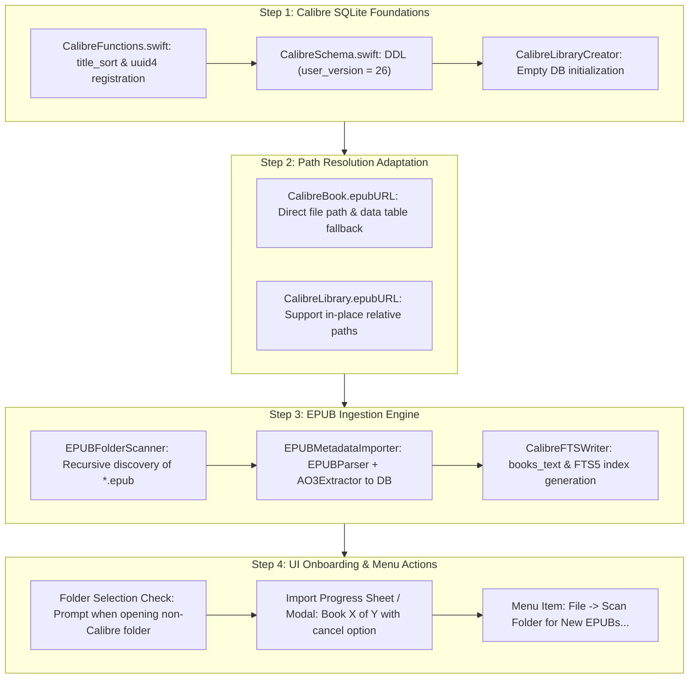

# Architecture & Implementation Plan: Standalone EPUB Folder Support

## Executive Summary

Users often have folders of EPUB files (e.g. `~/Downloads/Fics`, `~/Books`, or Google Drive/Dropbox sync folders) that are **not managed by Calibre**. Currently, Ambrosia requires an existing Calibre `metadata.db`.

This plan details how Ambrosia will support **any arbitrary folder of EPUBs** by automatically generating a Calibre-compatible `metadata.db` and `full-text-search.db`.

---

## 1. Architectural Decision: Calibre DB vs. Native Ambrosia DB

| Criterion | Calibre DB Generation (`metadata.db` + `full-text-search.db`) | Native Ambrosia DB (`ambrosia_meta.db` only) |
| :--- | :--- | :--- |
| **Existing Query Layer** | **100% reused.** Ambrosia's ~3,000 lines of query, sorting, pagination, tag expansion, and filter code in `CalibreLibrary.swift` work immediately. | **Complete rewrite / duplication.** Requires abstracting a `LibraryProvider` protocol and duplicating parallel sorting, filtering, and pagination query engines. |
| **Full-Text Search** | **100% reused.** Ambrosia's `CalibreFTSLibrary`, typographic search cards, multi-snippet extraction, and reader passage jumping work immediately. | Requires writing and maintaining a second custom FTS indexing and querying engine. |
| **Interoperability** | **Full interoperability.** The folder becomes a standard Calibre library readable by Calibre Desktop, Calibre-Web, Kavita, and OPDS clients. | Proprietary storage format locked exclusively to Ambrosia. |
| **Code Footprint** | Small, focused generator (~600 lines) based on Octavo's battle-tested SQLite schema and triggers. | Massive footprint: schema migrations, custom indices, query builders, and dual maintenance. |
| **Verdict** | **STRONGLY RECOMMENDED** | Rejected |

---

## 2. Ingestion Modes: In-Place Indexing vs. Calibre Structure

When a user points Ambrosia to an arbitrary folder of EPUBs, we support two layout strategies:

1. **In-Place Indexing (Default & Zero Mutation)**:
   - Does **not** move, rename, or reorganize the user's files.
   - `books.path` stores the relative directory or file path from library root.
   - `data.name` stores the file stem; `data.format` stores `"EPUB"`.
   - `metadata.db` and `full-text-search.db` are placed at the root of the folder.
2. **Calibre Layout Organization (Optional)**:
   - Organizes books into standard Calibre hierarchy: `<Author>/<Title> (<id>)/<Title> - <Author>.epub`.
   - Generates `metadata.opf` sidecar and `cover.jpg`.
   - Uses Octavo's `BookImport.swift` deterministic filename-sanitizing algorithm (`filenameSafe`).

---

## 3. Core Components Derived from Octavo & Calibre

### A. Calibre Functions (`CalibreFunctions.swift`)
*Source: Octavo `CalibreFunctions.swift`*
- Registers custom SQLite scalar functions required by Calibre triggers:
  - `title_sort(title)`: Moves leading articles to the end (`"The Hobbit"` ➔ `"Hobbit, The"`).
  - `uuid4()`: Generates random lowercase UUIDs.
- Registered via `sqlite3_create_function_v2` on the writable database handle before DDL execution.

### B. Calibre Schema DDL (`CalibreSchema.swift`)
*Source: Octavo `CalibreSchema.swift`*
- Calibre schema version `PRAGMA user_version = 26`.
- Tables: `books`, `authors`, `books_authors_link`, `tags`, `books_tags_link`, `series`, `books_series_link`, `publishers`, `books_publishers_link`, `comments`, `data`, `identifiers`, `preferences`, `library_id`.
- Foreign key checks and triggers: `books_insert_trg`, `books_update_trg`, `series_insert_trg`, `series_update_trg`.

### C. Calibre FTS Schema (`CalibreFTSCreator.swift`)
*Source: Calibre `fts_sqlite.sql`*
- FTS schema version `PRAGMA user_version = 1`.
- Tables:
  - `dirtied_formats (id, book, format, in_progress)`
  - `books_text (id, book, timestamp, format, format_hash, format_size, searchable_text, text_size, text_hash, err_msg)`
  - `books_fts USING fts5(searchable_text, content='books_text', content_rowid='id', tokenize='calibre remove_diacritics 2')`
  - `books_fts_stemmed USING fts5(searchable_text, content='books_text', content_rowid='id', tokenize='porter calibre remove_diacritics 2')`
- Triggers: `books_fts_insert_trg`, `books_fts_delete_trg`, `books_fts_update_trg`.
- Uses Ambrosia's registered `calibre` tokenizer (`calibre_tokenizer.c`).

### D. EPUB Metadata & Text Extraction Pipeline
- **Metadata**: Reuses Ambrosia's `EPUBParser` to read `content.opf` (DC metadata: title, creator/author, publisher, dates, subjects/tags, series meta, description, cover manifest item).
- **AO3 Tags**: Reuses `AO3MetadataExtractor` to parse rich AO3 tags, fandoms, ships, ratings, and warnings from HTML prefaces.
- **FTS Body Text**: Iterates spine items via `EPUBParser`, strips HTML tags with `HTMLStripper`, and writes searchable text directly to `books_text`.

---

## 4. Phased Implementation Roadmap

---

## 5. Detailed Task Breakdown

### Phase 1: Database Generation & SQLite Primitives
- [ ] Create `Ambrosia/Database/Standalone/CalibreFunctions.swift` implementing `title_sort`, `author_sort`, `uuid4`, and `filenameSafe`.
- [ ] Create `Ambrosia/Database/Standalone/CalibreSchema.swift` with Calibre `user_version = 26` DDL.
- [ ] Create `Ambrosia/Database/Standalone/CalibreLibraryCreator.swift`:
  - Opens/creates `metadata.db`.
  - Registers `title_sort` and `uuid4`.
  - Executes DDL via `sqlite3_exec`.
  - Seeds `library_id` and initial preferences.

### Phase 2: Path Resolution & In-Place File Support
- [ ] Extend `CalibreBook.epubURL(libraryRoot:)`:
  - Check if `relativePath` points directly to an `.epub` file.
  - Fallback to scanning folder if `relativePath` is a directory.
- [ ] Extend `CalibreLibrary.epubURL(calibreID:)`:
  - Handle direct relative file paths and query `data` table (`format = 'EPUB'`).

### Phase 3: Loose EPUB Scanner & Importer
- [ ] Create `Ambrosia/Database/Standalone/EPUBFolderScanner.swift`:
  - Discovers all `.epub` files recursively under the given root URL.
  - Skips hidden files (`.`, `.ambrosia`, trash).
- [ ] Create `Ambrosia/Database/Standalone/CalibreLibraryWriter.swift`:
  - Extracts metadata using `EPUBParser`.
  - Extracts AO3 metadata and tags.
  - Inserts authors, series, tags, publishers, and books into `metadata.db`.
  - Extracts and saves cover image if present.
- [ ] Create `Ambrosia/Database/Standalone/CalibreFTSWriter.swift`:
  - Initializes `full-text-search.db` (`user_version = 1`).
  - Registers `calibre` tokenizer.
  - Extracts text from spine HTML items and inserts into `books_text` (triggers auto-populate `books_fts`).

### Phase 4: UI Integration & Rescan Workflow
- [ ] Update `AppDelegate.chooseLibraryFolder()`:
  - If selected folder lacks `metadata.db` but contains `.epub` files:
    - Display alert: *"Set Up Ambrosia Library: Ambrosia found [N] EPUB files in this folder. Would you like to set up a library here?"*
    - Options: "Set Up Library" or "Cancel".
- [ ] Create `ImportProgressWindowController`:
  - Progress bar showing "Scanning EPUBs...", "Extracting metadata...", "Building full-text search...".
- [ ] Add Menu Action **File ▸ Scan Library for New Books…** (`⌘R` or custom shortcut):
  - Diffs files on disk against `metadata.db` `data`/`books` records.
  - Ingests newly added EPUBs and appends to FTS index.
  - Notifies `LibrarySession` to refresh.

### Phase 5: Verification & Tests
- [ ] Unit tests for `CalibreFunctions` (`title_sort`, `uuid4`, `authorSort`, `filenameSafe`).
- [ ] Integration test: Generate `metadata.db` from a folder with sample EPUBs, open via `CalibreLibrary`, verify book counts, authors, tags, and spine text.
- [ ] Integration test: Verify generated `full-text-search.db` responds to `CalibreFTSLibrary.searchBooks` and multi-snippets.
- [ ] Run full test suite: `rtk ./test.sh`.
