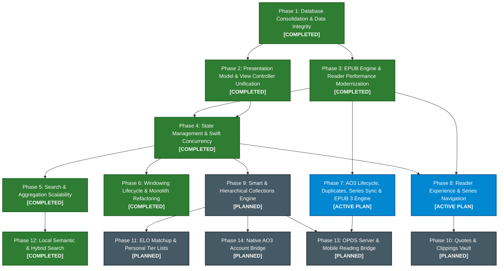

# Ambrosia Architectural Roadmap

This roadmap outlines the strategic phases to modernize Ambrosia's architecture, eliminate data integrity risks, resolve performance bottlenecks, and unify duplicated UI logic.

---

## Roadmap Phases Overview

---

## 1. Built, Active & Unbuilt Systems Matrix

This matrix provides a comprehensive, unified view of all architectural systems in Ambrosia, cross-referencing shipped code, active engineering plans ([`docs/plans/`](~/Documents/Applications/ambrosia/docs/plans)), completed historical blueprints ([`docs/plans/finished/`](~/Documents/Applications/ambrosia/docs/plans/finished)), and living topic documentation ([`docs/*.md`](~/Documents/Applications/ambrosia/docs)).

| System / Capability | State | Phase & Plan Citation | Living Topic Doc | Code Evidence & Verification |
| :--- | :--- | :--- | :--- | :--- |
| **Data Integrity & Storage Consolidation** | **Built** ✅ | **Phase 1** &bull; [`phase1-database-consolidation-plan.md`](~/Documents/Applications/ambrosia/docs/plans/finished/phase1-database-consolidation-plan.md) | [docs/metadb-and-migrations.md](~/Documents/Applications/ambrosia/docs/metadb-and-migrations.md) | SwiftData removed; `book_state` & `reading_goals` in `AmbrosiaMetaDB`; `busyTimeout = 5.0` on SQLite connections. |
| **Dual-Database Isolation** | **Built** ✅ | Foundation &bull; [`calibre-dependency-reduction-plan.md`](~/Documents/Applications/ambrosia/docs/plans/finished/calibre-dependency-reduction-plan.md) | [docs/calibre-library.md](~/Documents/Applications/ambrosia/docs/calibre-library.md) | Read-only `metadata.db` vs read/write `ambrosia_meta.db`; custom kudos & word count parity. |
| **Presentation Layer Unification** | **Built** ✅ | **Phase 2** &bull; [`phase2-presentation-unification-plan.md`](~/Documents/Applications/ambrosia/docs/plans/finished/phase2-presentation-unification-plan.md) | [docs/library-ui.md](~/Documents/Applications/ambrosia/docs/library-ui.md) | Unified `LibraryDisplayController` driving both List and Email view surfaces without reload races. |
| **Row Layout Bounding & Scroll Perf** | **Built** ✅ | Phase 2 Opt &bull; [`library-row-performance-fix-plan.md`](~/Documents/Applications/ambrosia/docs/plans/finished/library-row-performance-fix-plan.md) | [docs/library-ui.md](~/Documents/Applications/ambrosia/docs/library-ui.md) | Clamped book descriptions, static tag chip layouts, bounded thumbnail decode dimensions. |
| **UI Theme & Status Color Centralization** | **Active Plan** 📋 | Phase 2/8 Styling &bull; [`theme-centralization-plan.md`](~/Documents/Applications/ambrosia/docs/plans/theme-centralization-plan.md) | [docs/library-ui.md](~/Documents/Applications/ambrosia/docs/library-ui.md) | Centralize corner-radius and status-meaning color literals into new `Theme.swift`. |
| **Library GUI Correctness & Stability** | **Built** ✅ | Phase 2 Fixes &bull; [`library-gui-stability-plan.md`](~/Documents/Applications/ambrosia/docs/plans/finished/library-gui-stability-plan.md) | [docs/library-ui.md](~/Documents/Applications/ambrosia/docs/library-ui.md) | Historical fixes now reflected in the unified display controller and current concurrency invariants. |
| **EPUB Single-Pass Sanitizer & Reader** | **Built** ✅ | **Phase 3** &bull; [`phase3-epub-reader-performance-plan.md`](~/Documents/Applications/ambrosia/docs/plans/finished/phase3-epub-reader-performance-plan.md) | [docs/epub-parsing.md](~/Documents/Applications/ambrosia/docs/epub-parsing.md), [docs/reader.md](~/Documents/Applications/ambrosia/docs/reader.md) | SwiftSoup single-pass DOM walk stripping publisher CSS; concurrent multi-core chapter extraction. |
| **State Management & Swift 6 Concurrency** | **Built** ✅ | **Phase 4** &bull; [`phase4-state-concurrency-plan.md`](~/Documents/Applications/ambrosia/docs/plans/finished/phase4-state-concurrency-plan.md) | [docs/concurrency-invariants.md](~/Documents/Applications/ambrosia/docs/concurrency-invariants.md) | `@Observable` migration across settings & session; `SWIFT_STRICT_CONCURRENCY: targeted`. |
| **Search & Facet Scalability** | **Built** ✅ | **Phase 5** &bull; [`phase5-search-facet-scalability-plan.md`](~/Documents/Applications/ambrosia/docs/plans/finished/phase5-search-facet-scalability-plan.md) | [docs/search-and-filter.md](~/Documents/Applications/ambrosia/docs/search-and-filter.md) | Facet debounce timer; `SQLIDList` JSON parameters; `SearchQueryParser` multi-token syntax. |
| **Native Calibre FTS5 Index Querying** | **Built** ✅ | Phase 5 Engine &bull; [`calibre-native-fts-plan.md`](~/Documents/Applications/ambrosia/docs/plans/finished/calibre-native-fts-plan.md) | [docs/calibre-fts.md](~/Documents/Applications/ambrosia/docs/calibre-fts.md) | `CalibreFTSLibrary` direct SQLite FTS5 queries; custom Calibre tokenizer registration. |
| **Multi-Tier Caching System** | **Built** ✅ | Phase 5 Caching &bull; [`library-load-performance-and-caching-plan.md`](~/Documents/Applications/ambrosia/docs/plans/finished/library-load-performance-and-caching-plan.md) | [docs/caching.md](~/Documents/Applications/ambrosia/docs/caching.md) | `filterResultCache` (8 entries), `pageCache` (16 entries), `countCache` (64 entries). |
| **Incremental Additional Filter Eval** | **Built (Gated)** 🔒 | Phase 5 Addendum &bull; [`incremental-filter-evaluation-plan.md`](~/Documents/Applications/ambrosia/docs/plans/finished/incremental-filter-evaluation-plan.md) | [docs/search-and-filter.md](~/Documents/Applications/ambrosia/docs/search-and-filter.md) | Gated by `IncrementalFilterFlag` (`incrementalFilterEvaluation`); narrow evaluation over cached IDs. |
| **App Lifecycle & Monolith Deconstruction** | **Built** ✅ | **Phase 6** &bull; [`phase6-app-lifecycle-monolith-deconstruction-plan.md`](~/Documents/Applications/ambrosia/docs/plans/finished/phase6-app-lifecycle-monolith-deconstruction-plan.md) | [docs/overview.md](~/Documents/Applications/ambrosia/docs/overview.md) | Eliminated ghost window; decoupled `LibraryWindowController` and `LibrarySession`. |
| **XcodeGen & Test Architecture** | **Built** ✅ | Tooling &bull; [`quality-remediation-and-xcodegen-plan.md`](~/Documents/Applications/ambrosia/docs/plans/finished/quality-remediation-and-xcodegen-plan.md) | [docs/testing.md](~/Documents/Applications/ambrosia/docs/testing.md) | Source-of-truth `project.yml`; `.swiftformat` configuration; 580+ unit tests passing. |
| **EPUB Import & Safe Trashing** | **Active Plan** 📋 | **Phase 7** &bull; [`epub-import-and-safe-trashing-plan.md`](~/Documents/Applications/ambrosia/docs/plans/epub-import-and-safe-trashing-plan.md) | [docs/calibre-library.md](~/Documents/Applications/ambrosia/docs/calibre-library.md) | Drag-and-drop pre-triage ingestion and reversible trashing remain unbuilt. |
| **Reader Experience & Series Navigation** | **Active Plan** 📋 | **Phase 8** &bull; [`phase8-reader-experience-series-navigation-plan.md`](~/Documents/Applications/ambrosia/docs/plans/phase8-reader-experience-series-navigation-plan.md) | [docs/reader.md](~/Documents/Applications/ambrosia/docs/reader.md) | Direct chapter comment links, next-in-series navigation, preface visual presets. |
| **Smart & Hierarchical Collections** | **Planned** 🗓️ | **Phase 9** | [docs/metadb-and-migrations.md](~/Documents/Applications/ambrosia/docs/metadb-and-migrations.md) | Dynamic saved filters as live collections, nested folders, curated manual sequencing. |
| **Quotes & Clippings Annotations Vault** | **Planned** 🗓️ | **Phase 10** | [docs/annotations.md](~/Documents/Applications/ambrosia/docs/annotations.md) | Cross-library annotation browser, quote search, copy with citation, Obsidian export. |
| **ELO Matchup & Personal Tier Lists** | **Planned** 🗓️ | **Phase 11** | [docs/metadb-and-migrations.md](~/Documents/Applications/ambrosia/docs/metadb-and-migrations.md) | Pairwise head-to-head matchup UI over `AmbrosiaMetaDB` ELO schema, generating tier lists (S/A/B/C). |
| **Local Semantic, Hybrid & Precision Search** | **Built** ✅ | **Phase 12** &bull; [`phase12-local-semantic-hybrid-and-precision-search-plan.md`](~/Documents/Applications/ambrosia/docs/plans/finished/phase12-local-semantic-hybrid-and-precision-search-plan.md) | [docs/search-and-filter.md](~/Documents/Applications/ambrosia/docs/search-and-filter.md) | On-device sentence embeddings, Accelerate BLAS SIMD matrix dot product, RRF hybrid fusion, SQLite REGEXP, Calibre `=`/`~` operators. |
| **Full-Text Corpus Semantic Search & External Ingestion** | **Active Plan** 📋 | **Phase 12 Extension** &bull; [`fulltext-semantic-search-and-external-ingestion-plan.md`](~/Documents/Applications/ambrosia/docs/plans/fulltext-semantic-search-and-external-ingestion-plan.md) | [docs/search-and-filter.md](~/Documents/Applications/ambrosia/docs/search-and-filter.md), [docs/calibre-fts.md](~/Documents/Applications/ambrosia/docs/calibre-fts.md) | Paragraph-aware chunking (~400 words, 50-word overlap), dual-mode execution (on-device + external headless CLI), on-demand model manager, passage jumping. |
| **OPDS Catalog Server & Mobile Bridge** | **Planned** 🗓️ | **Phase 13** | [docs/local-feed-server.md](~/Documents/Applications/ambrosia/docs/local-feed-server.md) | Serve library and modernized EPUB 3/Omnibuses over local Wi-Fi OPDS 1.2/2.0 to mobile reader apps. |
| **Native AO3 Account Bridge** | **Planned** 🗓️ | **Phase 14** | [docs/ao3-metadata-extraction.md](~/Documents/Applications/ambrosia/docs/ao3-metadata-extraction.md) | In-reader Kudos submission, remote AO3 Bookmarks & Marked-for-Later two-way sync. |
| **Standalone Mode without Calibre** | **Blueprint Ready** 📦 | Architecture &bull; [`standalone-epub-folder-plan.md`](~/Documents/Applications/ambrosia/docs/plans/finished/standalone-epub-folder-plan.md) | [docs/calibre-library.md](~/Documents/Applications/ambrosia/docs/calibre-library.md) | Decouple library cataloging from Calibre `metadata.db` to open arbitrary folders of EPUBs. |
| **External Fanfiction Metadata Extraction**| **Blueprint Ready** 📦 | Architecture &bull; [`external-fanfiction-metadata-extraction-plan.md`](~/Documents/Applications/ambrosia/docs/plans/finished/external-fanfiction-metadata-extraction-plan.md) | [docs/ao3-metadata-extraction.md](~/Documents/Applications/ambrosia/docs/ao3-metadata-extraction.md) | Metadata extractors for FanFicFare, FicLab, and FicHub EPUB structures. |

---

## 1.1 Known Gaps & Technical Debt Register

Consolidated from [`docs/not-yet-built.md`](~/Documents/Applications/ambrosia/docs/not-yet-built.md):

1. **FTS Results Snippet Panel & Reader Jump**: The snippet extraction API exists in `CalibreFTSLibrary.snippets` (see `calibre-fts.md`). Building the UI panel requires a pure hit locator that maps text match offsets across `EPUBParser` pagination boundaries (scheduled for **Phase 12**).
2. **Progressive FTS Grid Updates**: Deferred unless benchmarking in `CalibreFTSBenchmarkTests` shows warm p95 search latency exceeding 400 ms on a 25,000+ item library.
3. **Index-Completeness Indicator**: `CalibreFTSLibrary.indexProgress()` reports unindexed count; needs a non-intrusive status bar pill during active background indexing.
4. **Stemmed Index (`books_fts_stemmed`)**: The Calibre tokenizer supports stemming, but Ambrosia's query compiler currently queries `books_fts` exclusively.
5. **Music Integration**: Ambient audio bridge for reading atmosphere; deferred to companion audio suite.

## 2. Roadmap Phases Breakdown

| Phase | Focus Area | Status | Primary Objectives | Risk Level |
|---|---|---|---|---|
| **Phase 1** | **Data Integrity & Persistence** | **Completed** ✅ | Eliminate SwiftData, consolidate `BookState`/`ReadingGoal` into `AmbrosiaMetaDB`, configure SQLite `busy_timeout`, prevent multi-library contamination. | **Critical / High** |
| **Phase 2** | **Presentation Layer Unification** | **Completed** ✅ | Extract unified `@MainActor` presentation controller to eliminate 4,000+ lines of duplicated paging/filtering logic across List and Email modes. | **Medium** |
| **Phase 3** | **Reader Engine & EPUB Performance** | **Completed** ✅ | Replace multi-pass regex sanitization with DOM-based single-pass parsing; implement CSS custom property live updates. | **Medium** |
| **Phase 4** | **State Management & Swift 6** | **Completed** ✅ | Modernize `ReaderPreferences` from Combine to `@Observable`; upgrade from Swift 5 mode to Swift 6 strict concurrency. | **Medium / Low** |
| **Phase 5** | **Search & Facet Scalability** | **Completed** ✅ | Debounce facet queries; replace unbounded `IN (?, ?, ...)` clauses with temporary tables or virtual ID sets. | **Low** |
| **Phase 6** | **App Lifecycle & Monolith Deconstruction** | **Completed** ✅ | Eliminate SwiftUI "ghost window" hack; decompose monolithic files (>2,500 lines) into focused, single-responsibility modules. | **Low** |
| **Phase 7** | **AO3 Lifecycle, Duplicates, Series Sync & EPUB 3 Engine** | **Active Plan** 📋 | Completed: duplicate state migration, series gap manifests, EPUB 3 normalization, omnibus generation. Remaining: configurable omnibus policies and EPUB import with safe reversible trashing. | **Medium** |
| **Phase 8** | **Reader Experience & Series Navigation** | **Partially implemented** 📋 | Work-level comment links and fake-indent trimming exist; chapter-level comments, in-reader next-in-series navigation, preface variants, paragraph spacing, and drop-caps remain. | **Low** |
| **Phase 9** | **Smart & Hierarchical Collections** | **Planned** 🗓️ | Dynamic saved filters as live collections, nested folders, curated manual sequencing, auto-import AO3 collections, collection progress metrics. | **Low** |
| **Phase 10** | **Quotes & Clippings Vault** | **Planned** 🗓️ | Cross-library annotation browser, quote search, one-click copy with formatted book citation, and Markdown/Obsidian export. | **Low** |
| **Phase 11** | **ELO Matchup & Personal Tier Lists** | **Planned** 🗓️ | Pairwise head-to-head matchup UI over existing `AmbrosiaMetaDB` ELO schema, generating dynamic tier lists (S/A/B/C) and sort options. | **Low** |
| **Phase 12** | **Local Semantic, Hybrid & Precision Search** | **Completed** ✅ | On-device sentence embeddings for summaries/tags, Accelerate BLAS SIMD dot-product cosine similarity, Reciprocal Rank Fusion ($k=60$) with lexical search, Calibre exact (`=`) and regex (`~`) query operators, whole-word token matching, and occurrence highlight fixes. | **Medium** |
| **Phase 13** | **OPDS Server & Mobile Reading Bridge** | **Planned** 🗓️ | Serve library, collections, and Phase 7 modernized EPUBs & Series Omnibuses over local Wi-Fi via OPDS 1.2/2.0 to e-reader apps (Panels, Chunky, Moon+, Kobo) with WIP/completion filtering. | **Low** |
| **Phase 14** | **Native AO3 Account Bridge** | **Planned** 🗓️ | In-reader Kudos submission, remote AO3 Bookmarks and Marked-for-Later synchronization into Ambrosia smart collections. | **Medium** |

---

## Detailed Phase Breakdown

### Phase 1: Database Architecture Consolidation & Data Integrity
*See [`docs/plans/finished/phase1-database-consolidation-plan.md`](~/Documents/Applications/ambrosia/docs/plans/finished/phase1-database-consolidation-plan.md) for the complete implementation blueprint.*
- **Status**: **Completed** (October 2026) ✅
- **Problems Solved**:
  1. `BookState` was stored in a global SwiftData container keyed only by integer `calibreID`, causing reading progress and ELO scores to cross-contaminate between different Calibre libraries.
  2. SwiftData lock contention caused Thread Performance Checker priority inversions ("Hang Risk") and required complex fallback alert handling in `AmbrosiaApp`.
  3. Default 0 ms SQLite busy timeouts led to `SQLITE_BUSY` errors during concurrent extraction/reading.
  4. Monolithic and fragile initializers passed `ModelContainer`/`ModelContext` across 15+ views without actual usage.
- **Completed Milestones**:
  - [x] Add `connection.busyTimeout = 5.0` / `PRAGMA busy_timeout = 5000` to `AmbrosiaMetaDB` and `CalibreLibrary`.
  - [x] Design and apply `book_state` and `reading_goals` DDL in `AmbrosiaMetaDB` with proper indices.
  - [x] Converted `BookState` and `ReadingGoal` from SwiftData `@Model` classes to immutable `Sendable` value structs.
  - [x] Implemented zero-data-loss one-time migration (`migrate_legacy_swiftdata_to_sqlite`) converting CoreData Apple Reference Date timestamps (`+ 978307200.0`) to Unix epoch timestamps.
  - [x] Migrated reader and UI call sites to `AmbrosiaMetaDB` actor APIs with LRU caching (`bookState(for:)`, `bookStates(for:)`, `updateReadingPosition(...)`).
  - [x] Completely removed SwiftData models, `ModelContainer`, and all `import SwiftData` occurrences from the project.
  - [x] Added `AmbrosiaTests/BookStateMetaDBTests.swift` testing position persistence, reading time, reading goals, library isolation, and SwiftData migration.
  - [x] Verified full build and test suite (`./test.sh`): **0 SwiftLint violations**, **all 566 unit tests passed**.

### Phase 2: UI Presentation Model & View Controller Unification
*See [`docs/plans/finished/phase2-presentation-unification-plan.md`](~/Documents/Applications/ambrosia/docs/plans/finished/phase2-presentation-unification-plan.md) for the complete implementation blueprint.*
- **Status**: **Completed** (October 2026) ✅
- **Problems Solved**:
  - `LibraryRootView.swift` and `EmailLibraryViewController.swift` duplicated ~3,200 lines of query planning, 3-branch filter execution, group-aware SQL drain loops, and metadata hydration.
  - Applying filters or switching surfaces triggered cross-surface reload races, requiring brittle `suppressNextReloadToken` and `isTornDown` workarounds.
  - Switching between List and Email mode destroyed `EmailLibraryViewController`, incurring a 150–350 ms penalty and UI flickers.
- **Completed Milestones**:
  - [x] Created `@Observable @MainActor final class LibraryDisplayController` owning query planning, 3-branch filter execution, paging offsets, series grouping, and metadata hydration.
  - [x] Refactored `LibraryRootView` into a declarative presentation shell (reduced from 2,578 lines to ~720 lines, removing 24 local `@State` variables and manual Task management).
  - [x] Refactored `EmailLibraryViewController` into a declarative split view (reduced from 2,343 lines to ~730 lines, removing duplicate observation loops, reload races, and manual paging).
  - [x] Wired `LibraryDisplayController` into `LibraryViewController`, caching view controllers and toggling `.isHidden` on mode switch for instant, flicker-free transitions.
  - [x] Added `AmbrosiaTests/LibraryDisplayControllerTests.swift` testing initial state, selection resolution, paging bounds, visibility policy derivation, author filter replacement, and fulltext phrase extraction.
  - [x] Verified full build and test suite (`./test.sh`): **0 SwiftLint violations**, **all 572 unit tests passed** (net -4,029 LOC reduction).

### Phase 3: EPUB Engine & Reader Performance Modernization
*See [`docs/plans/finished/phase3-epub-reader-performance-plan.md`](~/Documents/Applications/ambrosia/docs/plans/finished/phase3-epub-reader-performance-plan.md) for the complete implementation blueprint.*
- **Status**: Completed (2026-10-23)
- **Problem**:
  - [`EPUBParser+Rendering.swift`](~/Documents/Applications/ambrosia/Ambrosia/Reader/EPUBParser+Rendering.swift) ran 5–6 chained `replacingOccurrences(..., options: .regularExpression)` per chapter, recompiling regexes and allocating megabytes of string buffers sequentially across large fics.
  - Reader appearance changes (font, line spacing, margins, background color) risked triggering full EPUB re-parsing and `WKWebView` DOM reloads.
- **Milestones**:
  - [x] Replaced the sequential regex cascade in `sanitise` and `extractBodyContent` with a unified, single-pass DOM walk using `SwiftSoup` (stripping publisher CSS, style blocks, inline style attributes, and active scripts/event handlers in one pass).
  - [x] Parallelized multi-chapter extraction in `mergedHTML` using `DispatchQueue.concurrentPerform` across available processor cores (cutting load times by 4x–8x on multi-chapter works).
  - [x] Adopted Honeycrisp and Kudos Reader patterns for AO3 preface heading stripping and spacer paragraph handling.
  - [x] Verified zero-flicker CSS `:root` variable injection (`applyCosmeticCSSUpdate`) for cosmetic adjustments.
  - [x] Added full test coverage in [`EPUBParserSanitizationTests.swift`](~/Documents/Applications/ambrosia/AmbrosiaTests/EPUBParserSanitizationTests.swift) (576 tests passing, 0 SwiftLint violations).

### Phase 4: State Management & Swift Concurrency Modernization
*See [`docs/plans/finished/phase4-state-concurrency-plan.md`](~/Documents/Applications/ambrosia/docs/plans/finished/phase4-state-concurrency-plan.md) for the complete implementation blueprint.*
- **Status**: Completed (2026-10-23)
- **Problem**:
  - The project mixed Combine (`ReaderPreferences`, `AO3TagSeedDatabaseConfig` using `ObservableObject`, `@Published`, and `PassthroughSubject`), `@Observable` (`LibrarySession`, `LibraryDisplayController`, `LibraryToolbarState`), and untyped notifications.
  - The compiler setting in `project.yml` lacked strict concurrency enforcement, leaving boundary crossings unchecked.
- **Milestones**:
  - [x] Migrated `ReaderPreferences` and `AO3TagSeedDatabaseConfig` to the modern Swift `@Observable` macro (stripping 36+ `@Published` property wrappers).
  - [x] Converted all SwiftUI views from `@ObservedObject` to `@Bindable` / native `@Observable` property tracking across `PreferencesWindowController`, `CollectionsView`, `RSSPublishView`, `FilterDrawerView`, and `LibraryRootView`.
  - [x] Converted AppKit controllers (`LibraryDisplayController`, `LibraryWindowController`, `LibraryViewController`, `EmailLibraryViewController`, `AppDelegate`) to structured `withObservationTracking`.
  - [x] Configured `SWIFT_STRICT_CONCURRENCY: targeted` in `project.yml` and regenerated project with `xcodegen`.
  - [x] Verified full build and test suite (`./test.sh`): **0 SwiftLint violations**, **all 576 unit tests passed**.

### Phase 5: Search & Facet Query Scalability
*See [`docs/plans/finished/phase5-search-facet-scalability-plan.md`](~/Documents/Applications/ambrosia/docs/plans/finished/phase5-search-facet-scalability-plan.md) for the complete implementation blueprint.*
- **Status**: Completed (2026-10-23)
- **Problem**:
  - `AO3FilterFacetController` dispatched 7 simultaneous SQL aggregations on every checkbox toggle without debouncing.
  - Aggregations bound the entire scoped ID set as thousands of `IN (?, ?, ...)` parameters.
  - `SearchQueryParser` only parsed a single scoped token, dropping subsequent prefixes like `author:Alice tag:Romance`.
- **Milestones**:
  - [x] Wrapped `refreshFacets()` in `DebounceTimer(delay: 0.15)` in `AO3FilterPopupView` to collapse rapid checkbox toggles into a single aggregation pass.
  - [x] Migrated `AmbrosiaMetaDB.topFacets(for:scopedTo:)` and `topRatingFacets(scopedTo:)` to `SQLIDList.clause(column:)` using JSON-bound single parameters (`json_each(?)`), eliminating parameter explosion and query size inflation.
  - [x] Upgraded `SearchQueryParser` with `parseMultiToken(_:)` and `asFilterRules()`, supporting quoted values (e.g. `author:"Jane Doe" tag:"Slow Burn"`), preserving plain words, and converting them into filter rules committed to `LibraryToolbarState`.
  - [x] Added unit tests in [`SearchQueryParserMultiTokenTests.swift`](~/Documents/Applications/ambrosia/AmbrosiaTests/SearchQueryParserMultiTokenTests.swift) (581 tests passing, 0 SwiftLint violations).

### Phase 6: App Lifecycle & Monolith Deconstruction
*See [`docs/plans/finished/phase6-app-lifecycle-monolith-deconstruction-plan.md`](~/Documents/Applications/ambrosia/docs/plans/finished/phase6-app-lifecycle-monolith-deconstruction-plan.md) for the complete implementation blueprint.*
- **Status**: **Completed** (October 2026) ✅
- **Problems Solved**:
  - `AmbrosiaApp` initialized an invisible `WindowGroup` with `Color.clear` that had to be hidden via `ghostWindow.orderOut(nil)` on launch and guarded on dock reopen.
  - `LocalFeedServer.swift` was a 2,520-line monolith mixing HTTP socket server routing, RSS 2.0 XML rendering, JSON Feed v1.1 serialization, OPML export, Gzip compression, and SQLite transfer database building.
- **Milestones**:
  - [x] Modernized `AmbrosiaApp` to use a native SwiftUI `Settings { EmptyView() }` scene retaining all menu commands, eliminating the `Color.clear` phantom window completely.
  - [x] Removed the `ghostWindow.orderOut(nil)` hack from `AppDelegate` and ensured clean dock click window activation.
  - [x] Extracted `RSSFeedBuilder.swift` handling RSS 2.0 XML rendering, CDATA content embedding, and metadata extensions.
  - [x] Extracted `JSONFeedBuilder.swift` handling JSON Feed v1.1 serialization, metadata enrichment, and JSON encoding.
  - [x] Extracted `OPMLFeedBuilder.swift` for subscription export.
  - [x] Created `FeedBuilderTypes.swift` defining shared domain types (`FeedBookPair`, `FeedDisplayUnit`, `FeedDateFormatter`, `xmlEscape`).
  - [x] Added unit tests in [`FeedBuilderTests.swift`](~/Documents/Applications/ambrosia/AmbrosiaTests/FeedBuilderTests.swift) (593 tests passing, 0 SwiftLint violations).

### Phase 7: AO3 Work Lifecycle, Deduplication, Series Gap Manifests & EPUB 3 Omnibus Engine
*Milestones 1–3 and the omnibus builder are recorded in [`phase7-ao3-lifecycle-deduplication-epub3-omnibus-plan.md`](~/Documents/Applications/ambrosia/docs/plans/phase7-ao3-lifecycle-deduplication-epub3-omnibus-plan.md); remaining policy controls and import work are described there and in [`epub-import-and-safe-trashing-plan.md`](~/Documents/Applications/ambrosia/docs/plans/epub-import-and-safe-trashing-plan.md).*
- **Status**: **Active: import and reversible trashing remain** 📋
- **Problem**:
  - The original lifecycle, duplicate-management, series-gap, and EPUB 3 export gaps have been addressed by completed milestones 1–4.
  - Remaining work is safe EPUB import and reversible cleanup. Ambrosia must avoid mutating Calibre's database directly and preserve app-owned state when a duplicate or superseded EPUB is removed.
- **Milestones**:
  - [x] **Milestone 1: Calibre Duplicate Resolution & State Migration**:
    - Build a dedicated "Duplicate AO3 Works Manager" sheet displaying side-by-side version diffs (Calibre IDs, word counts, chapter counts `5/10` vs `10/10`, revised dates, reading progress %, and annotation counts).
    - Implement `AmbrosiaMetaDB.transferBookState(fromLoserID:toWinnerID:)` migrating reading sessions, last-read positions, and annotations to the canonical winner.
    - Export safe Calibre CLI cleanup commands (`calibredb remove <loser_ids>`) and Calibre search queries (`id:1042 or id:1089`) so users can prune losers from Calibre.
  - [x] **Milestone 2: Series Gap & Update Manifest Generator**:
    - Compare local series works against AO3 canonical series listings to identify missing prefix, infix, and suffix works, as well as works with newer chapters on AO3.
    - Export clean **Series Gap Manifests**:
      - Plain text (`.txt`): Single-column list of URLs formatted for command-line batch tools like `ao3downloader -f links.txt` or FanFicFare.
      - Interactive HTML (`.html`): Offline summary dashboard with series statistics, direct AO3 links, and a one-click "Copy All URLs" button.
  - [x] **Milestone 3: EPUB 3 Modernization Engine (`epub-otwarchive` Spec)**:
    - Implement `AO3LanguageMap.swift` (BCP 47 language mapping).
    - Implement `AO3EPUB3Builder.swift` generating EPUB 3 `content.opf`, hierarchical `toc.xhtml`, semantic sections (`imprint.xhtml`, `preface.xhtml`, `afterword.xhtml`), and clean AO3 stylesheets matching the `epub-otwarchive` specification.
    - Implement `AO3EPUB3Normalizer.swift` orchestration engine with `ZIPFoundation` container packing.
    - Add developer-side local-only verification script (`scripts/verify_epub_export.sh`).
  - [ ] **Milestone 4: Configurable Series Omnibus Policies**:
    - Implement `AO3OmnibusBuilder` leveraging `AO3EPUB3Builder` to merge multi-work series or custom collections into a unified Omnibus EPUB 3 with multi-level TOC.
    - Enforce explicit completion policies for file export and OPDS feeds:
      - *Incomplete local series*: The builder supports configurable behavior (`skip`, `warn-with-manifest`, or `placeholder` pages for missing parts); UI selection remains unbuilt.
      - *Unfinished WIP series*: File export annotates the omnibus as WIP. OPDS feed filtering remains deferred to Phase 13.
      - *Incomplete WIP works*: Annotate unfinished chapter status in TOC and frontmatter.
  - [ ] **Milestone 5: EPUB Drag-and-Drop Ingestion, Pre-Triage Engine & Safe Reversible Trashing**:
    - *See [`docs/plans/epub-import-and-safe-trashing-plan.md`](~/Documents/Applications/ambrosia/docs/plans/epub-import-and-safe-trashing-plan.md) for the complete engineering plan.*
    - Implement drag-and-drop ingestion (`.onDrop(of: [.fileURL])`) with interactive visual drop overlay on the library window and Dock drop handling (leveraging patterns from `Honeycrisp`).
    - Build in-memory pre-triage engine (`EPUBImportTriageEngine.swift`) to parse incoming EPUB frontmatter without full archive expansion (leveraging `swift-toolkit` container streaming) and compare against the active Calibre library before disk or database mutation.
    - Classify work progression: exact duplicates (auto-skip), chapter updates (in-place upgrade preserving reading progress/bookmarks), older revisions (skip with warning), divergent cuts (diff prompt), and new works.
    - Architectural boundary: Ambrosia retains full ownership of pre-triage, version diffing, and reading state migration (`ambrosia_meta.db` reading positions, notes, bookmarks) to eliminate the data-loss blindspot of external Calibre plugins, while delegating physical additions and deletions to Calibre's native `calibredb` CLI (100% safe with live Calibre instances).
    - Implement zero-corruption mutation architecture (`CalibreImportManager.swift` & `CalibreTrashManager.swift`) using Calibre CLI (`calibredb`) when available, active Calibre process locking, pre-trashing state migration in `ambrosia_meta.db`, and reversible macOS system Trash integration (`FileManager.default.trashItem`).
    - Add "Trash Identical Duplicates (Reversible)" and per-cluster superseded edition trashing with safety confirmation modals to `DuplicateWorksManagerView`.

### Phase 8: Reader Experience, Series Navigation & Preface Styling Modernization
*See [`docs/plans/phase8-reader-experience-series-navigation-plan.md`](~/Documents/Applications/ambrosia/docs/plans/phase8-reader-experience-series-navigation-plan.md) for the complete implementation blueprint.*
- **Status**: **Active Plan** 📋 (November 2026)
- **Problem**:
  - Readers can reach work-level AO3 comments from endmatter, but cannot jump directly to comments for the chapter they finished.
  - Sequential series reading requires exiting the reader, locating series clusters in the library list, and opening the next work manually.
  - The reader only provides a single hardcoded Reversi-styled preface card with no visual themes (Minimalist, Classic AO3, Colophon) or semantic category color coding.
  - Paragraph formatting lacks independent vertical spacing (gap) controls and versal/drop-caps for chapter openings. Fake-indent trimming is already available as a reader preference.
- **Milestones**:
  - [ ] Extract chapter IDs and inject direct "Comments on Chapter N" links in chapter footers and `TOCSidebarView.swift`.
  - [ ] Add `adjacentSeriesWorks(for:)` in `AmbrosiaMetaDB` and implement in-reader "Next/Previous in Series" toolbar actions and end-of-work navigation cards.
  - [ ] Support `AO3PrefaceStyle` presets (`.reversiCard`, `.minimalTable`, `.classicArchive`, `.colophon`) and semantic category tinting.
  - [x] Trim leading whitespace used as fake paragraph indents via the reader content preference.
  - [ ] Implement independent `paragraphSpacing` in `ReaderPreferences` and chapter opening versal drop-caps.
  - [ ] Add unit tests in `AmbrosiaTests` and verify 0 regressions across existing test suite.

### Phase 9: Smart & Hierarchical Collections Engine
- **Status**: **Planned** 🗓️
- **Problem**:
  - Collections are currently flat, manual lists of IDs. Complex multi-criteria filters (e.g. *"Enemies to Lovers + Complete + >50k Words"*) cannot be saved as self-updating live collections.
  - Users with extensive collections have no way to nest them into hierarchical folders (e.g. `Tropes / Time Travel`, `Reading Challenges / 2026`).
  - Works within collections cannot be manually ordered for curated reading lists.
  - Extracted `ao3_collections_json` metadata remains inert rather than being leveraged for automatic collection creation.
- **Milestones**:
  - [ ] Add `query_json TEXT` to `collections` schema for `kind = 'smart'`, supporting serialized `FilterExpression`s dynamically resolved via `filterResultCache`.
  - [ ] Add `parent_id TEXT REFERENCES collections(id) ON DELETE CASCADE` and `is_folder INTEGER DEFAULT 0` for nested collection trees in `CollectionsView` and sidebars.
  - [ ] Add `position INTEGER DEFAULT 0` to `collection_members` to support manual drag-and-drop reordering within curated collections.
  - [ ] Implement automated AO3 collections ingestion tool (*"Import AO3 Collections from Library"*).
  - [ ] Add collection aggregate metrics (total words, estimated reading hours, completion percentage bar) to the collection inspector header.

### Phase 10: Quotes & Clippings Vault (Annotation Explorer)
- **Status**: **Planned** 🗓️
- **Problem**:
  - Highlighted quotes and reader annotations are trapped inside individual books, with no centralized interface to browse, search, or review memorable passages across the entire library.
  - Sharing quotes requires manual copying without standardized book/author/chapter citations.
- **Milestones**:
  - [ ] Create a dedicated "Quotes & Clippings Vault" pane in the library window.
  - [ ] Support full-text filtering across annotations by quote text, user notes, highlight color, fandom, and author.
  - [ ] Add one-click "Copy with Citation" producing formatted Markdown (e.g. quote text, book title, author, chapter, and reading date).
  - [ ] Implement batch export of annotations to Markdown files compatible with Obsidian, Logseq, and Apple Notes.

### Phase 11: ELO Matchup Workflow & Personal Tier Lists
- **Status**: **Planned** 🗓️
- **Problem**:
  - Ambrosia maintains the underlying mathematical schema for pairwise ELO matchups and scores in `AmbrosiaMetaDB` (`elo_score`, `matchup`), but exposes no user interface to evaluate works head-to-head or browse personal rankings.
- **Milestones**:
  - [ ] Build a dedicated "Head-to-Head Matchup" presentation surface comparing two finished works side-by-side with cover art, summary, tags, and word count.
  - [ ] Support fast keyboard selection (`Work A`, `Work B`, `Draw/Tie`, `Skip`) updating Bradley-Terry / ELO scores asynchronously in `AmbrosiaMetaDB`.
  - [ ] Generate dynamic personal tier lists (*S-Tier, A-Tier, B-Tier, C-Tier*) with threshold cutoffs.
  - [ ] Add library sorting and filter drawer rules for `elo_score` and tier rank.

### Phase 12: Local Semantic, Hybrid & Precision Search Engine
*See blueprints: [`docs/plans/finished/phase12-local-semantic-hybrid-and-precision-search-plan.md`](~/Documents/Applications/ambrosia/docs/plans/finished/phase12-local-semantic-hybrid-and-precision-search-plan.md) (Core, Shipped) and [`docs/plans/fulltext-semantic-search-and-external-ingestion-plan.md`](~/Documents/Applications/ambrosia/docs/plans/fulltext-semantic-search-and-external-ingestion-plan.md) (Full-Text Extension).*
- **Status**: **Core Completed ✅ / Full-Text Extension Active Plan 📋** (November 2026)
- **Problem**:
  - Keyword and literal FTS5 searches fail when readers search by narrative themes, vibes, or conceptual tropes without knowing the exact author tags (e.g. *"time loop where they try to prevent a murder"* or *"forced proximity in a snowstorm"*).
  - Cloud-based vector APIs compromise reader privacy, require ongoing API costs, and fail when offline.
  - In existing metadata search, SQL `LIKE '%term%'` causes aggressive false positives (e.g. searching `"love"` matches `"lovely"`, `"inlove"`, `"clover"`, and `"gloves"`).
  - Snippet occurrence extraction in `FTSOccurrenceExtractor` naively highlights substrings instead of token boundaries.
  - Ambrosia lacks Calibre-parity operators for exact match (`field:=value`), regular expressions (`field:~pattern`), and whole-word matching.
  - Full-text search across 20+ GB libraries cannot be embedded on mobile laptops without days of continuous compute and memory exhaustion, necessitating an external headless ingestion pipeline.
- **Milestones**:
  - [x] **Milestone 1: Precision Lexical & Regex Operators**:
    - Implement `SQLiteRegexRegistration.swift` to register a cached `NSRegularExpression` scalar function on the SQLite connection pool.
    - Extend `SearchQueryParser.swift` to support Calibre syntax: exact equality (`tag:=love`, `title:="Exact Title"`) and regular expressions (`title:~"\blove\b"`, `tag:~"^Chapter \d+"`).
    - Add `.matchesWord` and `.matchesRegex` operators to `FilterRule.swift` for visual filter drawer users.
    - Upgrade `FTSOccurrenceExtractor.swift` to use word-boundary regex (`\b`) for snippet generation and keyword highlighting.
  - [x] **Milestone 2: Story-Level On-Device Semantic Engine**:
    - Integrate local, on-device Apple Silicon Core ML / NaturalLanguage text embedding model (`NLEmbedding.sentenceEmbedding(for: .english)` in `SemanticSearchEngine.swift`).
    - Synthesize high-signal Work Profile documents (`WorkEmbeddingSynthesizer.swift`) combining title, author, fandoms, relationships, characters, freeforms, ratings, language, status, and summary.
    - Store embeddings in binary format (`VectorStore.swift`, magic `0x4C465631`) and scan in memory using Apple `Accelerate` BLAS SIMD (`cblas_sgemv`) for sub-2ms similarity.
  - [x] **Milestone 3: Hybrid Search & Reciprocal Rank Fusion**:
    - Implement `HybridSearchCoordinator.swift` executing concurrent FTS5 keyword queries and vector similarity searches.
    - Implement Reciprocal Rank Fusion ($k=60$) score blending.
    - Expose `semantic:"..."` syntax and blended hybrid scoring in the main library search bar and Relevance sort order.
  - [ ] **Milestone 4: Full-Text Corpus Semantic Search & Narrative Chunker**:
    - Implement `NarrativeChunker` splitting chapter text into ~400-word paragraph-bounded blocks with 50-word overlaps.
    - Maintain UTF-16 offset anchors to enable exact passage jumping in `ReaderViewController`.
  - [ ] **Milestone 5: External Headless Ingestion & Model Management**:
    - Distribute `scripts/ambrosia_embed_cli.py` for headless GPU batch indexing on Linux/Windows CUDA servers.
    - Implement portable SQLite database export/import (`ambrosia_semantic_passages.db`).
    - Build on-demand `ModelManager` for SHA-256 verified download of CoreML/MLX query embedders (`Qwen3-Embedding-0.6B` and `bge-small-en-v1.5`).

### Phase 13: OPDS Catalog Server & Mobile Reading Bridge
*Depends on Phase 7 (AO3 EPUB 3 Modernization & Omnibus Engine) and Phase 9 (Smart Collections).*
- **Status**: **Planned** 🗓️
- **Problem**:
  - Reading Ambrosia-managed libraries on mobile devices (iPads, iPhones) or dedicated e-readers (Kobo, Boox) requires manual USB cable transfers or Calibre desktop synchronization.
  - E-readers fetching raw Calibre files receive outdated EPUB 2 files with broken chapter splits and poor CSS styling.
- **Milestones**:
  - [ ] Implement an OPDS 1.2 / 2.0 Catalog feed endpoint (`/opds`) inside `LocalFeedServer.swift`.
  - [ ] Expose library navigation feeds: Recent Additions, In Progress, Collections (Phase 9), Smart Filters, and Series Omnibuses (Phase 7).
  - [ ] Serve on-the-fly modernized EPUB 3 downloads generated by the Phase 7 `AO3EPUB3Builder` / `AO3OmnibusBuilder` directly to mobile reader apps (Panels, Chunky, Moon+ Reader, Kobo browser, Apple Books).
  - [ ] Support policy-driven series feed filtering (toggles to include/exclude incomplete series or ongoing WIP series).
  - [ ] Support local Wi-Fi Bonjour service discovery (`_opds._tcp.local`) for automatic zero-configuration discovery in mobile e-reader apps.

### Phase 14: Native AO3 Account Bridge
*Depends on Phase 9 (Smart Collections).*
- **Status**: **Planned** 🗓️
- **Problem**:
  - Interacting with AO3 (leaving kudos, managing personal bookmarks, checking "Marked for Later") requires switching to a web browser, re-authenticating, and manually finding the work.
- **Milestones**:
  - [ ] Add an in-reader "Leave Kudos" button executing direct background HTTP requests to AO3's kudos endpoint.
  - [ ] Provide optional secure session credential storage in macOS Keychain.
  - [ ] Implement two-way sync between remote AO3 "Marked for Later" and Ambrosia's "Read Later" system collection.
  - [ ] Support fetching personal AO3 Bookmarks (with notes and rec tags) into an auto-updating Ambrosia Smart Collection.
