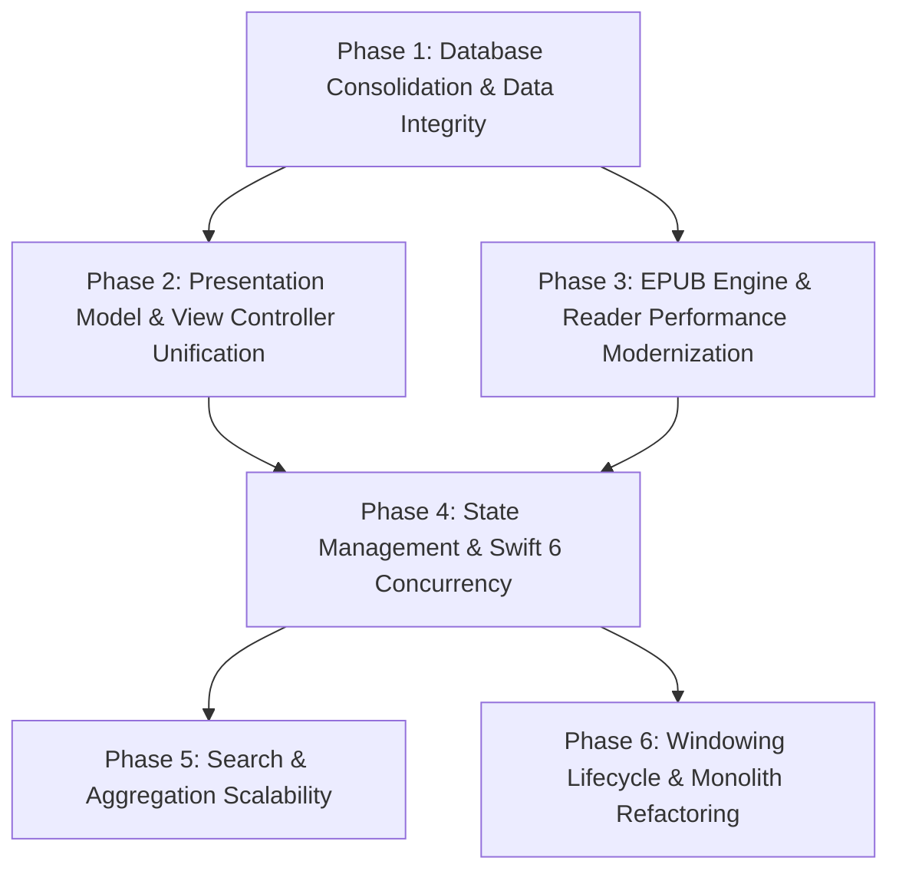

# Ambrosia Architectural Roadmap

This roadmap outlines the strategic phases to modernize Ambrosia's architecture, eliminate data integrity risks, resolve performance bottlenecks, and unify duplicated UI logic.

---

## Roadmap Phases Overview

| Phase | Focus Area | Primary Objectives | Risk Level |
|---|---|---|---|
| **Phase 1** | **Data Integrity & Persistence** | Eliminate SwiftData, consolidate `BookState`/`ReadingGoal` into `AmbrosiaMetaDB`, configure SQLite `busy_timeout`, prevent multi-library contamination. | **Critical / High** |
| **Phase 2** | **Presentation Layer Unification** | Extract unified `@MainActor` presentation controller to eliminate 4,000+ lines of duplicated paging/filtering logic across List and Email modes. | **Medium** |
| **Phase 3** | **Reader Engine & EPUB Performance** | Replace multi-pass regex sanitization with DOM-based single-pass parsing; implement CSS custom property live updates. | **Medium** |
| **Phase 4** | **State Management & Swift 6** | Modernize `ReaderPreferences` from Combine to `@Observable`; upgrade from Swift 5 mode to Swift 6 strict concurrency. | **Medium / Low** |
| **Phase 5** | **Search & Facet Scalability** | Debounce facet queries; replace unbounded `IN (?, ?, ...)` clauses with temporary tables or virtual ID sets. | **Low** |
| **Phase 6** | **App Lifecycle & Monolith Deconstruction** | Eliminate SwiftUI "ghost window" hack; decompose monolithic files (>2,500 lines) into focused, single-responsibility modules. | **Low** |

---

## Detailed Phase Breakdown

### Phase 1: Database Architecture Consolidation & Data Integrity
*See [`docs/plans/phase1-database-consolidation-plan.md`](file:///Users/ethanchan/Documents/Applications/ambrosia/docs/plans/phase1-database-consolidation-plan.md) for the complete implementation blueprint.*
- **Problem**:
  1. `BookState` is stored in a global SwiftData container keyed only by integer `calibreID`, causing reading progress and ELO scores to cross-contaminate between different Calibre libraries.
  2. SwiftData lock contention causes Thread Performance Checker priority inversions ("Hang Risk") and requires complex fallback alert handling in `AmbrosiaApp`.
  3. Default 0 ms SQLite busy timeouts lead to `SQLITE_BUSY` errors during concurrent extraction/reading.
- **Milestones**:
  - Add `PRAGMA busy_timeout = 5000` to `AmbrosiaMetaDB` and `CalibreLibrary`.
  - Design and apply `book_state` and `reading_goals` DDL in `AmbrosiaMetaDB` with proper indices.
  - Implement zero-data-loss one-time migration from legacy SwiftData SQLite stores.
  - Migrate reader and UI call sites to `AmbrosiaMetaDB` actor APIs.
  - Remove SwiftData models, `ModelContainer`, and dependencies from the project.

### Phase 2: UI Presentation Model & View Controller Unification
- **Problem**:
  - [`LibraryRootView.swift`](file:///Users/ethanchan/Documents/Applications/ambrosia/Ambrosia/LibraryUI/LibraryRootView.swift) (2,573 lines) and [`EmailLibraryViewController.swift`](file:///Users/ethanchan/Documents/Applications/ambrosia/Ambrosia/LibraryUI/Email/EmailLibraryViewController.swift) (2,354 lines) independently duplicate:
    - 3-branch filter execution (`sqlFilterClause`, LRU cached, full compute).
    - Grouped vs. ungrouped paging and `PagingOffsetState` mutations.
    - Visibility filtering and membership sets.
    - Fragile reload token suppression (`suppressNextReloadToken`) to avoid reload races.
- **Milestones**:
  - Create a unified `LibraryDisplayController` class isolated to `@MainActor`.
  - Move filter evaluation, paging, sorting, and item synthesis into the display controller.
  - Convert `LibraryRootView` and `EmailLibraryViewController` to purely declarative presentation surfaces that bind to `displayController.items`, `displayController.pagingState`, etc.
  - Retire duplicate notification observers and manual token guards.

### Phase 3: EPUB Engine & Reader Performance Modernization
- **Problem**:
  - [`EPUBParser+Rendering.swift`](file:///Users/ethanchan/Documents/Applications/ambrosia/Ambrosia/Reader/EPUBParser+Rendering.swift) runs 5–6 chained `replacingOccurrences(..., options: .regularExpression)` per chapter, recompiling regexes and allocating megabytes of string buffers.
  - Reader appearance changes (font, line spacing, margins, background color) trigger full EPUB re-parsing and `WKWebView` DOM reloads.
- **Milestones**:
  - Replace regex chain in `sanitise` and `extractBodyContent` with a compiled Swift `Regex` or single-pass parser using the linked `SwiftSoup` library.
  - Migrate reader CSS styles to CSS custom variables (`:root { --ambrosia-font-family: ...; }`).
  - Wire cosmetic preference changes to direct JavaScript property injections (`document.documentElement.style.setProperty(...)`), reserving full reload only for structural mode switches.

### Phase 4: State Management & Swift 6 Concurrency
- **Problem**:
  - The project mixes Combine (`ReaderPreferences`), `@Observable` (`LibrarySession`, `LibraryToolbarState`), `NotificationCenter`, and manual `withObservationTracking` run loops.
  - The compiler setting in `project.yml` is `SWIFT_VERSION: 5.0`, masking data race hazards that `concurrency-invariants.md` manually tracks.
- **Milestones**:
  - Migrate `ReaderPreferences` to the modern Swift `@Observable` macro.
  - Replace `NotificationCenter` posts (`librarySnapshotsDidBecomeReady`, `libraryContentsDidChange`) with typed `AsyncStream`s on `LibrarySession`.
  - Upgrade `SWIFT_VERSION` to `6.0` in `project.yml` with `-strict-concurrency=complete`, resolving compiler warnings systematically.

### Phase 5: Search & Facet Query Scalability
- **Problem**:
  - `AO3FilterFacetController` dispatches 7 simultaneous SQL aggregations on every checkbox toggle without debouncing.
  - Aggregations bind the entire scoped ID set as thousands of `IN (?, ?, ...)` parameters.
  - `SearchQueryParser` only parses a single scoped token, rejecting combined queries like `author:X tag:Y`.
- **Milestones**:
  - Wrap `refreshFacets()` in `DebounceTimer`.
  - Replace large parameter-bound `IN` clauses with temporary SQLite candidate tables (`temp.candidate_ids`).
  - Upgrade `SearchQueryParser` to parse multiple scoped tokens with proper Boolean logic.

### Phase 6: App Lifecycle & Monolith Deconstruction
- **Problem**:
  - `AmbrosiaApp` initializes an invisible `WindowGroup` with `Color.clear` that must be hidden on launch and suppressed on dock reopen.
  - Core files exceed 2,500 lines, mixing multiple unrelated responsibilities (e.g. `LocalFeedServer.swift` handles HTTP server, RSS XML, JSON Feed, OPML, Gzip, and SQLite transfer database building).
- **Milestones**:
  - Adopt native macOS windowing using `Settings` / windowless scenes with AppKit window management.
  - Decompose `LocalFeedServer.swift` into `RSSFeedBuilder`, `JSONFeedBuilder`, `OPMLBuilder`, and `TransferDatabaseBuilder`.
  - Split `AmbrosiaMetaDB.swift` into domain-specific extensions (`+AO3`, `+Series`, `+Collections`, `+ReadingState`).
