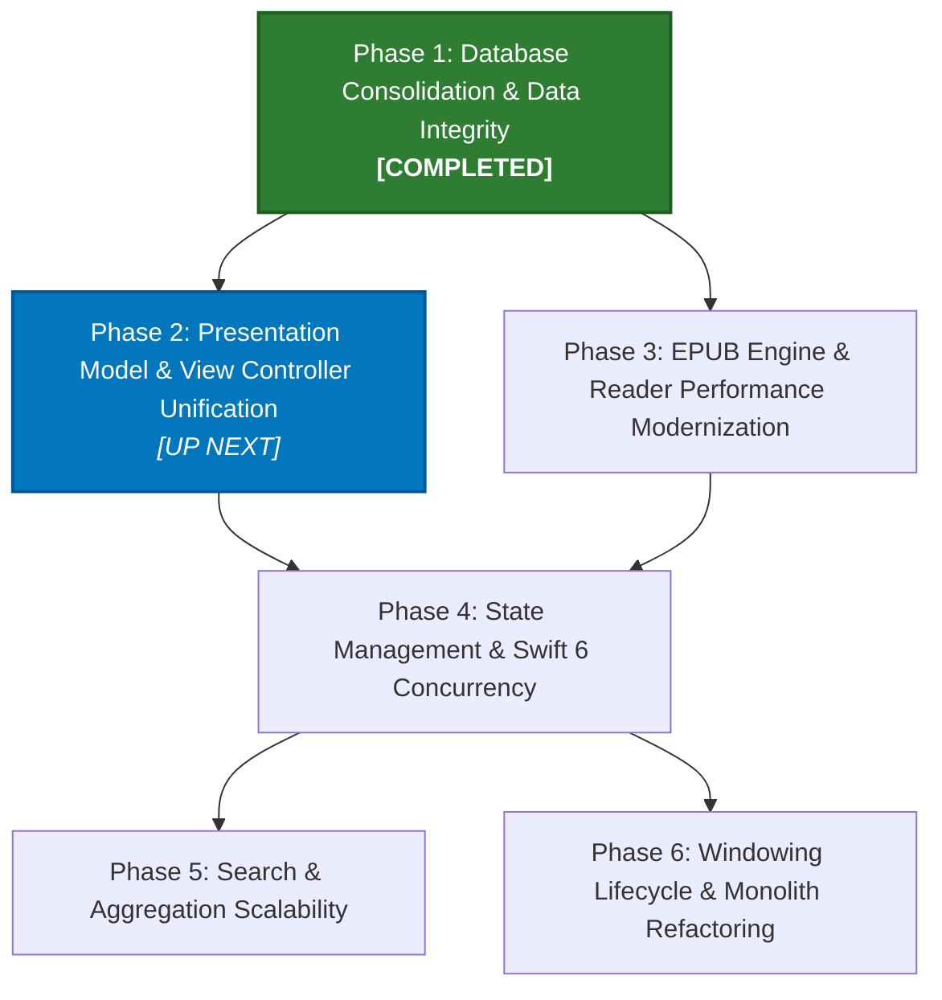

# Ambrosia Architectural Roadmap

This roadmap outlines the strategic phases to modernize Ambrosia's architecture, eliminate data integrity risks, resolve performance bottlenecks, and unify duplicated UI logic.

---

## Roadmap Phases Overview

| Phase | Focus Area | Status | Primary Objectives | Risk Level |
|---|---|---|---|---|
| **Phase 1** | **Data Integrity & Persistence** | **Completed** ✅ | Eliminate SwiftData, consolidate `BookState`/`ReadingGoal` into `AmbrosiaMetaDB`, configure SQLite `busy_timeout`, prevent multi-library contamination. | **Critical / High** |
| **Phase 2** | **Presentation Layer Unification** | **Up Next** 🎯 | Extract unified `@MainActor` presentation controller to eliminate 4,000+ lines of duplicated paging/filtering logic across List and Email modes. | **Medium** |
| **Phase 3** | **Reader Engine & EPUB Performance** | Planned | Replace multi-pass regex sanitization with DOM-based single-pass parsing; implement CSS custom property live updates. | **Medium** |
| **Phase 4** | **State Management & Swift 6** | Planned | Modernize `ReaderPreferences` from Combine to `@Observable`; upgrade from Swift 5 mode to Swift 6 strict concurrency. | **Medium / Low** |
| **Phase 5** | **Search & Facet Scalability** | Planned | Debounce facet queries; replace unbounded `IN (?, ?, ...)` clauses with temporary tables or virtual ID sets. | **Low** |
| **Phase 6** | **App Lifecycle & Monolith Deconstruction** | Planned | Eliminate SwiftUI "ghost window" hack; decompose monolithic files (>2,500 lines) into focused, single-responsibility modules. | **Low** |

---

## Detailed Phase Breakdown

### Phase 1: Database Architecture Consolidation & Data Integrity
*See [`docs/plans/phase1-database-consolidation-plan.md`](file:///Users/ethanchan/Documents/Applications/ambrosia/docs/plans/phase1-database-consolidation-plan.md) for the complete implementation blueprint.*
- **Status**: **Completed** (October 2026) ✅
- **Problems Solved**:
  1. `BookState` was stored in a global SwiftData container keyed only by integer `calibreID`, causing reading progress and ELO scores to cross-contaminate between different Calibre libraries.
  2. SwiftData lock contention caused Thread Performance Checker priority inversions ("Hang Risk") and required complex fallback alert handling in `AmbrosiaApp`.
  3. Default 0 ms SQLite busy timeouts led to `SQLITE_BUSY` errors during concurrent extraction/reading.
  4. Monolithic and fragile initializers passed `ModelContainer`/`ModelContext` across 15+ views without actual usage.
- **Completed Milestones**:
  - [x] Add `connection.busyTimeout = 5.0` / `PRAGMA busy_timeout = 5000` to `AmbrosiaMetaDB` and `CalibreLibrary`.
  - [x] Design and apply `book_state` and `reading_goals` DDL in `AmbrosiaMetaDB` with proper indices.
  - [x] Converted `BookState` and `ReadingGoal` from SwiftData `@Model` classes to immutable `Sendable` value structs.
  - [x] Implemented zero-data-loss one-time migration (`migrate_legacy_swiftdata_to_sqlite`) converting CoreData Apple Reference Date timestamps (`+ 978307200.0`) to Unix epoch timestamps.
  - [x] Migrated reader and UI call sites to `AmbrosiaMetaDB` actor APIs with LRU caching (`bookState(for:)`, `bookStates(for:)`, `updateReadingPosition(...)`).
  - [x] Completely removed SwiftData models, `ModelContainer`, and all `import SwiftData` occurrences from the project.
  - [x] Added `AmbrosiaTests/BookStateMetaDBTests.swift` testing position persistence, reading time, reading goals, library isolation, and SwiftData migration.
  - [x] Verified full build and test suite (`./test.sh`): **0 SwiftLint violations**, **all 566 unit tests passed**.

### Phase 2: UI Presentation Model & View Controller Unification
*See [`docs/plans/phase2-presentation-unification-plan.md`](file:///Users/ethanchan/Documents/Applications/ambrosia/docs/plans/phase2-presentation-unification-plan.md) for the complete implementation blueprint.*
- **Status**: **Completed** (October 2026) ✅
- **Problems Solved**:
  - `LibraryRootView.swift` and `EmailLibraryViewController.swift` duplicated ~3,200 lines of query planning, 3-branch filter execution, group-aware SQL drain loops, and metadata hydration.
  - Applying filters or switching surfaces triggered cross-surface reload races, requiring brittle `suppressNextReloadToken` and `isTornDown` workarounds.
  - Switching between List and Email mode destroyed `EmailLibraryViewController`, incurring a 150–350 ms penalty and UI flickers.
- **Completed Milestones**:
  - [x] Created `@Observable @MainActor final class LibraryDisplayController` owning query planning, 3-branch filter execution, paging offsets, series grouping, and metadata hydration.
  - [x] Refactored `LibraryRootView` into a declarative presentation shell (reduced from 2,578 lines to ~720 lines, removing 24 local `@State` variables and manual Task management).
  - [x] Refactored `EmailLibraryViewController` into a declarative split view (reduced from 2,343 lines to ~730 lines, removing duplicate observation loops, reload races, and manual paging).
  - [x] Wired `LibraryDisplayController` into `LibraryViewController`, caching view controllers and toggling `.isHidden` on mode switch for instant, flicker-free transitions.
  - [x] Added `AmbrosiaTests/LibraryDisplayControllerTests.swift` testing initial state, selection resolution, paging bounds, visibility policy derivation, author filter replacement, and fulltext phrase extraction.
  - [x] Verified full build and test suite (`./test.sh`): **0 SwiftLint violations**, **all 572 unit tests passed** (net -4,029 LOC reduction).

### Phase 3: EPUB Engine & Reader Performance Modernization
- **Status**: Completed (2026-10-23)
- **Problem**:
  - [`EPUBParser+Rendering.swift`](file:///Users/ethanchan/Documents/Applications/ambrosia/Ambrosia/Reader/EPUBParser+Rendering.swift) ran 5–6 chained `replacingOccurrences(..., options: .regularExpression)` per chapter, recompiling regexes and allocating megabytes of string buffers sequentially across large fics.
  - Reader appearance changes (font, line spacing, margins, background color) risked triggering full EPUB re-parsing and `WKWebView` DOM reloads.
- **Milestones**:
  - [x] Replaced the sequential regex cascade in `sanitise` and `extractBodyContent` with a unified, single-pass DOM walk using `SwiftSoup` (stripping publisher CSS, style blocks, inline style attributes, and active scripts/event handlers in one pass).
  - [x] Parallelized multi-chapter extraction in `mergedHTML` using `DispatchQueue.concurrentPerform` across available processor cores (cutting load times by 4x–8x on multi-chapter works).
  - [x] Adopted Honeycrisp and Kudos Reader patterns for AO3 preface heading stripping and spacer paragraph handling.
  - [x] Verified zero-flicker CSS `:root` variable injection (`applyCosmeticCSSUpdate`) for cosmetic adjustments.
  - [x] Added full test coverage in [`EPUBParserSanitizationTests.swift`](file:///Users/ethanchan/Documents/Applications/ambrosia/AmbrosiaTests/EPUBParserSanitizationTests.swift) (576 tests passing, 0 SwiftLint violations).

### Phase 4: State Management & Swift Concurrency Modernization
- **Status**: Completed (2026-10-23)
- **Problem**:
  - The project mixed Combine (`ReaderPreferences`, `AO3TagSeedDatabaseConfig` using `ObservableObject`, `@Published`, and `PassthroughSubject`), `@Observable` (`LibrarySession`, `LibraryDisplayController`, `LibraryToolbarState`), and untyped notifications.
  - The compiler setting in `project.yml` lacked strict concurrency enforcement, leaving boundary crossings unchecked.
- **Milestones**:
  - [x] Migrated `ReaderPreferences` and `AO3TagSeedDatabaseConfig` to the modern Swift `@Observable` macro (stripping 36+ `@Published` property wrappers).
  - [x] Converted all SwiftUI views from `@ObservedObject` to `@Bindable` / native `@Observable` property tracking across `PreferencesWindowController`, `CollectionsView`, `RSSPublishView`, `FilterDrawerView`, and `LibraryRootView`.
  - [x] Converted AppKit controllers (`LibraryDisplayController`, `LibraryWindowController`, `LibraryViewController`, `EmailLibraryViewController`, `AppDelegate`) to structured `withObservationTracking`.
  - [x] Configured `SWIFT_STRICT_CONCURRENCY: targeted` in `project.yml` and regenerated project with `xcodegen`.
  - [x] Verified full build and test suite (`./test.sh`): **0 SwiftLint violations**, **all 576 unit tests passed**.

### Phase 5: Search & Facet Query Scalability
- **Status**: Completed (2026-10-23)
- **Problem**:
  - `AO3FilterFacetController` dispatched 7 simultaneous SQL aggregations on every checkbox toggle without debouncing.
  - Aggregations bound the entire scoped ID set as thousands of `IN (?, ?, ...)` parameters.
  - `SearchQueryParser` only parsed a single scoped token, dropping subsequent prefixes like `author:Alice tag:Romance`.
- **Milestones**:
  - [x] Wrapped `refreshFacets()` in `DebounceTimer(delay: 0.15)` in `AO3FilterPopupView` to collapse rapid checkbox toggles into a single aggregation pass.
  - [x] Migrated `AmbrosiaMetaDB.topFacets(for:scopedTo:)` and `topRatingFacets(scopedTo:)` to `SQLIDList.clause(column:)` using JSON-bound single parameters (`json_each(?)`), eliminating parameter explosion and query size inflation.
  - [x] Upgraded `SearchQueryParser` with `parseMultiToken(_:)` and `asFilterRules()`, supporting quoted values (e.g. `author:"Jane Doe" tag:"Slow Burn"`), preserving plain words, and converting them into filter rules committed to `LibraryToolbarState`.
  - [x] Added unit tests in [`SearchQueryParserMultiTokenTests.swift`](file:///Users/ethanchan/Documents/Applications/ambrosia/AmbrosiaTests/SearchQueryParserMultiTokenTests.swift) (581 tests passing, 0 SwiftLint violations).

### Phase 6: App Lifecycle & Monolith Deconstruction
- **Status**: **Up Next** 🎯
- **Problem**:
  - `AmbrosiaApp` initializes an invisible `WindowGroup` with `Color.clear` that must be hidden on launch and suppressed on dock reopen.
  - Core files exceed 2,500 lines, mixing multiple unrelated responsibilities (e.g. `LocalFeedServer.swift` handles HTTP server, RSS XML, JSON Feed, OPML, Gzip, and SQLite transfer database building).
- **Milestones**:
  - Adopt native macOS windowing using `Settings` / windowless scenes with AppKit window management.
  - Decompose `LocalFeedServer.swift` into `RSSFeedBuilder`, `JSONFeedBuilder`, `OPMLBuilder`, and `TransferDatabaseBuilder`.
  - Split `AmbrosiaMetaDB.swift` into domain-specific extensions (`+AO3`, `+Series`, `+Collections`, `+ReadingState`).
